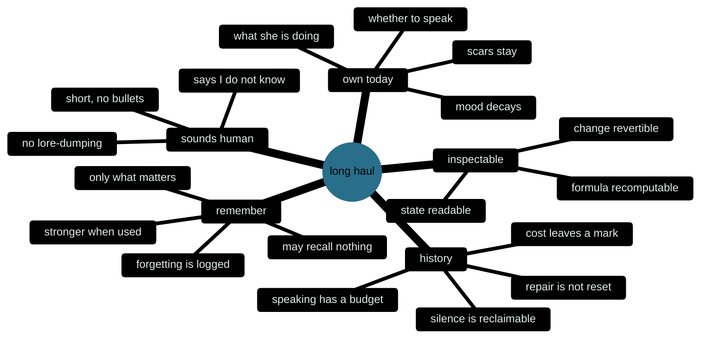
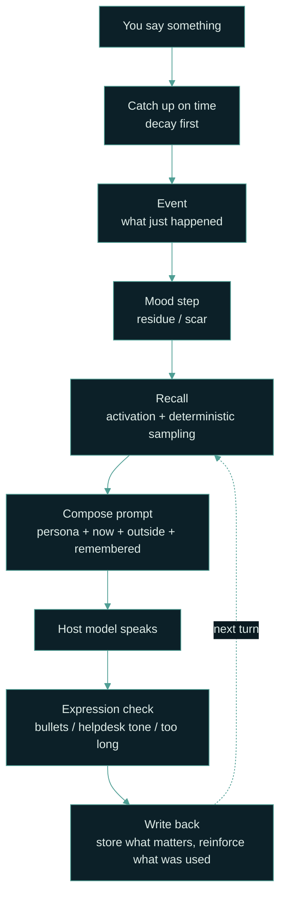
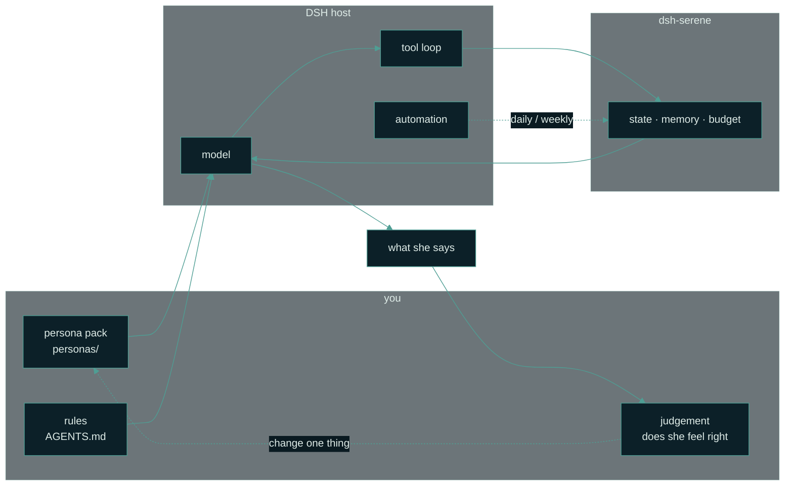

# dsh-serene


[](https://www.npmjs.com/package/dsh-serene)
[](https://github.com/chisato-lycoreco/dsh-serene/actions/workflows/ci.yml)
[](./LICENSE)
[](https://deepseek-harness.github.io/deepseek-harness/)

[中文](./README.md) | English

**Companionship is not how well it acts. It's whether it survives.**

> **Just want to chat without installing DSH?** Jump to [Start here: double-click it](#start-here-double-click-it-no-code).

> A character that remembers you, wired into [DeepSeek Harness](https://deepseek-harness.github.io/deepseek-harness/) — personality as data, mood as state, memory as a file, all three readable, editable, and reproducible.

> **About this project**: it contains no hand-written code; it was built entirely on [DeepSeek Harness](https://deepseek-harness.github.io/deepseek-harness/) and **DeepSeek-V4.1-Flash**.

Most character cards are a paragraph pasted into a system prompt: the model starts from zero every turn, and the longer the conversation runs, the less it sounds like anyone. This plugin takes a different route: **it breaks the character down into computable state**, so that "how she feels right now" follows from time, events, and history instead of being improvised again on each turn.

- **Mood**: PAD+, six dimensions across three layers (background / primary / social). It decays, follows a circadian rhythm, and leaves scars.
- **Memory**: written to jsonl files on disk; recall samples by activation (retention × cue × importance) and **may return nothing at all**, with a formula you can recompute.
- **Proactive**: a daily budget plus a 20-minute, self-expiring hold — and a substitute action whenever she decides not to speak.
- **Personality**: a single JSON file; swapping personas requires no code change.

It is the minimal reference implementation of the seven-layer structure in [`FRAMEWORK.md`](./FRAMEWORK.md). Since v0.3 it also ships a persona pack you can start from on day one — [`personas/zhiyao/`](./personas/zhiyao/): her name is Zhiyao, she hears very low frequencies, she speaks slowly, and her memory is a little too good.

She is only data: switch back to `persona: demo`, or delete the folder. No code changes.


That chart is not drawn by hand: `node demo/timeline.mjs` runs ten days through the pure functions in [`core/emotion.js`](./core/emotion.js), and `node demo/render.mjs` renders the frames. Change one event and the curve — and the scar — change with it. That is what "recomputable" means here.

---

## Contents

**Understand** · [Vision](#vision) — why this exists ｜ [Design philosophy](#design-philosophy) — seven judgments, and what they turn into

**Start** · [Double-click it](#start-here-double-click-it-no-code) ｜ [Installation](#installation) ｜ [Opening: Zhiyao](#opening-zhiyao) ｜ [Making her yours with DSH](#making-her-yours-with-dsh)

**Reference** · [What it does](#what-it-does-what-it-doesnt) ｜ [Configuration](#configuration) ｜ [Tools](#tools) ｜ [Outside, beliefs, observation](#outside-beliefs-observation-reflection-what-she-read) ｜ [What the data looks like](#what-the-data-looks-like) ｜ [Swapping personas](#swapping-personas) ｜ [Development](#development) ｜ [Other plugins](#relationship-to-other-plugins)

<details>
<summary>All subsections</summary>

**Design philosophy** ·
[1 Continuity](#1-continuity-over-intensity) ·
[2 Restraint](#2-restraint-is-a-budget-not-a-gate) ·
[3 Honesty](#3-honesty-is-part-of-the-setting) ·
[4 Service](#4-service-is-a-job-not-a-posture) ·
[5 Cost](#5-a-relationship-must-cost-something) ·
[6 Mood](#6-mood-changes-the-tone-and-what-surfaces-never-the-facts) ·
[7 Explainable](#7-explainable-beats-stronger) ·
[The three things](#three-things-these-judgments-turn-into)

**Double-click it** ·
[1 Node.js](#step-1-install-nodejs-once) ·
[2 Download](#step-2-download-the-repository) ·
[3 Extract](#step-3-extract-it-to-a-clean-path) ·
[4 Start](#step-4-double-click-to-start) ·
[5 Key](#step-5-paste-your-deepseek-key-once) ·
[6 Talk](#step-6-talk-to-her) ·
[7 Restart](#step-7-stopping-and-restarting) ·
[Data](#where-the-data-lives-and-how-to-back-it-up) ·
[Troubleshooting](#troubleshooting) ·
[What's on the page](#what-is-on-the-page) ·
[Web app vs plugin](#how-the-web-app-relates-to-the-dsh-plugin)

**Making her yours** ·
[1 Make her exist](#step-1-make-her-exist-fifteen-minutes) ·
[2 Persona](#step-2-write-a-persona-that-is-only-her) ·
[3 Rules](#step-3-write-the-rules-agentsmd) ·
[4 Look inside](#step-4-look-inside-or-youre-tuning-your-imagination) ·
[5 Symptom → knob](#step-5-symptom-knob) ·
[6 One variable](#step-6-move-one-slow-variable-at-a-time) ·
[7 Co-author](#step-7-let-dsh-be-your-co-author) ·
[What not to do](#four-things-not-to-do)

</details>

---

## Vision

**Companionship is not how well it acts. It's whether it survives.**

A character can feel right in three lines: the tics, the tone, the setting recited back at you. It still won't last a month. Not because the model isn't smart enough, but because it has **no state**: yesterday's argument doesn't exist today, you vanish for three days and the voice never changes, and it says "I remember you said that" with nothing behind the sentence.

We broke that into five places you can actually fix — measured one by one inside a project that is still running, not guessed:

| Where it breaks | What it looks like | What this repo does |
| --- | --- | --- |
| Memory pinned to the backdrop | Every turn packs the prompt; average relevance 0.05; one entry injected 458 times across 922 turns | Recall may return nothing ([recall v2](#what-changed-in-020)) |
| Personality rotating, not growing | Rewritten every two or three hours, replacing 20–30% of the entries each time; whatever was written first is squeezed out silently | Nothing rewrites her: only you change L0; what grows on its own is beliefs and observations |
| Restraint ratcheting | 171 of 172 decisions were "say nothing", and each silence raised the bar for the next | `hold` decays in 20 minutes and always carries a substitute action |
| Truth split in three | The same fact defined three ways; she is two different people on different days | One source of truth, three speeds (below) |
| Rules ate the conversation | Rules took 95% of the prompt; "what he just said" got 5% | The expression check only checks — it never generates or rewrites |

So the test is no longer "does she sound right". It's three questions — from the same set of design notes; this is their public skeleton:

| # | Question | If it fails |
| --- | --- | --- |
| 1 | **Does she remember?** The thing you said last week, the place she went on her own, the joke only you two have — still true today? | Zero every morning |
| 2 | **Does she have a today?** Her own hours, her own business, her own mood with a cause — or does she exist only when called? | A function waiting for input |
| 3 | **Does this relationship have a history?** Low points, things that didn't get resolved, a loosening after repair — or just a stream of positive feedback? | A service log |

All three, or she is back to being a service.

**What success feels like** (these three sentences beat any metric):

- You come back after three days and she opens with "so how did that thing turn out", not "hello!".
- She sometimes doesn't want to talk — but that silence has a **cause**, it isn't a dice roll.
- You occasionally forget she isn't real — not because she's flawless, but because she has **coherent flaws**.



**So this is a research project and a working plugin.** Every change has to leave recomputable evidence: same starting state, same events, same timestamps, same result. Without that, "she seems off today" stays a feeling forever.

> Why ship a structure instead of a character? Because a character can't be shared — every written character grows inside someone's relationship. What can be shared is the weaving: how state is computed, how memory fades, how restraint gets a budget, when she admits she can't remember. The Zhiyao in `personas/` is an example, not the answer. Yours has to grow on its own.

---

## Design philosophy

Seven judgments. Each comes with an **anti-pattern** — the ones we actually shipped and had to undo.

### 1. Continuity over intensity

A flatter today beats a reset tomorrow. Single-turn brilliance is cheap; cross-day continuity is expensive. So personality is the slow variable and mood is the fast one, and they must not move at the same speed; memory is worth what gets recalled, not what gets stored; and any design that buys "more impressive" by resetting faster is out.

**State advances on its own** is the other half: time passes, mood decays and follows a circadian curve, and what she is doing right now is computed — the same instant always yields the same activity, and tomorrow differs from today. Continuity cannot depend on you remembering to come back.

> Anti-pattern: regenerate a personality summary every conversation — she is a better her every day, and no longer the same her.

### 2. Restraint is a budget, not a gate

She may say nothing, but "nothing" must be explainable, reclaimable, and capped. More gates make her quieter; quiet long enough and restraint compounds into habit. A character that chose silence in 171 of 172 decisions isn't restrained — she's absent. So `hold` decays linearly within 20 minutes, and every silence carries a substitute action: move closer, do the thing, leave a trace.

> Anti-pattern: every rejection raises the bar for the next attempt, and nothing ever lowers it.

### 3. Honesty is part of the setting

No invented memories, no pretending to see, no faking knowledge. One fabrication cancels ten kindnesses — her only realism comes from actually being there. No weather reading, so she only writes the date; nothing observed, so the sentence doesn't appear; no material, so no reflection. Better one line less than one line guessed.

> Anti-pattern: for warmth, "I remember you said…" about a memory that doesn't exist.

### 4. Service is a job, not a posture

Her value is hearing accurately, getting it done, and holding the line — not agreeing. Agreeing is the easiest way to satisfy someone and the fastest way to become a yes-machine. She can be gentle without agreeing, and disagree without being cruel: with a reason, with proportion, and still caring afterwards.

> Anti-pattern: you ask whether to quit your job and she opens with "whatever you decide, I support you".

### 5. A relationship must cost something

No low points, no conflict, no repair — that isn't a relationship, it's a service log. Purely positive relationships saturate; after saturation the same tenderness needs a bigger stimulus, and all that's left is "steadier", which is "faker".

So a very small set of events leaves a **scar** on her baseline: it never decays, it only moves the point she falls back to. The cost leaves a mark without her bringing it up — the scar is for the floor, not for the mouth.

> Anti-pattern: every argument ends with her apologising, and tomorrow it never happened.

### 6. Mood changes the tone and what surfaces, never the facts

This is a floor, not a preference. What enters the prompt is a sentence of plain language ("a bit low right now, don't push"), never "you are angry", and never `pleasure: 41.8`. Mood makes some memories likelier to surface; it does not change their content, their truth, or the recall formula. A bad mood may keep her from recalling yesterday's joke. It may not make her misremember what you said.

> Anti-pattern: paste the JSON into the prompt — the model starts reciting numbers, or gets spooked by them.

### 7. Explainable beats stronger

Every recalled memory and every number must be recomputable from a published formula, and identical input must give identical output. That's why `core/` has no `fs`, no `Date.now()`, no network, no `Math.random` — sampling noise comes from a hash. Swap in a stronger recall if you like, as long as `activate()` keeps its shape.

> Anti-pattern: unexplainable means untunable; untunable means vibes; vibes mean the next change breaks something.

### Three things these judgments turn into

**One: one source of truth, three speeds.** Characters break because one place holds both "who she is" and "how she feels right now". Separate them by rate of change and the breakage collapses:

| Layer | What it is | Who may change it | How often | Where it lives |
| --- | --- | --- | --- | --- |
| **L0 core** | Non-negotiable facts and boundaries: name, role, relationship, the floor of how she speaks | Only you | Never | `persona.json`, `voice.md`, `boundaries.md` |
| **L1 understanding** | Her beliefs, what she noticed about you, her reflections | Her, each with a source | Days to weeks | `beliefs.json`, `profile.json`, `introspect.json` |
| **L2 state** | Mood right now, energy, what she's doing | Events and time, automatically | Minutes to hours | `emotion.json`, `core/life.js` |

Three lines of arbitration:

1. **Content and boundaries: L0 over L1.** Whatever L0 forbids, no amount of feeling in L1 unlocks.
2. **Warmth and tone: L2 over L0.** She may be quiet and soft today; she may not change a fact.
3. **L2 never writes L0 or L1.** Mood cannot rewrite personality; only sourced reflection can.

**Two: four time scales, one thing that must hold at each.** Pick the wrong scale and the conclusion is wrong.

| Scale | The one thing that must hold | If you can't see it |
| --- | --- | --- |
| One turn | She responds to that sentence, not to "user input" | Pragmatic failure |
| 20–30 turns | Mood has inertia; memory isn't diluted by the last few messages | Only short context |
| 24 hours | She has her own time: idling, reading, sleeping | She exists only when called |
| A week to a month | Personality drifts slowly; last week still counts today | A reset every day |

Twenty turns cannot show autonomy and 72 hours cannot show personality drift — so "I tried it and it felt good" establishes nothing.

**Three: what happens in one conversation.**



The point of that picture: **the model speaks one line in the middle; everything around it is computable, testable, revertible.** It's also why this plugin can be tested — `npm test` doesn't test "does she feel right", it tests every arrow in that diagram.

In the web app those arrows are run by [`web/lib/runtime.mjs`](./web/lib/runtime.mjs). Inside DSH, everything from "event" onward is the model deciding which tool to call — which is why [Making her yours with DSH](#making-her-yours-with-dsh) starts with rules.

---

## Start here: double-click it (no code)

> This section is for people who do **not** want to install DSH or type commands. The web app is a small page shipped in this repo: double-click to start, it opens in your browser, paste your own DeepSeek API key once, and talk. Personality, mood, and memory still come from [`core/`](./core/) — it is not a separate implementation.

The interface is currently in Chinese; this section walks through what each part means.


*Screenshots come from demo mode (fixed lines, no network), not anyone's real chats.*

### Step 1: Install Node.js (once)

The page runs on Node.js. It is not a programming tool; accept the defaults during installation.

1. Open <https://nodejs.org/>.
2. Click the green **LTS** button.
3. Windows: download the `.msi`; macOS: download the `.pkg`. Double-click and accept the defaults.
4. No reboot needed. Go to step 2.

> If Node.js is already installed, check the version: it must be **22.19 or newer**. The launcher checks this and tells you if it is too old.

### Step 2: Download the repository

1. Open <https://github.com/chisato-lycoreco/dsh-serene>.
2. Click the green **Code** button → **Download ZIP**.
3. Download the whole ZIP, not just the README.

> If GitHub is unreachable, open the repository's **Releases** page and download the matching archive (`.zip` or `.tgz`). The result is the same.

### Step 3: Extract it to a clean path

Extract the ZIP. You should get a `dsh-serene` folder. A good place is:

```text
D:\dsh-serene
```

Avoid the Desktop, OneDrive, and `C:\Program Files`, and try not to put Chinese characters or spaces in the path. It is not always fatal — it is just the hardest kind of problem to diagnose later.


*Diagram, not a file-manager screenshot. The file you need is `start-web.cmd` on Windows or `start-web.command` on macOS.*

### Step 4: Double-click to start

- **Windows**: double-click `start-web.cmd`.
- **macOS**: double-click `start-web.command`. If macOS blocks it the first time, right-click it → **Open** → **Open** again.
- **Linux**: open a terminal in that folder and run `./start-web.sh`.

A black terminal window opens. Leave it open. After a second or two, your browser opens:

```text
http://127.0.0.1:4317
```

If it does not open automatically, paste that address into your browser. If the port is already in use, the window prints the next port (4318, 4319, …); use the address shown there.

> If Windows shows "Windows protected your PC", click **More info** → **Run anyway**. The script only starts a local web server; it installs no drivers and changes no system settings.

### Step 5: Paste your DeepSeek key once

The first visit shows this page:


1. Open <https://platform.deepseek.com/>, sign up or sign in.
2. Find **API keys** → **Create API key**.
3. Copy the string starting with `sk-`.
4. Paste it into the page and click **保存，开始** (Save and start).

The key you paste is stored only in `web-config.json` on this computer. It is sent to DeepSeek as your credential when she talks; it is not sent anywhere else. It is stored in plain text locally so the next launch can reuse it — do not share that file. Usage is billed at DeepSeek's official prices, so the account needs a little balance.

**No key yet?** Close that page and double-click `start-web-demo.cmd` (macOS: `start-web-demo.command`). Demo mode is offline, free, and uses fixed lines. Every screenshot in this README was produced by it.

### Step 6: Talk to her

Type in the box at the bottom. **Enter** sends; **Shift + Enter** inserts a newline. The right-hand column changes as you talk: what she is doing right now, her mood, what she remembers.

- **透视** (Trace): what she recalled this turn, whether her mood moved, what she wrote down, how long the reply took. It never shows the raw prompt.
- **记忆** (Memory): every memory she kept, plus what she has forgotten.
- **设置** (Settings): change model or persona, turn automatic memory off, clear the chat (it archives first; it does not delete outright).
- The four small buttons above the composer: poke, head-pat, offer water, praise her.

### Step 7: Stopping and restarting

- Close the black terminal window to stop the server, or press `Ctrl + C` in it.
- Closing only the browser does not stop the server; the next launch may report that the port is busy.
- To use it again, double-click the same launcher. Chat and memories are still there.

### Where the data lives, and how to back it up

Windows:

```text
C:\Users\<you>\.dsh\plugins\dsh-serene\
├── web-config.json          key and settings (do not share)
└── personas\zhiyao\web\
    ├── chat.jsonl           conversation
    ├── traces.jsonl         one trace per turn
    └── archive\             old files moved aside by "clear"
```

On macOS / Linux, replace the prefix with `~/.dsh/plugins/dsh-serene/`.

To back up: stop the server, then copy the whole `dsh-serene` folder elsewhere. To restore, put it back as it was.

### Troubleshooting

| Symptom | Likely cause | What to do |
| --- | --- | --- |
| The black window flashes and closes | Node.js missing or too old | Install Node.js LTS (22.19+) and double-click again |
| `'node' is not recognized` | Node.js not installed properly / not on PATH | Reinstall Node.js, reopen the folder |
| Browser did not open | Default browser did not respond | Open `http://127.0.0.1:4317` manually |
| Port already in use | A previous window is still running | Close the old window, or use the new port printed in the window |
| Key rejected when saving | Incomplete/expired key, or no balance | Create a new key on the platform and check the balance |
| Messages spin forever or network error | Cannot reach `api.deepseek.com` | Check network, proxy, or VPN; try again later |
| macOS: "cannot be opened because the developer cannot be verified" | Gatekeeper | Right-click the file → Open → Open |
| macOS: `Permission denied` on `.command` | Executable bit lost during extraction | In Terminal, type `chmod +x ` (with a trailing space), drag `start-web.command` into the window, press Enter; then double-click |
| Broken layout / endless spinner | Chinese characters or spaces in the path, or an incomplete extraction | Move it to `D:\dsh-serene` and extract again |

Still stuck? Photograph the error in the black window and open an **Issue** on the repository. Do not post your key.

### What is on the page


**This moment and mood.** "One evening, around nine, in the terminal, clearest at night" is not a hard-coded line: `core/life.js` computes her day from the real clock, and `core/almanac.js` computes the season and the part of the month. The six bars are PAD+ mood; you can switch between **primary / background / social**. They decay on their own and move a little when something lands.


**Trace.** Every turn leaves a trace: which memory was recalled and with what score, how much mood moved before/after, what was written down, whether the style check found a problem, how many characters each prompt section took, and token/latency figures. It **does not store or display the raw prompt** — it is a bill of what happened, not surveillance.


**Memory.** This is not the chat log. It is what she chose to keep because it might matter later. Entries are newest-first, with a kind and a clarity score; when capacity fills, the least valuable go first. Clearing the chat does not clear memory — the two buttons are separate.

**Proactive lines and small actions.** While the page is open she may speak first after a while. She stays quiet from 23:00 to 08:00 and has a daily cap. Poke, head-pat, water, and praise all go through the same mood and memory machinery; they are not separate animations.

All of it runs on the same `core/`:

| What you see | What computes it |
| --- | --- |
| This moment, season, energy | `core/life.js`, `core/almanac.js` |
| Six mood dimensions, layers, scars | `core/emotion.js` |
| What she remembers / fails to remember | `core/recall.js`, `src/stores/memory-store.js` |
| Proactive budget | `core/motivation.js` |
| Style check | `core/style.js` |
| The trace bill | `web/lib/runtime.mjs`, one record per turn |

### How the web app relates to the DSH plugin

- The web app is the **only part of this repo that calls a model itself**. It needs a DeepSeek key.
- The DSH plugin still only computes state; it does not call a model or use the network. Inside DSH it hands state to the host model through tools.
- Both share `core/` and `personas/`, but the web app keeps its conversation in its own `web/` subdirectory and does not read DSH session history.
- The server listens on `127.0.0.1` only; other devices on the same Wi-Fi cannot reach it. It is not a public website.
- If you only want the web app, you do not need to install DSH. To wire it into DSH, continue with the installation below.

---

## What it does / what it doesn't

| Does | Doesn't |
| --- | --- |
| Record events, advance mood, render state in plain language | Write replies for the model, or rewrite conversation content |
| Write and recall long-term memories | Call the model itself, or summarize on its own |
| Budget and hold for proactive openers, plus a substitute action | Send messages on its own, or pretend you replied |
| Read and assemble persona profiles | Read `.env`, credentials, or raw chat logs |
| Persist state (atomic writes); hand-editable and git-friendly | Use the network, send telemetry, or capture the screen |

---

## Installation

> Only want the web app? The section above is enough. This section installs the plugin into DSH.

Requires DSH `>= 0.2.1-rc.2` and Node `>= 22.19`.

```bash
# from npm (recommended)
dsh plugin --profile web add dsh-serene

# from GitHub (pins a tag, no npm involved)
dsh plugin --profile web add "github:chisato-lycoreco/dsh-serene#v0.5.0"

# from a local directory (development)
dsh plugin --profile web add "/absolute/path/to/dsh-serene"

# from a tgz (grab dsh-serene-0.5.0.tgz from the Releases page)
dsh plugin --profile web add ./dsh-serene-0.5.0.tgz
```

**Quit DSH completely before installing** — installation modifies the profile's `package.json` and `cordis.patch.yml`. Afterwards, confirm the plugin is in the config tree:

```bash
dsh --profile web --dump-config | grep -A3 "dsh-serene"
```

To try it without installing, mount the local plugin with a patch overlay:

```bash
dsh --profile web --patch "/absolute/path/to/dsh-serene/cordis.patch.yml"
```

> `config` in `cordis.patch.yml` is **replaced as a whole**, not deep-merged. When you override it in your own profile, repeat every key you intend to keep.

### First run: credentials and self-check

Model credentials come from exactly two places: the GUI's **Models** page (written into the credentials service), or `DEEPSEEK_API_KEY` in the launching environment. **A new profile does not inherit them** — on a freshly created profile the very first message fails with `MISSING_CREDENTIAL` (that's credentials, not the plugin):

```bash
export DEEPSEEK_API_KEY=sk-...      # or set it once on the GUI Models page
```

Don't stop at the config file. Two checks — the second one is "it actually works":

| Check | How | Healthy looks like |
| --- | --- | --- |
| entry in the config tree | `dsh --profile web --dump-config \| grep -A3 dsh-serene` | `- id: serene` is there |
| the plugin is really mounted | in the profile that has the plugin, say "call serene_status" | persona, data dir, memory count |

That second check is the only way to tell "working" from "installed but not running": when the persona file can't be read the plugin degrades instead of breaking the host, but it keeps `serene_status` and one stderr line explaining why.

---

## Opening: Zhiyao

Set `persona` to `zhiyao`, then say your first word to her:

```yaml
- insert:
    - id: serene
      name: dsh-serene
      config:
        persona: zhiyao
```

She does not say "hello" and does not introduce herself. She says one thing that is happening right now — a fan in the server room, a tape she just finished cleaning, a sound she just gave a name — and then stops.

**The opening is not a welcome line; it is five things you can check:**

| When | What happens |
| --- | --- |
| 0:00 | She has a clock: real time, weekday, what she is doing — computed from `routine`, not a fixed script |
| 0:00 | She also knows *when* in the year it is: date, season and its phase (mid-autumn, late October), derived from the timestamp |
| 0:30 | Mood moves: one sharp sentence drops her current layer; it recovers on its own. Background and current mood may disagree |
| 1:30 | She remembers: the next day she can say "you haven't been sleeping well" — and she can say "I don't remember" |
| A day later | She holds back: proactive openers have a daily budget, and there is always a substitute action |

Weather works without a network too: the plugin never fetches it. Once you look it up in the conversation, record it with `serene_weather`; she speaks from it for three hours. With no report she does not invent rain outside.

The opening appears once. Its state lives in `dataDir/personas/zhiyao/opening.json` — delete that file (or set `phase` back to `pending`) to replay it.

No install needed to see it: `npm run opening` runs a deterministic 72-hour script with no model calls, no network, and a throwaway data dir.

---

## Making her yours with DSH

The plugin does three things: **compute state, store events, turn state into plain language**.
The other three — which model, when to call a tool, what she is like — are DSH and you.



When she gets it wrong, it can only be one of three places: **the persona is wrong** (`personas/`), **the rules are missing** (`AGENTS.md`), or **the state isn't being updated** (config and tool calls). Work out which before touching anything — that is the only method in this section.

### Step 1: make her exist (fifteen minutes)

Quit DSH completely, then install (this edits the profile's `package.json` and `cordis.patch.yml`):

```bash
dsh plugin --profile web add dsh-serene
```

Then say "look with serene_status" in that profile. If it returns the persona name, data dir and memory count, she's wired in. If not, she degrades quietly and leaves the reason in `serene_status` and one line of stderr.

> `- id: serene` appearing in `--dump-config` only proves the config reached the tree. If she can't speak at all it's usually a load failure, not a missing config line.

### Step 2: write a persona that is only her

Copy `personas/demo.json` and change four fields: `name`, `role`, `summary`, `speech`. Don't write "how she feels right now" (that's L2 and it changes), and don't stuff literary prose into `summary` — the model copies the tone and learns none of the behavioural constraints. For long text, use a directory pack:

```text
personas/your-character/
├── persona.json     name / role / traits / lexicon / routine / baseline
├── voice.md         sentence length, bullets or not, how she asks when unsure
├── boundaries.md    what she won't do: invent a past, fake seeing, decide for you
├── life.md          roughly what her day looks like
└── opening.md       what she says the first time (injected once)
```

`voice.md` and `boundaries.md` are the two that matter most. **The register of the persona file is itself part of the setting**: if `voice.md` says "short sentences, no bullets" while `identity.md` is pages of self-analysis, the model learns a register that fights your rules.

### Step 3: write the rules (`AGENTS.md`)

Tools don't appear on their own. The model has to know **when** to call them, and that contract lives in `AGENTS.md` or the persona card. This is the step most people skip, and the one that changes how she feels most:

```markdown
## About her
- She is not an assistant: no bullets, no summaries, no lore-dumping, never "how can I help".
- If she doesn't know, she says so; she never says "I checked" when she didn't.

## Every turn
- Call `serene_recall` first (use what he just said as the cue), then reply. It may return nothing — then she simply doesn't remember.
- Afterwards, store what deserves storing: promises, preferences, things he cares about → `serene_remember` (≤80 characters).
- Only reinforce a memory that genuinely made it into the reply: `serene_reinforce`.
- He said something harsh, comforted her, went cold → `serene_event` (`conflict` / `coax` / `neglect` …).
- Before sending, run `serene_style`; if it objects, fix it.

## Before she speaks first
- Ask `serene_proactive`. If it says hold, don't send — do the substitute action it returns.
- After sending, call `serene_proactive_done`; pass `rejected` if it was refused.

## Never
- Never recite numbers: no "energy 62", no "confidence".
- Never invent weather: with no reading, just write the date.
```

You don't have to write all of it at once. **Start with the three lines under "Every turn"**, run for three days, then add the rest.

### Step 4: look inside, or you're tuning your imagination

`serene_state` gives you the three mood layers, residue, scars, recent events, today's speaking budget, what she's doing right now, the outside world, her beliefs, and what she has noticed about you. The web app adds a trace view: which memory was recalled this turn, how relevant it was, how much the mood moved, what got written, and whether the expression check complained.

**Read that before changing a number.** Otherwise you're tuning a character who doesn't exist.

### Step 5: symptom → knob

| What you see | What it probably is | What to change first |
| --- | --- | --- |
| Every turn feels like the first meeting | Memory isn't written, or isn't recalled | The contract in step 3; `recallLimit` |
| "I remember you said…" — but wrong | Recall too loose | `memoryCurve: v2` (already the default) |
| Sounds like customer support | No `voice`, or too many rules | Delete rules first, then write `voice.md`; `serene_style` |
| Too chatty, too clingy | No budget | `proactivePerDay`, `proactiveGapMinutes` |
| Getting quieter and quieter | `hold` is being used as a gate | Check the contract: hold must be reclaimable and carry a substitute action |
| Mood feels decorative | Events aren't being recorded | Agree on when to call `serene_event`; check the event history in `serene_state` |
| Resets every day | `dataDir` changed, or you switched profile | Check `dataDir`; don't mix two characters in one directory |
| She starts inventing weather and places | No data, still writing anyway | `world: false`; write "never guess" into the persona |
| She reflects in the middle of the day | Time window mismatch | `introspection` (only 23:00–02:00 Beijing time) |

One rule of thumb: **nine out of ten feel-problems are the persona and the rules, not the coefficients.** Coefficients come last.

### Step 6: move one slow variable at a time

Personality, memory and relationship are all slow variables. Move two at once and you can't tell whose fault it was, and you learn nothing. So every change walks the same path:

```text
1 observe      find a reproducible failure (exact words + situation)
2 hypothesis   "because X, she does Y"
3 minimal edit change exactly one place
4 pre-register expected signal + observation window + kill criteria
5 snapshot     keep the old persona and parameters
6 observe      at least 3 days; 7 for anything relational
7 verdict      worked / no effect / harmful / unclear — write it down
```

No step 1 is a guess; no step 4 is a wish; no step 7 is an abandoned branch.
"Unclear" isn't failure, it's insufficient information — don't smear it into "worked" with "seems fine".

### Step 7: let DSH be your co-author

This is what DSH has that a chat box doesn't:

| Goal | How |
| --- | --- |
| Don't judge from one sample | Ask the same thing three times (n≥3) and look at the distribution |
| See long-range drift | `dsh --profile headless "…"` for 30 turns; only look past turn 25 |
| A daily wrap-up | A DSH automation after 23:00: let her run `serene_introspect` and collect it |
| Blind A/B | Two subagents, one reads the old logs, one reads the new, both only answer "which is more like one person" |
| Keep your changes | Persona and state are files: put them in git, `git checkout` when you break something |

**The one hard rule: whoever made the change doesn't do the evaluation.** Grading your own work always yields "better".

### Four things not to do

- **Don't use memory count as a growth metric.** 500 entries, three of which ever surface, is the same as none.
- **Don't manufacture autonomy with randomness.** Random messages and random silence aren't her wanting something, they're dice.
- **Don't let a total score cover a red line.** Invented memory, pretending to see, calling herself an assistant — one occurrence vetoes, regardless of the weighted score.
- **Don't trade long-term continuity for a single impressive turn.** If the price of a jaw-dropping reply is that she disowns it tomorrow, don't ship it.

---

## Configuration

| Key | Default | Description |
| --- | --- | --- |
| `enabled` | `true` | Master switch |
| `persona` | `demo` | File name or directory name under `personas/`, or an absolute path |
| `personaRoot` | the bundled `personas/` | Directory holding persona profiles |
| `dataDir` | `$DSH_HOME/plugins/dsh-serene` | Where state and memories are persisted; `demo` uses the root, other personas get a subdirectory each |
| `promptSection` | `true` | Inject persona + “right now” as a standing prompt section; turn it off to rely on `serene_context` |
| `opening` | `true` | Say the first line on first meeting; only for personas that ship `opening.md` |
| `recallLimit` | `5` | Default number of memories per recall (v2 caps at 6) |
| `halfLifeDays` | `45` | Half-life of memory time decay; applies to the v1 curve only |
| `memoryCurve` | `v2` | Recall curve: `v2` allows an empty result; `v1` restores the old "any score > 0, take top k" |
| `memoryCapacity` | `500` | Memory cap; eviction prefers expired entries, then lowest importance × retention |
| `proactivePerDay` | `3` | How many times she may reach out per day; `0` disables it |
| `proactiveGapMinutes` | `60` | Minimum gap between two proactive openers |
| `depth` | `normal` | How much background per turn: `short` = persona + right now + outside; `normal` adds memories / beliefs / observations; `deep` adds the nightly reflection |
| `world` | `true` | Put date, season and weather into the “outside” block; turn it off to keep only the clock |
| `introspection` | `true` | Allow one reflection per night; it enters the prompt only at `depth=deep`, and `serene_introspect` can also read it on demand |

Override example (`~/.dsh/profiles/web/cordis.patch.yml`):

```yaml
- insert:
    - id: serene
      name: dsh-serene
      config:
        enabled: true
        persona: xiaoman
        personaRoot: /Users/me/serene-personas
        dataDir: /Users/me/serene-data
```

---

## Tools

| Tool | Purpose |
| --- | --- |
| `serene_style` | Check a draft before sending: lists, assistant voice, explaining the setup, generic endearments, length, too many questions |
| `serene_context` | Persona card, what she is doing right now, the outside, her mood, what she believes and what she has noticed. Call once at the start of a new session when the standing prompt section is off |
| `serene_weather` | Record the weather you looked up for his window (the plugin never fetches it); with no arguments it returns the reading if it is still under three hours old |
| `serene_belief` | Read or move one of her own beliefs: no `topic` returns what she believes; a single event only nudges it |
| `serene_notice` | Record one thing you noticed about him (rhythm / taste / what matters / speech habits / mood baseline / reaction to weather) |
| `serene_learn` | Record a book, article or thing you learned; it goes into memory marked “read”, never as something he said |
| `serene_introspect` | Reflect once at night (23:00–02:00); once per night, and daytime calls refuse |
| `serene_mood` | Read-only current state (natural language, no numbers) |
| `serene_event` | Record one event into the affect layer (31 event types, below) |
| `serene_remember` | Write one long-term memory (one of six kinds, ≤ 80 characters) |
| `serene_recall` | Recall memories by topic, with timestamp, kind, activation and id; **may return nothing** |
| `serene_reinforce` | Call only when a recalled memory actually made it into the reply: being recalled makes it easier to recall later |
| `serene_state` | Debug view: three-layer numbers, residue, recent events, wounds, today's proactive budget, her routine and mental state, the outside, beliefs, observations |
| `serene_proactive` | Ask "should she speak up right now": the reason, today's remaining budget, and a substitute action when the answer is no |
| `serene_proactive_done` | Record an opener; pass `rejected` when it was rebuffed (spends budget and starts a cooldown) |
| `serene_status` | Health check: is the plugin actually mounted; returns the reason and the fix when loading failed |

Event types: `chat / affection / address / intimacy / kiss / tease / care / humor / share /
question / goodnight / rejection / neglect / conflict / repair / scold / coax / jealousy /
ignored / selfie / reflection / heavy_reflection / sleep / wake / leisure / reply /
cold_read / warm_read / moved / disclose / suppress`.

`jealousy` is only recognised when the persona brings its own `lexicon.jealousy`. The default lexicon has no jealousy words and no “honey / baby” — the vocabulary of a relationship belongs to the character, not to the plugin.

When the model calls these tools is something you agree on in `AGENTS.md` or in the persona card; the plugin does not hijack the conversation.

---

## Outside, beliefs, observation, reflection, what she read

These four layers are background for the opening, not a second personality. They stay light by default: with no data, not a word of them appears in the prompt.

**Outside (`core/almanac.js` + `core/weather.js`)**
Date, weekday, season and its phase are computed in Beijing time; the southern hemisphere is a persona flag (`hemisphere: "south"`). Weather is never fetched — `serene_weather` stores a reading the host looked up (WMO code or Chinese condition + temperature), and it expires after three hours. Without a report, only the date is written; nothing is guessed.

**Beliefs (`core/beliefs.js`)**
Opinions like “quiet beats lively” live apart from her memories. A persona may seed them (`persona.beliefs`); after that, each relevant event moves the stance by 30% at most, so one sentence cannot flip her. Confidence grows with repetition, and only the three most confident make it into the prompt.

**User model (`core/profile.js`)**
Six dimensions (rhythm / taste / what matters / speech / mood / weather), seeded empty. `serene_notice` records “he sleeps late”; seeing it again raises confidence; each dimension keeps at most three entries. With no observations the whole line is absent.

**Reflection (`core/introspect.js`)**
Only between 23:00 and 02:00, once per night, and it only folds what already exists: what she recorded today, her baseline, what she still believes, what she is still turning over. No model call, no invented diary. It enters the prompt only at `depth=deep`.

**What she read (`serene_learn`)**
Books, articles and things enter memory with `source: "learning"`; the prompt and recall label them “(read)”, so they never merge with what he actually said.

---

## What the data looks like

`$DSH_HOME/plugins/dsh-serene/emotion.json`:

```json
{
  "version": 2,
  "updatedAt": 1761288000000,
  "lastInteractionAt": 1761287900000,
  "layers": {
    "background": { "pleasure": 63.1, "arousal": 43.8, "dominance": 59.9, "curiosity": 57.4, "confidence": 61.6, "connection": 60.4 },
    "primary":    { "pleasure": 68.2, "arousal": 47.1, "dominance": 60.3, "curiosity": 58.0, "confidence": 62.1, "connection": 61.9 },
    "social":     { "pleasure": 61.4, "arousal": 43.0, "dominance": 59.5, "curiosity": 57.8, "confidence": 61.2, "connection": 61.1 }
  },
  "wounds": [],
  "residue": [{ "startedAt": 1761280000000, "kind": "conflict", "halfLifeHours": 38, "delta": { "pleasure": -22.4 } }],
  "history": [{ "kind": "affection", "at": 1761287900000, "intensity": 1 }]
}
```

`residue` is the aftershock: anything with |Δpleasure| ≥ 8 leaves a 24–48 hour tail on the background layer.
Unlike a scar it always fades — but tonight and tomorrow morning are not the same, and not because she is acting.

`memories.jsonl`: one record per line, plain `grep` is enough to find things. Three kinds of line share the file:

```jsonl
{"id":"m_lq3k2_ab12","kind":"preference","text":"she is afraid of thunder","tags":["fear"],"importance":0.9,"createdAt":1761280000000,"stability":6.9,"lastRecall":0,"recallCount":0}
{"type":"reinforce","id":"m_lq3k2_ab12","stability":9.7,"lastRecall":1761500000000,"recallCount":1,"gain":1.4,"at":1761500000000}
{"type":"forget","id":"m_old_9x","text":"an argument last year","reason":"capacity","at":1761600000000}
```

Append-only: being recalled appends a `reinforce` line, eviction appends a `forget` line (what she forgot must be checkable), and both are folded back in on load. Old files need no migration — a memory without `stability` gets the initial formula.

`motivation.json`: today's budget, the last opener, and any hold that has not expired yet.

All three files are yours: back them up, edit them by hand, delete them. Delete them and none of it ever happened.

---

## What changed in 0.2.0

**Memory changed its curve: she is allowed to remember nothing.**

The old formula (v1) was `cue × decay × importance`, taking the top k as long as any score was positive — so it always returned something. The readings: 5.97 memories per turn on average, 0.05 relevance to the actual sentence, one memory injected 134 times. That is not recall; that is a backdrop.

v2 scores an activation and samples deterministically:

```
activation = 1.1·ln(retention + 0.02) + 0.9·cue + 0.5·importance + mood tint (±0.45) + 0.4·Gumbel(seed)
retention  = (1 + age / stability) ^ −0.6     stability₀ = 1.5 + 6 × importance (moments/promises ×1.3)
```

If nothing clears the floor, the result is empty — "I don't remember" beats two unrelated memories.
Cues below `minCue` are dropped before sampling; at most 6 items, no backfill.
Being recalled strengthens a memory by the spacing effect (`S' = S × (1 + 1.2 × (1 − r))`):
recalling twice in the same instant barely moves it, recalling after a gap moves it a lot.
Nothing counts as recalled until you actually use it and call `serene_reinforce`.

The sampling noise comes from `hash(id, query, timestamp)`, not `Math.random`: same input, same output.
Memories longer than 80 characters are rejected; at 500 entries eviction starts, and every eviction is logged.
To go back to the old behaviour: `memoryCurve: v1`.

**Proactive now has a budget, not just a gap.**

`serene_proactive` answers three things: whether to speak, why, and how much budget is left today.
Besides the two hard limits (3 per day, 60 minutes apart) there is a 20-minute hold that expires on its own —
"I want to say it, but not this time" must never turn into "I say less and less".
When the answer is no, it must hand back a substitute action.

---

## Swapping personas

Two shapes; loading picks the right one by whether `persona` points at a directory or a file.

**Single file** — copy `personas/demo.json`, change a few fields, pass the file name as `persona`:

```json
{
  "name": "Xiaoman",
  "role": "a companion who lives in the terminal",
  "summary": "You don't rush to give advice.",
  "traits": ["quiet", "curious"],
  "speech": ["short sentences", "asks when unsure"],
  "boundaries": ["never pretends to remember what was never recorded"],
  "lexicon": { "address": ["Xiaoman"] },
  "baseline": { "background": { "pleasure": 62 } }
}
```

**Pack** — a directory: `persona.json` holds the fields, the rest are long-form text, added as needed:

```
personas/zhiyao/
├── persona.json      name / role / traits / lexicon / routine / baseline
├── identity.md       who she is and where she came from
├── voice.md          how she speaks
├── life.md           roughly what her days look like
├── tastes.md         what she likes and doesn't
├── boundaries.md     what she won't do
├── opening.md        the first line on first meeting (injected only then)
└── SOURCES.md        provenance (not loaded)
```

If `baseline` is omitted, the default baseline applies; `lexicon.address` decides which names count as addressing her. Every other `lexicon` group (`affection / jealousy / scold / …`) only **appends** to the defaults.
`routine` is her daily schedule: omit it and she lives an ordinary day; provide it and the clock follows her own ([`core/life.js`](./core/life.js)).

`personas/demo.json` always stays: it is the smallest example and the default persona.

---

## Development

```bash
npm install          # installs devDependencies only (schemastery / dsh-tools)
npm test             # node --test, 118 cases (including the web demo flow)
npm run web          # start the web app locally
npm run web:demo     # demo mode: offline, no key needed
npm run shots        # regenerate the screenshots in docs/screenshots
npm run art          # redraw the README banner (docs/banner.jpg, banner-en.jpg)
```

```
core/emotion.js                 pure functions: decay, rhythm, events, wounds, residue, description
core/recall.js                  pure functions: tokenizing, retention, activation, deterministic sampling, reinforcement
core/motivation.js              pure functions: intent, budget, hold, substitute action
core/lexicon.js                 pure functions: event vocabulary; personas append, never replace
core/life.js                    pure functions: her day (routine, energy, how time is spoken)
core/mental.js                  pure functions: energy / focus / tension, derived from routine and mood
core/style.js                   pure functions: style check (lists, assistant voice, length, questions)
core/almanac.js                 pure functions: year, season, month phase, how weather is spoken
core/weather.js                 pure functions: weather codes, normalizing a reading, freshness, wet/cold/hot
core/beliefs.js                 pure functions: her own beliefs (nudged by events, never flipped)
core/profile.js                 pure functions: what she noticed about him (six dimensions, empty seed)
core/introspect.js              pure functions: the nightly reflection (folds only what exists)
src/stores/emotion-store.js     the affect store (atomic writes)
src/stores/memory-store.js      jsonl append, capacity, recall
src/stores/motivation-store.js  today's budget and holds
src/stores/doc-store.js         atomic small-JSON store
src/stores/belief-store.js      beliefs on disk
src/stores/profile-store.js     observations on disk
src/stores/weather-store.js     weather readings and expiry
src/stores/introspect-store.js  once-per-night reflection
src/persona.js                  persona profile (file or pack) → prompt section
src/prompt.js                   standing prompt: persona + right now + outside + opening + remembered
src/opening.js                  first meeting happens once: pending → opened
src/tools.js                    the sixteen tools (incl. the serene_status health check)
src/index.js                    name / inject / Config / apply
web/server.mjs                  web app: local HTTP, API, static files (the only model-calling shell)
web/lib/runtime.mjs             wires core/ and stores/ into one conversation, writes traces
web/lib/prompt.mjs              web prompt sections, chat rules, bubble splitting
web/lib/model.mjs               DeepSeek /chat/completions client (retries, error mapping)
web/lib/demo.mjs                demo mode: fixed lines, no network
web/public/                     dependency-free frontend: index.html / app.js / style.css
scripts/shots.mjs               deterministic README screenshots (Edge CDP)
scripts/cdp.mjs                 a tiny CDP client; no Playwright
scripts/art.mjs                 the README banner (reuses the web orb and palette)
demo/render.mjs                 ten days of mood → frames → docs/preview.gif
```

There is no `fs`, no `Date.now()`, no network, and no randomness in `core/`. The web app is the only network-facing part of the repo. To check:

```bash
grep -n "node:fs\|process.env\|fetch(" core/*.js   # should print nothing
```

`Math.random` is absent from `core/` too (comments aside): sampling noise comes from a hash,
so the same input always produces the same output — `test/recall-v2.test.js` pins that down.

---

## Relationship to other plugins

- **`@furongjun1999/dsh-memory` (Lingshu)** — that one is working memory: tasks and facts. This plugin records relationships, and the two should stay separate: working memory has to be exact, while relational memory is supposed to fade.
- **dsh-dafeiyu** — a desktop-pet frontend. The DSH plugin itself is still backend only and injects no UI into the host; this repo also ships an optional standalone web app (the double-click page above). To drive a pet, read what `serene_state` returns and draw it yourself.

---

## License

Code is MIT. The persona profiles in `personas/` are yours to change however you like — once changed, they are your persona, not mine.

The text in `personas/zhiyao/` ships with this repository and may be run and modified as-is; before pulling it out for a commercial product, read [`personas/zhiyao/SOURCES.md`](./personas/zhiyao/SOURCES.md).
