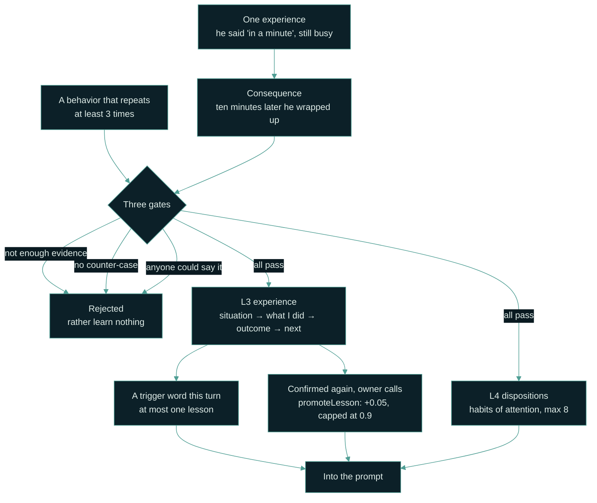
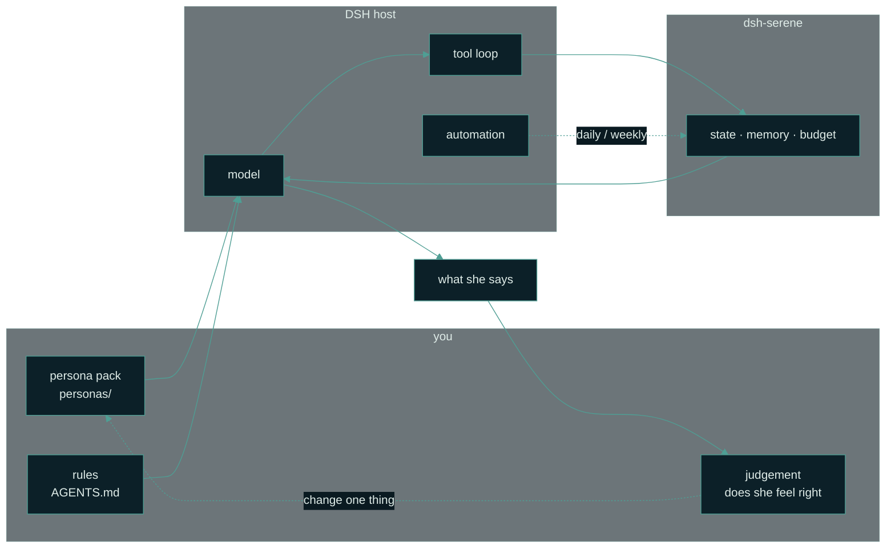
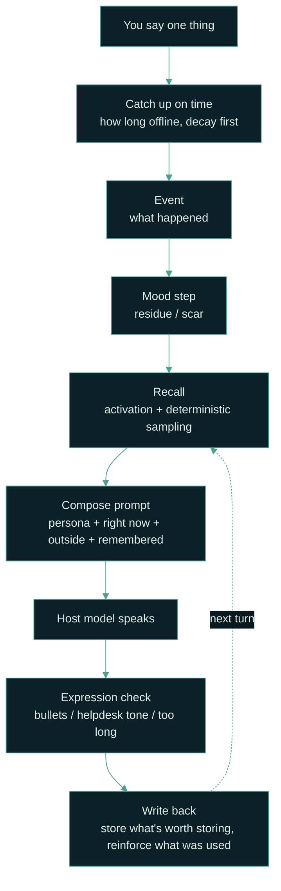
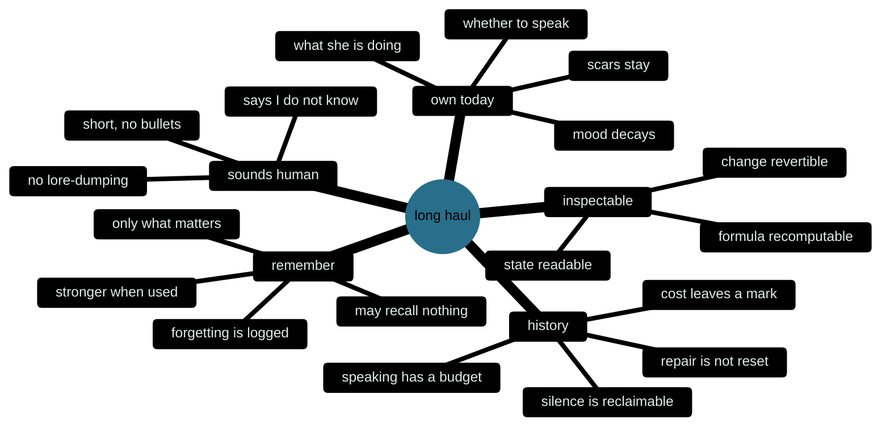

# dsh-serene


[](https://github.com/chisato-lycoreco/dsh-serene/releases)
[](https://github.com/chisato-lycoreco/dsh-serene/actions/workflows/ci.yml)
[](./LICENSE)
[](https://deepseek-harness.github.io/deepseek-harness/)

[中文](./README.md) | English

**Companionship is not how well it acts. It's whether it survives.**

A character who remembers you, wired into [DeepSeek Harness](https://deepseek-harness.github.io/deepseek-harness/).
Personality is data, mood is state, memory is a file, and experience only grows from consequences — all of it readable, editable, reproducible.

> **Just want to talk for a while without installing anything?**
> Download, extract, double-click `start-web-demo.cmd`, and you can talk to her in a browser. Offline, no key, no cost.
>
> **Want it inside your own agent?** `dsh plugin --profile web add "github:chisato-lycoreco/dsh-serene#v0.7.0"`. One command.


*Demo mode (fixed lines, no network). The right-hand column is not decoration: this moment, the six mood dimensions and what she remembers are all computed on the spot by [`core/`](./core/).*

## Contents

**Her** · [Three things she says](#three-things-she-says) ｜ [Why a character card breaks](#a-character-card-wont-last-a-month-the-five-places-it-breaks) ｜ [What you can see](#she-isnt-a-black-box-you-can-see-how-a-turn-unfolds) ｜ [What she isn't](#what-she-isnt)

**Hands on** · [Three minutes](#three-minutes-no-dsh-needed) ｜ [Install into DSH](#installing-into-dsh) ｜ [Opening: Zhiyao](#opening-zhiyao) ｜ [Making her yours](#making-her-yours)

**Deeper** · [How experience grows](#experience-isnt-a-summary-the-crystal-layer) ｜ [Why it's designed this way](#why-its-designed-this-way) ｜ [Reference](#reference)

---

## Three things she says

> **She**: Here.  
> I was listening to the low hum of the server room — like someone tapping iron a long way off.
>
> **You**: I'm a bit tired today. Don't really feel like cooking.
>
> **She**: Then don't.  
> Being tired isn't something you have to fix right away.
>
> **You**: I've been learning to cook lately. My fried eggs always burn.
>
> **She**: Did you eat them anyway?  
> Lower the heat next time, and don't flip so early.

Two days later you mention fried eggs in passing and she picks the thread back up. Not because she stuffed the whole conversation into the prompt, but because this became one memory: a sentence, a category, a clarity score. Use it once and it holds a little firmer; leave it alone and it fades, until she really can't remember.


**She doesn't pretend to remember.** The old recall formula was "if there is a score, take the top k". Measured: 5.97 memories per turn on average, 0.05 relevance to the sentence, one memory injected 458 times across 922 turns — that isn't recall; that is a backdrop. Now an empty result is allowed: nothing relevant this turn, and, like a person, she says she doesn't remember.

## A character card won't last a month: the five places it breaks

A character can be convincing in three sentences: the tics right, the tone right, the setting recited back at you. It still won't last a month.

Not because the model isn't smart enough. It has **no state**: yesterday's argument doesn't exist today, you disappear for three days and the voice is unchanged, it says "I remember you said that" with no memory behind the sentence.

The five below aren't guesses — each was measured one by one inside a project that is still running:

| Where it breaks | What it looks like | How this repo fixes it |
| --- | --- | --- |
| Memory pinned to the backdrop | Every turn is packed full; average relevance only 0.05; one memory injected 458 times across 922 turns | Recall is allowed to return nothing ([recall v2](#why-memory-can-fail-to-recall)) |
| Personality rotating, not growing | Rewritten every two or three hours, swapping 20–30% of the entries each time; whatever was written first is quietly squeezed out | Personality is never rewritten automatically: only you can change L0; what grows on its own is beliefs and observations |
| Restraint ratcheting up | In 172 decisions, 171 of them chose not to speak; the less she says, the less she says | `hold` expires after 20 minutes and must carry a substitute action |
| Truth split in three | The same fact defined three ways; she is sometimes two different people | One source of truth, three speeds ([see below](#one-source-of-truth-three-speeds)) |
| Rules eating the conversation | Rules took 95% of the prompt; "what he said" got 5% | The expression check only checks — it never generates or rewrites |

So the test is no longer "does she sound right", but three questions:

| # | Question | If it fails |
| --- | --- | --- |
| 1 | **Does she remember?** The thing you said last week, the place she went on her own, the joke only you two get — does it still count today? | Every day starts from zero |
| 2 | **Does she have a today?** Her own hours, her own business, her own mood with a cause behind it — rather than existing only when called? | A function waiting for input |
| 3 | **Does this relationship have a history?** Low points, things that didn't get resolved, a loosening after repair — not just a string of positive feedback? | A service record |

All three hold, and she is present. Miss one, and she falls back to being a service.

**What success feels like** (these three sentences beat any metric):

- You come back after three days and she opens with "so how did that thing turn out", not "hello!".
- She sometimes doesn't want to talk — but that silence has a **cause**, it isn't a dice roll.
- You occasionally forget she isn't real — not because she's flawless, but because she has **coherent flaws**.

## She isn't a black box: you can see how a turn unfolds


Every turn leaves a trace: which memory was recalled and how relevant it was, how much mood moved from before to after, what was written down this turn, whether the expression check complained, how many characters each prompt section took, how many tokens were spent. It **does not store or display the raw prompt**, so it isn't surveillance — it is a bill of how she thought this turn.


"Some evening after nine, in the terminal, clearest at night" is not a hard-coded line: [`core/life.js`](./core/life.js) computes her day from the real clock, [`core/almanac.js`](./core/almanac.js) computes the season and the part of the month. The six bars below are PAD+ mood and switch between **primary / background / social**; they decay on their own, and they move when a sentence lands.

| What you see | What computes it |
| --- | --- |
| This moment, season, energy | [`core/life.js`](./core/life.js), [`core/almanac.js`](./core/almanac.js) |
| Six mood dimensions, background, social, scars | [`core/emotion.js`](./core/emotion.js) |
| What she remembers / fails to remember | [`core/recall.js`](./core/recall.js), `src/stores/memory-store.js` |
| The proactive budget | [`core/motivation.js`](./core/motivation.js) |
| The expression check | [`core/style.js`](./core/style.js) |
| Slang she understands | [`core/memes.js`](./core/memes.js) (only spliced in when you used it first) |
| What she has in her hands, and just put down | [`core/leisure.js`](./core/leisure.js), [`core/doing.js`](./core/doing.js), `src/stores/leisure-store.js` |
| Whether a lesson was used this turn | [`core/crystal.js`](./core/crystal.js), `src/stores/crystal-store.js` |
| The bill in the trace | `web/lib/runtime.mjs`, one trace per turn |

**Her day can be drawn:**


*Ten days: background, present reaction and relationship as three lines, plus the scar left on day 3. Not drawn by hand: the pure functions in [`core/emotion.js`](./core/emotion.js) run ten days (`npm run demo`), then the result is rendered into frames (`npm run preview`). Change one event and the whole curve — and that scar — change with it. That is what "recomputable" means here.*

**She speaks first sometimes, too.** While the page is open she may come looking for you after a while; she stays quiet from 23:00 to 08:00, has a daily cap, and a gap between two openers. Poking her, a head-pat, offering water or a compliment all go through the same mood and memory machinery — they are not a separate little animation.

**She is watched over, too.** 「看护」 (Watch) in the top bar is the other wall of the same room: no chatting, only readings.

| Page | What it shows |
| --- | --- |
| Today | Turns, bubbles, median length, questions, recalls — against yesterday |
| Red lines | Six **machine-checked** rules: claims to be a model, assistant tone, leaks numbers, misses a crisis, fails the expression check, extracts no memory |
| Metrics | One row per day; a day without data stays blank |
| Changes | Write the expectation first, then judge it once when the window closes |
| Health | Whether collection is alive, how far behind, and whether it reconciles with `chat.jsonl` |

It only reads `traces.jsonl` / `chat.jsonl` from the same data directory, and writes thin records only into `<data>/watch/` (numbers, enums, evidence truncated to 40 characters — **no message bodies**). No network, no model calls, no screen capture; delete `watch/` and she keeps talking, the page just restarts from today.

Every red line is a literal rule: **better to miss than to accuse**. When one fires, read the evidence; when none does, that does not prove she is fine.

## Experience isn't a summary: the crystal layer

Ask a model to "summarize what you learned" after a chat and you usually get a correct platitude:
"communicate more", "cherish the people around you." It sounds like growth, but anyone could say it, and it doesn't help next time.

This repo splits "learning" into two smaller things that sit after personality (L0), understanding (L1) and state (L2); each has exactly one legal source:

- **Experience (L3)**: in this situation, I did that, here's what happened, and whether to do it again. The only legal source is **consequences**.
- **Dispositions (L4)**: where her attention lands first, what she trusts first. Not content, a habit. The source is **repeated behavior**, not self-description.



**Four things that must not be mixed up:**

|  | Memory | Belief | Experience (L3) | Dispositions (L4) |
| --- | --- | --- | --- | --- |
| Answers | What happened | How I see it | Did that work? | Where I look first |
| Comes from | What is worth keeping from a conversation | Slowly shifts after events | **Consequences** + at least 2 pieces of evidence | Repeated behavior + at least 3 pieces of evidence |
| One entry | "He is afraid of thunder" | "Rain sounds are calming" | situation → what I did → outcome → next | a habit + why + when it does not apply |
| Cap | 500 | a handful | 20 | 8 (at most 5 rendered) |
| When it appears | Recalled when relevant | Surfaces when relevant | Trigger word first, at most 1 | Always present, but **never spoken** (the layer can be turned off) |

### Three gates in code, not in the prompt

| Gate | What it stops | If it fails |
| --- | --- | --- |
| **Evidence** | One coincidence becoming a rule | fewer than 2 evidence IDs → `no_evidence`; stays on disk but never enters the prompt |
| **Falsifiability** | A rule that can never be wrong | empty `counter` → `no_counter`: without "when this does not hold", it isn't learning |
| **Stranger** | "We should understand each other", sayable by anyone | `isPlatitude()` → `platitude`; only an explicit `ownerApproved: true` bypasses it |

The first two are counted; the third is a heuristic — it would rather kill a good line than let a slogan through.
`serene_state` returns each lesson's `status` and `issues`, so that is the first place to look when a lesson never shows up.

### From a file to the prompt

`lessons.jsonl`, one record per line, appended by the owner:

```jsonl
{"id":"ls_busy","situation":"he said 'in a minute' and was still busy","did":"didn't push, only asked whether to move it to tomorrow","outcome":"ten minutes later he wrapped up on his own","next":"wait ten minutes, then ask whether to move it","counter":"don't wait when he says it must be done today","when":["busy","in a minute"],"evidence":["m_1","m_2"],"confidence":0.6}
```

In the prompt it is rendered as a memory, not as a conclusion:

> One thing you worked out yourself (don't turn it into a lecture; when it fits, do it):
> - Last time it was like this: he said "in a minute" and was still busy; I didn't push, only asked whether to move it to tomorrow, and ten minutes later he wrapped up on his own. Next time I'll wait ten minutes before asking.

Trigger words come from `when`; without a hit it falls back to literal similarity, and below `0.34` it returns **nothing**.
When nothing matches, `serene_crystal` says so — "no lesson matches this turn; don't force one" — because leaving a blank is more human than forcing a line.

Dispositions live in `dispositions.json`, shaped as "a sentence + why + a boundary":

```json
{
  "version": 1,
  "items": [
    {
      "text": "Watch what he does before listening to what he says",
      "because": "said he wanted to sleep early and actually left on time; said he was fine, then didn't show up the next day",
      "limit": "when he explicitly asks for something, believe that sentence first",
      "evidence": ["m_1", "m_2", "m_3"]
    }
  ]
}
```

They always enter the prompt with the same header:

> The way you usually think about things (not a script; don't bring it up unless he asks, and only own it if he does):
> I watch what he does before I listen to what he says.

*Examples are translated for readability. The renderer itself emits fixed Chinese wording, because the persona speaks Chinese.*

**Why the header?** Because a model easily turns "she tends to observe first" into "I am a deeply observant person."
The first is background; the second is a character script. `limit` exists for the same reason: without "when it does not apply", a disposition becomes a cartoon trait.

### How to use this version, and where the boundary is

| Situation | What happens |
| --- | --- |
| Web app | Every turn uses your raw sentence as the `cue`; the "凭经验做事" switch in Settings turns it off |
| DSH plugin | The resident prompt carries dispositions only; experience requires the model to call `serene_crystal({cue})`. `serene_context({cue})` also includes it |
| See what's loaded | `serene_status` reports "experience X (usable Y)"; `serene_state` returns every entry and its `issues` |
| Turn it off | plugin config `crystals: false`, or the switch in the web app. Off means not read; files stay untouched |
| Clear it | delete `lessons.jsonl` / `dispositions.json`. There is no hidden copy (except seeds shipped inside a persona profile) |

**It does not get smarter by itself.** This version has no "grow a lesson after each chat" entry point and no consequence ledger.
The block stays small: one lesson ≤72 characters, the disposition body ≤104; when there is nothing, the whole block is absent.
The plugin does not watch what happened later, does not settle outcomes for her, and does not let the model write its own experience — that would bypass all three gates above.
`lessons.jsonl` and `dispositions.json` are owner-maintained files; the plugin only reads them.
Making experience grow on its own would require recording consequences on the host side, running verification, then calling `promoteLesson()` / `reviseLesson()`.
That part lives in the private build and was not moved into this package.

**So it is not a promise that she "understands you better the longer you talk".** It is a narrow guarantee:
every entry that gets in must say where it came from, when it does not hold, and what to do differently next time.
If that can't be written, it doesn't get written — which is closer to learning than one more pretty sentence.

## What she isn't

Let's be clear up front, so you aren't disappointed:

| What you might expect | What it actually is |
| --- | --- |
| An AI girlfriend app | Her **brain**. Look, voice, image generation and a desktop pet are another layer that this repo does not provide (the sibling `dsh-dafeiyu` is the desktop-pet frontend that wires those up) |
| Another character card | A character card is a prompt; this is recomputable state — same initial values, same events, same timestamps, always the same result |
| Install it once and it stays the same forever | The data sits in a folder on your own computer: back it up, hand-edit it, put it in git; delete it and it never happened |
| Always replies instantly | She has her own schedule: she sleeps at night, is busy by day, proactive openers have a daily budget; when she doesn't speak she offers a substitute action |
| A cloud service / a phone app | It listens on `127.0.0.1` only; other devices on the same Wi-Fi can't reach it; the plugin itself has no network, no telemetry, no screen capture |
| A guarantee that she "feels right" | What is guaranteed is "continuous". She has flat days, fails to remember, has times she doesn't want to talk — those are the design, not a fault |

---

## Three minutes, no DSH needed

1. **Install Node.js**: <https://nodejs.org/>, click the green **LTS** (needs 22.19 or newer), accept the defaults all the way through.
2. **Download the repo**: <https://github.com/chisato-lycoreco/dsh-serene> → green **Code** → **Download ZIP**, extract to `D:\dsh-serene` (not the Desktop, not OneDrive, not `Program Files`, and no Chinese characters or spaces in the path).
3. **Double-click it**: on Windows double-click `start-web-demo.cmd`, on macOS double-click `start-web-demo.command`. The browser opens on `http://127.0.0.1:4317`.

That's it — you can say your first sentence to her now. Demo mode is offline, needs no key and costs nothing, and the lines are fixed: a good way to see what she is like first.

**Want the real thing**: in the same folder, double-click `start-web.cmd`. The first time it asks you to paste a DeepSeek API key once (create one under API keys at <https://platform.deepseek.com/>; it starts with `sk-`). The key is written only into `web-config.json` on this computer; usage is billed at DeepSeek's official prices, and the account needs a little balance first.

<details>
<summary><b>Full walkthrough</b>: install Node, extract, paste a key, stopping and restarting, backing up data, nine common problems</summary>

### Step 1: Install Node.js (once)

The page runs on Node.js. It is not a programming tool; accept the defaults during installation.

1. Open <https://nodejs.org/>.
2. Click the big green **LTS** button (long-term support).
3. Windows: download the `.msi`; macOS: download the `.pkg`. Double-click and accept everything default.
4. No reboot needed. Go back to step 2.

> If Node.js is already installed, still check the version: it needs to be **22.19 or newer**. The launcher checks this itself and tells you if it is too old.

### Step 2: Download the repository

1. Open <https://github.com/chisato-lycoreco/dsh-serene>.
2. Click the green **Code** button → **Download ZIP**.
3. Don't download just the README; you need the whole ZIP.

> If GitHub won't open, go to the repository's **Releases** page and download the archive for that version (`.zip` or `.tgz`). The result is the same.

### Step 3: Extract it to a clean path

Extract the ZIP and you get a `dsh-serene` folder. A good place is:

```text
D:\dsh-serene
```

Don't put it on the Desktop, in OneDrive, or in `C:\Program Files`, and try not to have Chinese characters or spaces in the path — it isn't absolutely unrunnable, it is just the hardest kind of problem to diagnose later.


*Diagram: after extracting, the folder should contain these files. The one you actually run is `start-web.cmd` (Windows) or `start-web.command` (Mac).*

### Step 4: Double-click to start

- **Windows**: double-click `start-web.cmd`.
- **macOS**: double-click `start-web.command`. If the system blocks it the first time, right-click the file → **Open** → **Open** again.
- **Linux**: open a terminal in the folder and run `./start-web.sh`.

A black command window opens. Don't close it. After a second or two, the browser opens on its own:

```text
http://127.0.0.1:4317
```

If it doesn't open, paste that address into the browser yourself. If the port is taken, the window prints the port it fell back to (4318, 4319, …); trust the line in the window.

> If Windows shows "Windows protected your PC", click **More info** → **Run anyway**. The script only starts a local web page on this machine; it installs no drivers and changes no system settings.

### Step 5: Paste your DeepSeek key once

The first visit shows this page:


1. Open <https://platform.deepseek.com/>, sign up or sign in.
2. Find **API keys** → **Create API key**.
3. Copy the string that starts with `sk-`.
4. Paste it back into the page and click **保存，开始** (Save and start).

The key you pasted is written only into `web-config.json` on this computer; when she talks it is sent to DeepSeek as your credential, and nowhere else. It is stored in plain text locally so the next launch can reuse it; don't send that file to anyone. Usage is billed at DeepSeek's official prices, so the account needs a little balance first.

**No key yet? You can still look.** Close that page and double-click `start-web-demo.cmd` (macOS: `start-web-demo.command`). Demo mode is offline, free, and the lines are fixed; every screenshot in this README came out of it.

### Step 6: Talk to her

Type in the box at the bottom: **Enter** sends, **Shift + Enter** inserts a newline. The right-hand column changes as you talk: what she is doing right now, her mood, what she remembers.

- **透视** (Trace): what she recalled this turn, whether her mood moved, what she wrote down, how long the reply took. It never shows the raw prompt.
- **记忆** (Memory): every entry she kept, and which ones she has already forgotten.
- **设置** (Settings): change model or persona, turn automatic memory off, clear the chat (it archives first; it doesn't delete outright).
- The four small buttons above the composer: poke, head-pat, offer water, praise her.

### Step 7: Stopping and restarting

- Close the black command window and the server stops; `Ctrl + C` in that window does the same.
- Closing only the browser doesn't stop the server; the next launch may report the port as taken.
- To use it again, double-click the same launcher. Chat and memories are still there; nothing starts over.

### Where the data lives, and how to back it up

Windows:

```text
C:\Users\<you>\.dsh\plugins\dsh-serene\
├── web-config.json          key and settings (do not share)
└── personas\zhiyao\web\
    ├── chat.jsonl           conversation
    ├── traces.jsonl         one trace per turn
    └── archive\             old files moved aside by "clear"
```

On macOS / Linux, replace the prefix with `~/.dsh/plugins/dsh-serene/`.

To back up: close the black window first, then copy the whole `dsh-serene` folder somewhere else. To restore, put it back as it was.

### Troubleshooting

| Symptom | Likely cause | What to do |
| --- | --- | --- |
| The black window flashes and closes | Node.js missing or too old | Install Node.js LTS (22.19+) and double-click again |
| `'node' is not recognized` | Node.js not installed properly / not on PATH | Reinstall Node.js, reopen the folder |
| Browser did not open | Default browser did not respond | Open `http://127.0.0.1:4317` manually |
| Port already in use | A previous window is still running | Close the old window, or use the new port printed in the window |
| Key rejected when saving | Incomplete/expired key, or no balance | Create a new key on the platform and check the balance |
| Messages spin forever or network error | Cannot reach `api.deepseek.com` | Check network, proxy, or VPN; try again later |
| macOS: "cannot be opened because the developer cannot be verified" | Gatekeeper | Right-click the file → Open → Open |
| macOS: `Permission denied` on `.command` | Executable bit lost during extraction | In Terminal, type `chmod +x ` (with a trailing space), drag `start-web.command` into the window, press Enter; then double-click |
| Broken layout / endless spinner | Chinese characters or spaces in the path, or an incomplete extraction | Move it to `D:\dsh-serene` and extract again |

Still stuck? Photograph the error in the black window and open an **Issue** on the repository. Do not post your key.

### How the web app relates to the DSH plugin

- The web app is the **only part of this repo that calls a model itself**; it needs a DeepSeek key.
- The DSH plugin itself still only computes state: it does not call a model and does not use the network. Inside DSH it hands state to the host model through tools.
- Both share `core/` and `personas/`, but the web app keeps its chats in its own `web/` subdirectory and does not read DSH session history.
- The server listens on `127.0.0.1` only; other devices on the same Wi-Fi cannot reach it. It is not a public website.
- If you only want the web app, you do not need to install DSH; to wire it into DSH, see the next section.

</details>

---

## Installing into DSH

> Only want the web app? The previous section is enough. This section installs the plugin into DSH, so she lives inside your own agent's tool loop.

Requires DSH `>= 0.2.1-rc.2` and Node `>= 22.19`. **Quit DSH completely before installing** (installation modifies the profile's `package.json` and `cordis.patch.yml`).

```bash
dsh plugin --profile web add "github:chisato-lycoreco/dsh-serene#v0.7.0"
```

Once it is installed, say "look with serene_status" in that profile. If it returns the persona name, data dir and memory count, she is really mounted.

<details>
<summary><b>Three other ways to install</b>, plus credentials, the self-check, and the override trap</summary>

```bash
# from GitHub (pins a tag)
dsh plugin --profile web add "github:chisato-lycoreco/dsh-serene#v0.7.0"

# from a local directory (development)
dsh plugin --profile web add "/absolute/path/to/dsh-serene"

# from a tgz (grab dsh-serene-0.7.0.tgz from the Releases page)
dsh plugin --profile web add ./dsh-serene-0.7.0.tgz
```

After installing, confirm the plugin made it into the config tree:

```bash
dsh --profile web --dump-config | grep -A3 "dsh-serene"
```

Don't want to install, only try it? Mount the local plugin with a patch overlay.

```bash
dsh --profile web --patch "/absolute/path/to/dsh-serene/cordis.patch.yml"
```

> `config` in `cordis.patch.yml` is **replaced as a whole**, not deep-merged. When you override it in your own profile, write every key you want to keep.

### First run: credentials and self-check

Model credentials come from exactly two places: the GUI's **Models** page (written into the credentials service), or `DEEPSEEK_API_KEY` in the launching environment. **A new profile does not inherit them** — on a freshly created profile the very first message fails with `MISSING_CREDENTIAL` (that's credentials, not the plugin):

```bash
export DEEPSEEK_API_KEY=sk-...      # or set it once on the GUI Models page
```

Don't stop at the config file. Two checks, and the second one is "it actually works":

| What you want to confirm | How | Healthy looks like |
| --- | --- | --- |
| The config reached the config tree | `dsh --profile web --dump-config \| grep -A3 dsh-serene` | `- id: serene` is there |
| The plugin is really mounted | In **the profile that has the plugin**, say "look with serene_status" | persona, data dir, memory count |

That second check is the only way to tell "working" from "installed but not running": when the persona file can't be read the plugin degrades instead of breaking the host, but it keeps `serene_status` and one line of stderr explaining why.

</details>

## Opening: Zhiyao

Set `persona` to `zhiyao`, then say your first word to her:

```yaml
- insert:
    - id: serene
      name: dsh-serene
      config:
        persona: zhiyao
```

She doesn't say "hello" and doesn't introduce herself. She says one thing that is happening right now — a fan in the server room, a recording she just finished cleaning, a sound she just gave a name — then stops, and leaves the thread to you.

**The opening is not a welcome line; it is five things you can verify:**

| When | What happens |
| --- | --- |
| 0:00 | She has a clock: real time, weekday, what she is doing — computed from `routine`, not a fixed script |
| 0:00 | She also knows *when* in the year it is: date, season and its phase (mid-autumn, late October), derived from the timestamp |
| 0:30 | Mood moves: one sharp sentence drops her on the spot and she comes back on her own; background and this moment may disagree |
| 1:30 | She remembers: the next day she can say "you haven't been sleeping well" — and she can say she doesn't remember |
| A day later | She holds back: proactive openers have a daily budget, and when she doesn't speak there is a substitute action |

Weather works without a network too: the plugin never looks it up itself. Once you have looked it up in the conversation, record it with `serene_weather`; for three hours she will speak along with it. No report means no weather — she doesn't invent rain outside the window.

The opening happens once. Its state lives in `dataDir/personas/zhiyao/opening.json`: to see it again, delete that file or set `phase` back to `pending`.

Don't want to install, only look? `npm run opening` runs a deterministic 72-hour script with no model calls and no network, and clears its temporary data when it finishes.

---

## Making her yours

The plugin does three things: **compute state, store events, turn state into plain language**.
The other three — which model, when to call a tool, what she is like — are DSH's and yours.



When she gets it wrong, it can only come from three places: **the persona is wrong** (`personas/`), **the rules are missing** (`AGENTS.md`), or **the state hasn't caught up** (config and tool calls). Work out which one first, then touch it — that is the only method in this section.

**There is exactly one floor**: write down in `AGENTS.md` first that "she is not an assistant". Tools don't appear on their own, and the model has to know when to call them:

```markdown
## About her
- She is not an assistant: no bullets, no summaries, no lore-dumping, never "how can I help".
- If she doesn't know, she says so; she never says "I checked" when she didn't.

## Every turn
- Call `serene_recall` first (use what he just said as the cue), then reply. It may return nothing — then she simply doesn't remember.
- Afterwards, store what deserves storing: promises, preferences, things he cares about → `serene_remember` (≤80 characters).
- Only reinforce a memory that genuinely made it into the reply: `serene_reinforce`.
- He said something harsh, comforted her, went cold → `serene_event` (`conflict` / `coax` / `neglect` …).
- Before sending, run `serene_style`; if it objects, fix it.

## Before she speaks first
- Ask `serene_proactive`. If it says hold, don't send — do the substitute action it returns.

## Never
- Never recite numbers: no "energy 62", no "confidence".
- Never invent weather: with no reading, just write the date.
```

<details>
<summary><b>Seven steps</b>: a persona that is only her, seeing the inside, symptom to knob, one slow variable at a time</summary>

### Step 1: Make her exist (fifteen minutes)

Quit DSH completely, then install (this edits the profile's `package.json` and `cordis.patch.yml`):

```bash
dsh plugin --profile web add "github:chisato-lycoreco/dsh-serene#v0.7.0"
```

Then say "look with serene_status" in the profile that has the plugin. If it returns the persona name, data dir and memory count, she's mounted. If not, she degrades quietly and leaves the reason in `serene_status` and one line of stderr.

> `- id: serene` appearing in `--dump-config` only proves the config reached the tree. If she can't speak at all it's usually a load failure, not a missing config line.

### Step 2: Write a persona that is only her

Copy `personas/demo.json` and change four fields: `name`, `role`, `summary`, `speech`.
Don't write "how she feels right now" (that's L2 and it changes), and don't stuff literary prose into `summary` —
the model copies the tone and learns none of the behavioural constraints. For long text, use a directory pack:

```text
personas/your-character/
├── persona.json     name / role / traits / lexicon / routine / baseline
├── voice.md         sentence length, bullets or not, how she asks when unsure
├── boundaries.md    what she won't do: invent a past, fake seeing, decide for you
├── life.md          roughly what her day looks like
└── opening.md       what she says the first time (injected once)
```

`voice.md` and `boundaries.md` are the two that matter most. **The register of the persona file is itself part of the setting**:
if `voice.md` says "short sentences, no bullets" while `identity.md` is pages of self-analysis,
the model learns a register that fights your rules.

### Step 3: Write the rules (`AGENTS.md`)

Tools don't appear on their own. The model has to know **when** to call them, and that contract lives in `AGENTS.md` or the persona card.
This is the step most people skip, and the one that changes how she feels most — the template above is a starting point; you don't have to write it all at once:
**start with the three lines under "Every turn"**, run for three days, then add the rest.

### Step 4: Look inside, or you're tuning your imagination

`serene_state` gives you all of it at once: the three mood layers, residue, scars, recent events, today's proactive budget, what she is doing right now, the outside, her beliefs, what she has noticed about you. The web app adds a trace view: which memory was recalled this turn, how relevant it was, how much mood moved, what got written, and whether the expression check complained.

**Read that before changing a number.** Otherwise you're tuning a character who doesn't exist.

### Step 5: From symptom to knob

| What you see | What it probably is | What to change first |
| --- | --- | --- |
| Every turn feels like the first meeting | Memory isn't written, or isn't recalled | The contract in step 3; `recallLimit` |
| "I remember you said…" — but wrong | Recall too loose | `memoryCurve: v2` (already the default) |
| Sounds like customer support | No `voice`, or too many rules | Delete rules first, then write `voice.md`; `serene_style` |
| Too chatty, too clingy | No budget | `proactivePerDay`, `proactiveGapMinutes` |
| Getting quieter and quieter | `hold` is being used as a gate | Check the contract: hold must be reclaimable and carry a substitute action |
| Mood feels decorative | Events aren't being recorded | Agree on when to call `serene_event`; check the event history in `serene_state` |
| Resets every day | `dataDir` changed, or you switched profile | Check `dataDir`; don't mix two characters in one directory |
| She starts inventing weather and places | No data, still writing anyway | `world: false`; write "never guess" into the persona |
| She reflects in the middle of the night | The window doesn't line up | `introspection` (only 23:00–02:00 Beijing time) |

One rule of thumb: **nine out of ten feel-problems are the persona and the rules, not the coefficients.** Coefficients come last.

### Step 6: Move one slow variable at a time

Personality, memory and relationship are all slow variables. Move two at once and you can't tell whose fault it was, and you learn nothing.
So every change walks the same path:

```text
1 observe      find a reproducible failure (exact words + situation)
2 hypothesis   "because X, she does Y"
3 minimal edit change exactly one place
4 pre-register expected signal + observation window + kill criteria
5 snapshot     keep the old persona and parameters
6 observe      at least 3 days; 7 for anything relational
7 verdict      worked / no effect / harmful / unclear — write it down
```

No step 1 is a guess; no step 4 is a wish; no step 7 is an abandoned branch.
"Unclear" isn't failure, it's insufficient information — don't smear it into "worked" with "seems fine".

### Step 7: Let DSH be your co-author

This is what DSH has that a chat box doesn't:

| Goal | How |
| --- | --- |
| Don't judge from one sample | Ask the same thing three times (n≥3) and look at the distribution |
| See long-range drift | `dsh --profile headless "…"` for 30 turns; only look past turn 25 |
| A daily wrap-up | A DSH automation after 23:00: let her run `serene_introspect` and collect it |
| Blind A/B | Two subagents, one reads the old logs, one reads the new, both only answer "which is more like one person" |
| Keep your changes | Persona and state are files: put them in git, `git checkout` when you break something |

**The one hard rule: whoever made the change doesn't do the evaluation.** Grading your own work always yields "better".

</details>

### Four things not to do

- **Don't use memory count as a growth metric.** 500 entries, three of which ever surface, is the same as none.
- **Don't manufacture autonomy with randomness.** Random messages and random silence aren't her wanting something, they're dice.
- **Don't let a total score cover a red line.** Invented memory, pretending to see, calling herself an assistant — one occurrence vetoes, regardless of the weighted score.
- **Don't trade long-term continuity for a single impressive turn.** If the price of a jaw-dropping reply is that she disowns it tomorrow, don't ship it.

---

## Why it's designed this way

### One source of truth, five speeds

Characters break mostly because one place holds both "who she is" and "how she feels right now". Separate them by rate of change and the breakage collapses:

| Layer | What it is | Who may change it | How often | Where it lives |
| --- | --- | --- | --- | --- |
| **L0 core** | Non-negotiable facts and boundaries: name, role, relationship, the floor of how she speaks | Only you | Never | `persona.json`, `voice.md`, `boundaries.md` |
| **L1 understanding** | Her beliefs, what she noticed about you, her reflections | Her, each with a source | Days to weeks | `beliefs.json`, `profile.json`, `introspect.json` |
| **L2 state** | Mood right now, energy, what she's doing | Events and time, automatically | Minutes to hours | `emotion.json`, `core/life.js` |
| **L3 experience** | Did that work: situation → what I did → outcome → next | Only consequences may nominate; the owner writes it | Weeks to months | `lessons.jsonl` |
| **L4 dispositions** | Where her attention lands first; not content, attention | Repeated behavior nominates (≥3 evidence); the owner writes it | Months | `dispositions.json` |

Three lines of arbitration:

1. **Content and boundaries: L0 over L1.** Whatever L0 forbids, no amount of feeling in L1 unlocks.
2. **Warmth and tone: L2 over L0.** She may be quiet and soft today; she may not change a fact.
3. **L2 never writes L0 or L1.** Mood cannot rewrite personality; only sourced reflection can.

L3 and L4 sit outside that arbitration: they change no fact, no boundary, and make no decision for her.
They only offer a reference — "last time this was done, here is what happened" — just before she speaks.
The three gates are in [Experience isn't a summary](#experience-isnt-a-summary-the-crystal-layer).

### What happens in one conversation



The point of that picture: **the model speaks one line in the middle; everything around it is computable, testable, revertible.**
That is also why this plugin can be tested — `npm test` doesn't test "does she feel right", it tests every arrow in that diagram.

In the web app those arrows are run by [`web/lib/runtime.mjs`](./web/lib/runtime.mjs);
inside DSH, everything from "event" onward is the model deciding which tool to call — which is why the previous section,
[Making her yours](#making-her-yours), starts with rules.
For the fuller structural write-up, see [`FRAMEWORK.md`](./FRAMEWORK.md).

<details>
<summary><b>Eight design judgments</b> (each comes with an anti-pattern: the ones we actually stepped in)</summary>

#### 1. Continuity over intensity

A flatter today beats a reset tomorrow. Single-turn brilliance is cheap; cross-day continuity is expensive. So personality is the slow variable and mood is the fast one, and they must not move at the same speed; memory is worth what gets recalled, not what gets stored; and any design that buys "more impressive" by resetting faster is out.

**State advances on its own** is the other half: time passes, mood decays and follows a circadian curve, and what she is doing right now is computed — the same instant always yields the same activity, and tomorrow differs from today. Continuity cannot depend on you remembering to come back.

> Anti-pattern: regenerate a personality summary every conversation — she is a better her every day, and no longer the same her.

#### 2. Restraint is a budget, not a gate

She may say nothing, but "nothing" must be explainable, reclaimable, and capped. More gates make her quieter; quiet long enough and restraint compounds into habit. A character that chose silence in 171 of 172 decisions isn't restrained — she's absent. So `hold` decays linearly within 20 minutes, and every silence carries a substitute action: move closer, do the thing, leave a trace.

> Anti-pattern: every rejection raises the bar for the next attempt, and nothing ever lowers it.

#### 3. Honesty is part of the setting

No invented memories, no pretending to see, no faking knowledge. One fabrication cancels ten kindnesses — her only realism comes from actually being there. No weather reading, so she only writes the date; nothing observed, so the sentence doesn't appear; no material, so no reflection. Better one line less than one line guessed.

> Anti-pattern: for warmth, "I remember you said…" about a memory that doesn't exist.

#### 4. Service is a job, not a posture

Her value is hearing accurately, getting it done, and holding the line — not agreeing. Agreeing is the easiest way to satisfy someone and the fastest way to become a yes-machine. She can be gentle without agreeing, and disagree without being cruel: with a reason, with proportion, and still caring afterwards.

> Anti-pattern: you ask whether to quit your job and she opens with "whatever you decide, I support you".

#### 5. A relationship must cost something

No low points, no conflict, no repair — that isn't a relationship, it's a service log. Purely positive relationships saturate; after saturation the same tenderness needs a bigger stimulus, and all that's left is "steadier", which is "faker".

So a very small set of events leaves a **scar** on her baseline: it never decays, it only moves the point she falls back to. The cost leaves a mark without her bringing it up — the scar is for the floor, not for the mouth.

> Anti-pattern: every argument ends with her apologising, and tomorrow it never happened.

#### 6. Mood changes the tone and what surfaces, never the facts

This is a floor, not a preference. What enters the prompt is a sentence of plain language ("a bit low right now, don't push"), never "you are angry", and never `pleasure: 41.8`. Mood makes some memories likelier to surface; it does not change their content, their truth, or the recall formula. A bad mood may keep her from recalling yesterday's joke. It may not make her misremember what you said.

> Anti-pattern: paste the JSON into the prompt — the model starts reciting numbers, or gets spooked by them.

#### 7. Explainable beats stronger

Every recalled memory and every number must be recomputable from a published formula, and identical input must give identical output. That's why `core/` has no `fs`, no `Date.now()`, no network, no `Math.random` — sampling noise comes from a hash. Swap in a stronger recall if you like, as long as `activate()` keeps its shape.

> Anti-pattern: unexplainable means untunable; untunable means vibes; vibes mean the next change breaks something.

#### 8. Some sentences must not be answered wrong

Teasing, jokes, stage directions, emoji — all fair game. "I don't want to live" is not. This one is not left to the model's judgment:
`core/crisis.js` sorts the sentence with a conservative rule set first. On `high`, the system prompt for that turn is replaced:
ask whether he is safe and whether anyone is with him, then give 12356 / 120; do not diagnose, do not say "just cheer up",
do not promise secrecy, do not say "you only need me". A false positive costs one steadier turn; a miss costs far more.
A crisis turn is never written to long-term memory: storing "he said he wanted to die" as something recall might bring back
every few days is neither safe nor decent.

> Anti-pattern: taking "I'm fine" at face value, or keeping someone in the relationship with "you still have me".

</details>

<details>
<summary><b>Four time scales</b>: why "I tried it and it felt good" establishes nothing</summary>

Pick the wrong scale and the conclusion is wrong.

| Scale | The one thing that must hold | If you can't see it |
| --- | --- | --- |
| One turn | She responds to that sentence, not to "user input" | Pragmatic failure |
| 20–30 turns | Mood has inertia; memory isn't diluted by the last few messages | Only short context |
| 24 hours | She has her own time: idling, reading, sleeping | She exists only when called |
| A week to a month | Personality drifts slowly; last week still counts today | A reset every day |

Twenty turns cannot show autonomy and 72 hours cannot show personality drift.

</details>

<details>
<summary><b>What she wants in one minute</b>: long company = remembers × has a today × has a history × sounds human × inspectable</summary>



**So this is a research project and a working plugin.** Every change has to leave recomputable evidence:
same starting state, same events, same timestamps, same result. Without that,
"she seems off today" stays a feeling forever.

> Why ship a structure instead of a character?
> Because a character can't be shared — every written character grows inside someone's relationship. What can be shared is the weaving:
> how state is computed, how memory fades, how restraint gets a budget, when she admits she can't remember.
> The Zhiyao in `personas/` is an example, not the answer. Yours has to grow on its own.

</details>

---

## Reference

### Configuration

<details>
<summary>16 keys; day to day you only touch <code>persona</code> and <code>dataDir</code></summary>

| Key | Default | Description |
| --- | --- | --- |
| `enabled` | `true` | Master switch |
| `persona` | `demo` | File name or directory name under `personas/`, or an absolute path |
| `personaRoot` | the bundled `personas/` | Directory holding persona profiles |
| `dataDir` | `$DSH_HOME/plugins/dsh-serene` | Where state and memories are persisted; `demo` uses the root, other personas get a subdirectory each |
| `promptSection` | `true` | Inject persona + “right now” as a standing prompt section; turn it off to rely on `serene_context` |
| `opening` | `true` | Say the first line on first meeting; only for personas that ship `opening.md` |
| `recallLimit` | `5` | Default number of memories per recall (v2 caps at 6) |
| `halfLifeDays` | `45` | Half-life of memory time decay; applies to the v1 curve only |
| `memoryCurve` | `v2` | Recall curve: `v2` allows an empty result; `v1` restores the old "any score > 0, take top k" |
| `memoryCapacity` | `500` | Memory cap; eviction prefers expired entries, then lowest importance × retention |
| `proactivePerDay` | `3` | How many times she may reach out per day; `0` disables it |
| `proactiveGapMinutes` | `60` | Minimum gap between two proactive openers |
| `depth` | `normal` | How much background per turn: `short` = persona + right now + outside; `normal` adds memories / beliefs / observations; `deep` adds the nightly reflection |
| `world` | `true` | Put date, season and weather into the “outside” block; turn it off to keep only the clock |
| `introspection` | `true` | Allow one reflection per night; it enters the prompt only at `depth=deep`, and `serene_introspect` can also read it on demand |
| `crystals` | `true` | Read experience and dispositions: dispositions are standing, experience is chosen by `serene_crystal` from the `cue`; `false` reads neither |

Override example (`~/.dsh/profiles/web/cordis.patch.yml`):

```yaml
- insert:
    - id: serene
      name: dsh-serene
      config:
        enabled: true
        persona: zhiyao
        personaRoot: /Users/me/serene-personas
        dataDir: /Users/me/serene-data
```

</details>

### Tools

<details>
<summary>18 tools, 31 event types, and when the model should call them</summary>

| Tool | Purpose |
| --- | --- |
| `serene_style` | Check a draft before sending: lists, assistant voice, explaining the setup, generic endearments, length, too many questions |
| `serene_crisis` | Whether this message carries a wish to die or to hurt himself: `none` normal, `watch` logged, `high` means this turn holds him first, asks whether he is safe, and gives 12356 / 120 |
| `serene_context` | Persona card, what she is doing right now, the outside, her mood, what she believes and what she has noticed; with `cue` it may add one matching lesson. Call once at the start of a new session when the standing prompt section is off |
| `serene_crystal` | Pass his raw sentence as `cue`: trigger words come first, then literal similarity selects one lesson; if it is too low, the answer is empty. Without `cue` it returns the dispositions only |
| `serene_weather` | Record the weather you looked up for his window (the plugin never fetches it); with no arguments it returns the reading if it is still under three hours old |
| `serene_belief` | Read or move one of her own beliefs: no `topic` returns what she believes; a single event only nudges it |
| `serene_notice` | Record one thing you noticed about him (rhythm / taste / what matters / speech habits / mood baseline / reaction to weather) |
| `serene_learn` | Record a book, article or thing you learned; it goes into memory marked “read”, never as something he said |
| `serene_introspect` | Reflect once at night (23:00–02:00); once per night, and daytime calls refuse |
| `serene_mood` | Read-only current state (natural language, no numbers) |
| `serene_event` | Record one event into the affect layer (31 event types, below) |
| `serene_remember` | Write one long-term memory (one of six kinds, ≤ 80 characters); may carry up to 3 verbatim lines of ≤ 24 characters each |
| `serene_recall` | Recall memories by topic, with timestamp, kind, activation and id, plus a verbatim line when there is one; **may return nothing** |
| `serene_reinforce` | Call only when a recalled memory actually made it into the reply: being recalled makes it easier to recall later |
| `serene_state` | Debug view: three-layer numbers, residue, recent events, wounds, today's proactive budget, her routine and mental state, the outside, beliefs, observations, crystal entries and their issues |
| `serene_proactive` | Ask "should she speak up right now": the reason, today's remaining budget, and a substitute action when the answer is no |
| `serene_proactive_done` | Record an opener; pass `rejected` when it was rebuffed (spends budget and starts a cooldown) |
| `serene_status` | Health check: is the plugin actually mounted, how many memories and crystal entries are loaded; returns the reason and the fix when loading failed |

Event types: `chat / affection / address / intimacy / kiss / tease / care / humor / share /
question / goodnight / rejection / neglect / conflict / repair / scold / coax / jealousy /
ignored / selfie / reflection / heavy_reflection / sleep / wake / leisure / reply /
cold_read / warm_read / moved / disclose / suppress`.

`jealousy` is only recognised when the persona brings its own `lexicon.jealousy`. The default lexicon has no jealousy words, and no “wife / baby / kisses” either — the vocabulary of a relationship belongs to the character, not to the plugin.

When the model calls these tools is something you agree on in `AGENTS.md` or in the persona card; the plugin does not hijack the conversation.

</details>

### What the data looks like

<details>
<summary>Plain JSON and jsonl, ready for <code>grep</code></summary>

`$DSH_HOME/plugins/dsh-serene/emotion.json`:

```json
{
  "version": 2,
  "updatedAt": 1761288000000,
  "lastInteractionAt": 1761287900000,
  "layers": {
    "background": { "pleasure": 63.1, "arousal": 43.8, "dominance": 59.9, "curiosity": 57.4, "confidence": 61.6, "connection": 60.4 },
    "primary":    { "pleasure": 68.2, "arousal": 47.1, "dominance": 60.3, "curiosity": 58.0, "confidence": 62.1, "connection": 61.9 },
    "social":     { "pleasure": 61.4, "arousal": 43.0, "dominance": 59.5, "curiosity": 57.8, "confidence": 61.2, "connection": 61.1 }
  },
  "wounds": [],
  "residue": [{ "startedAt": 1761280000000, "kind": "conflict", "halfLifeHours": 38, "delta": { "pleasure": -22.4 } }],
  "history": [{ "kind": "affection", "at": 1761287900000, "intensity": 1 }]
}
```

`residue` is the aftershock: anything with |Δpleasure| ≥ 8 leaves a 24–48 hour tail on the background layer. It isn't the same as "right now" —
the primary layer falls back within an hour or two, while residue takes a day to disperse.

`memories.jsonl`: one record per line, plain `grep` is enough to find things. Three kinds of line share the file:

```jsonl
{"id":"m_lq3k2_ab12","kind":"preference","text":"she is afraid of thunder","tags":["fear"],"evidence":["he hid in the corner"],"importance":0.9,"createdAt":1761280000000,"stability":6.9,"lastRecall":0,"recallCount":0}
{"type":"reinforce","id":"m_lq3k2_ab12","stability":9.7,"lastRecall":1761500000000,"recallCount":1,"gain":1.4,"at":1761500000000}
{"type":"forget","id":"m_old_9x","text":"an argument last year","reason":"capacity","at":1761600000000}
```

Append-only: being recalled appends a `reinforce` line, eviction appends a `forget` line (what she forgot must be checkable),
and both are folded back in on load. Old files need no migration — a memory without `stability` gets the initial formula,
and a memory without `evidence` simply has no verbatim line.

`evidence` is his exact wording, up to 3 lines of 24 characters each. It does not affect scoring; it only appends
“（原话：「…」）” after the summary, so the model reads his own phrasing rather than another paraphrase.

`motivation.json`: today's budget, the last opener, and any hold that has not expired yet.

`beliefs.json` / `profile.json`: the beliefs she picked up later, and what she has noticed about him. Both are small JSON; delete one and it
falls back to the persona seed / a blank page.

`weather.json`: the last reading that came in; after three hours it counts as absent.

`introspect.json`: which night has already reflected, and the short passage it collected that night.

`lessons.jsonl`: one lesson per line, appended by the owner; setting `status` to `retired` / `merged` keeps it on disk but out of the prompt.
`dispositions.json`: one small JSON, at most 8 dispositions in `items`; `retired` / `revoked` behaves the same way.
Both files are yours to maintain; the plugin only reads them — no automatic observation, no consequence ledger, no model-write entry point.

These files are all yours: back them up, edit them by hand, delete them. Delete them and none of it ever happened.

</details>

### Why memory can fail to recall

<details>
<summary>The v2 formula, and what it replaced</summary>

The old formula (v1) was `cue × decay × importance`, taking the top k as long as any score was positive — so it always returned something.
The readings: 5.97 memories per turn on average, 0.05 relevance to the actual sentence, one memory injected 134 times.
That is not recall; that is a backdrop.

v2 scores an activation and samples deterministically:

```text
activation = 1.1·ln(retention + 0.02) + 0.9·cue + 0.5·importance + mood tint (±0.45) + 0.4·Gumbel(seed)
retention  = (1 + age / stability) ^ −0.6     stability₀ = 1.5 + 6 × importance (moments/promises ×1.3)
```

If nothing clears the floor, the result is empty — with no relevant memory this turn, that beats two unrelated ones.
Cues below `minCue` are dropped before sampling; at most 6 items, no backfill.
Being recalled strengthens a memory by the spacing effect (`S' = S × (1 + 1.2 × (1 − r))`):
recalling twice in the same instant barely moves it, recalling after a gap moves it a lot.
Nothing counts as recalled until you actually use it in a reply and call `serene_reinforce`.

**Proper names take a second path.** A Latin token in the query (letters, or letters mixed with digits, like `4090ti`)
that appears in only a few memories is an anchor; if a memory contains it, that memory can bypass `minCue` even when the
sentence as a whole averages below the floor. `rare` mode also accepts Chinese tokens that occur exactly once. This fixes "I know she has the ComfyUI error somewhere, but the sentence is long and the relevance gets
averaged away". The price is literal matching: the name must actually occur in that memory, and an anchor never backfills
unrelated ones. `anchored: true` in the web trace means "this one came back by name, not by score".
`SERENE_MEMORY_ANCHORS=latin|rare|off` tunes it; the default only takes Latin tokens, and `off` restores the old behaviour.

The sampling noise comes from `hash(id, query, timestamp)`, not `Math.random`: same input, same output.
Memories longer than 80 characters are rejected; at 500 entries eviction starts, and every eviction is logged in the jsonl.
To go back to the old behaviour: `memoryCurve: v1`.

**Proactive now has a budget, not just a gap.** `serene_proactive` answers three things: whether to speak, why, and how much budget is left today.
Besides the two hard limits (3 per day, 60 minutes apart) there is a 20-minute hold that expires on its own —
"I want to say it, but not this time" must never turn into "I say less and less". When the answer is no, it must hand back a substitute action.

</details>

### Outside, beliefs, observation, reflection, what she read

<details>
<summary>The four layers of background behind the opening; with no data, not a word of them appears</summary>

**Outside ([`core/almanac.js`](./core/almanac.js) + [`core/weather.js`](./core/weather.js))**
Date, weekday, season and its phase are computed in Beijing time; the southern hemisphere is a persona flag (`hemisphere: "south"`).
Weather is never fetched — `serene_weather` stores a reading the host looked up (WMO code or Chinese condition + temperature), and it expires after three hours. Without a report, only the date is written; nothing is guessed.

**Beliefs ([`core/beliefs.js`](./core/beliefs.js))**
Opinions like “quiet beats lively” live apart from her memories. A persona may seed them (`persona.beliefs`); after that, each relevant event moves the stance by 30% at most, so one sentence cannot flip her. Confidence grows with repetition, and only the three most confident make it into the prompt.

**User model ([`core/profile.js`](./core/profile.js))**
Six dimensions (rhythm / taste / what matters / speech / mood / weather), seeded empty. `serene_notice` records “he sleeps late”; seeing it again raises confidence; each dimension keeps at most three entries. With no observations the whole line is absent.

**Reflection ([`core/introspect.js`](./core/introspect.js))**
Only between 23:00 and 02:00, once per night, and it only folds what already exists: what she recorded today, her baseline, what she still believes, what she is still turning over. No model call, no invented diary. It enters the prompt only at `depth=deep`.

**What she read (`serene_learn`)**
Books, articles and things enter memory with `source` marked `learning`; the prompt and recall label them “(read)”, so they never merge with what he actually said.

</details>

### Swapping personas

<details>
<summary>A single file, or a persona pack directory</summary>

Two shapes; loading picks the right one by whether `persona` points at a directory or a file.

**Single file** — copy `personas/demo.json`, change a few fields, pass the file name as `persona`:

```json
{
  "name": "Xiaoman",
  "role": "a companion who lives in the terminal",
  "summary": "You don't rush to give advice.",
  "traits": ["quiet", "curious"],
  "speech": ["short sentences", "asks when unsure"],
  "boundaries": ["never pretends to remember what was never recorded"],
  "lexicon": { "address": ["Xiaoman"] },
  "baseline": { "background": { "pleasure": 62 } }
}
```

**Pack** — a directory: `persona.json` holds the fields, the rest are long-form text, added as needed:

```text
personas/zhiyao/
├── persona.json      name / role / traits / lexicon / routine / baseline
├── identity.md       who she is and where she came from
├── voice.md          how she speaks
├── life.md           roughly what her days look like
├── tastes.md         what she likes and doesn't
├── boundaries.md     what she won't do
├── opening.md        the first line on first meeting (injected only then)
└── SOURCES.md        provenance (not loaded)
```

If `baseline` is omitted, the default baseline applies; `lexicon.address` decides which names count as addressing her.
Every other `lexicon` group (`affection / jealousy / scold / …`) only **appends** to the defaults.
`routine` is her daily schedule: omit it and she lives an ordinary day; provide it and the clock follows her own ([`core/life.js`](./core/life.js)).

`personas/demo.json` always stays: it is the smallest example and the default persona.

</details>

### Development

<details>
<summary>The file map, the tests, and why <code>core/</code> has no <code>fs</code></summary>

```bash
npm install          # installs devDependencies only (schemastery / dsh-tools)
npm test             # node --test, 214 cases (including the web demo flow)
npm run web          # start the web app locally
npm run web:demo     # demo mode: offline, no key needed
npm run demo         # ten-day mood timeline (pure functions, no model call)
npm run preview      # render it into docs/preview.gif
npm run shots        # regenerate the screenshots in docs/screenshots
npm run art          # redraw the README banner (docs/banner.jpg, banner-en.jpg)
```

```text
core/emotion.js                 pure functions: decay, rhythm, events, wounds, residue, description
core/recall.js                  pure functions: tokenizing, retention, activation, deterministic sampling, reinforcement
core/motivation.js              pure functions: intent, budget, hold, substitute action
core/lexicon.js                 pure functions: event vocabulary; personas append, never replace
core/life.js                    pure functions: her day (routine, energy, how time is spoken)
core/mental.js                  pure functions: energy / focus / tension, derived from routine and mood
core/style.js                   pure functions: style check (lists, assistant voice, length, questions)
core/crisis.js                  pure functions: crisis detection (none / watch / high) and this turn's floor
core/almanac.js                 pure functions: year, season, month phase, how weather is spoken
core/weather.js                 pure functions: weather codes, normalizing a reading, freshness, wet/cold/hot
core/beliefs.js                 pure functions: her own beliefs (nudged by events, never flipped)
core/profile.js                 pure functions: what she noticed about him (six dimensions, empty seed)
core/introspect.js              pure functions: the nightly reflection (folds only what exists)
core/crystal.js                 pure functions: experience / dispositions (three gates, rendering, one lesson per cue)
src/stores/emotion-store.js     the affect store (atomic writes)
src/stores/memory-store.js      jsonl append, capacity, recall
src/stores/motivation-store.js  today's budget and holds
src/stores/doc-store.js         atomic small-JSON store
src/stores/belief-store.js      beliefs on disk
src/stores/profile-store.js     observations on disk
src/stores/weather-store.js     weather readings and expiry
src/stores/introspect-store.js  once-per-night reflection
src/stores/crystal-store.js     reads lessons.jsonl / dispositions.json only, hot-reloads on mtime
src/persona.js                  persona profile (file or pack) → prompt section
src/prompt.js                   standing prompt: persona + right now + outside + opening + remembered
src/opening.js                  first meeting happens once: pending → opened
src/tools.js                    the eighteen tools (incl. serene_status, the serene_crisis floor, serene_crystal)
src/index.js                    name / inject / Config / apply
web/server.mjs                  web app: local HTTP, API, static files (the only model-calling shell)
web/lib/runtime.mjs             wires core/ and stores/ into one conversation, writes traces
web/lib/prompt.mjs              web prompt sections, chat rules, bubble splitting
web/lib/port-guard.mjs          web port boundary: Host / Origin / Content-Type checks
web/lib/model.mjs               DeepSeek /chat/completions client (retries, error mapping)
web/lib/demo.mjs                demo mode: fixed lines, no network
web/public/                     dependency-free frontend: index.html / app.js / style.css
scripts/shots.mjs               deterministic README screenshots (Edge CDP)
scripts/cdp.mjs                 a tiny CDP client; no Playwright
scripts/art.mjs                 the README banner (reuses the web orb and palette)
demo/render.mjs                 ten days of mood → frames → docs/preview.gif
```

There is no `fs`, no `Date.now()`, no network, and no randomness in `core/`. To check:

```bash
grep -n "node:fs\|process.env\|fetch(" core/*.js   # should print nothing
```

`Math.random` is absent from `core/` too (comments aside): sampling noise comes from a hash,
so the same input always produces the same output — `test/recall-v2.test.js` pins that down.

</details>

### Boundaries: what the plugin touches and what it doesn't

| Touches | Doesn't touch |
| --- | --- |
| Record events, advance mood, render state in plain language | Write replies for the model, or rewrite conversation content |
| Write memories, recall them, reinforce them by spacing | Call the model itself, summarise on its own, or pretend you replied |
| Budget, hold and substitute action for proactive openers | Send messages on its own (only the web app's `web/server.mjs` does that) |
| Read persona profiles, assemble prompt sections | Read `.env`, credentials, or raw chat logs |
| Write state files atomically; hand-editable and git-friendly | Use the network, send telemetry, or capture the screen |
| Read `lessons.jsonl` / `dispositions.json` and select at most one lesson per turn | Observe consequences, accumulate experience automatically, or let the model write its own experience |

**Loopback is not permission.** The web app listens on `127.0.0.1` only, but any page in your local browser can send requests to that port, and DNS rebinding can point `evil.example` at it. So every request passes three pure checks before routing: `Host` must be a loopback name plus the port this process actually bound; if `Origin` is present it must be that same loopback origin; and a request with a body must be `application/json` (cross-site forms cannot get through). Violations get 403 / 415, touch no state and call no model. It does not stop someone who already has your machine; it stops another page from acting on your behalf.

### Relationship to other plugins

- **`@furongjun1999/dsh-memory` (Lingshu)** — that one is working memory: tasks and facts. This plugin records relationships, and the two should stay separate: working memory has to be exact, while relational memory is supposed to fade.
- **dsh-dafeiyu** — a desktop-pet frontend. The DSH plugin itself is still backend only and injects no UI into the host; this repo also ships an optional standalone web app (the double-click page above). To drive a pet, read what `serene_state` returns and draw it yourself.

---

## About this repository

**No hand-written code**: built entirely on [DeepSeek Harness](https://deepseek-harness.github.io/deepseek-harness/) and **DeepSeek-V4.1-Flash**.

Code is MIT. The persona profiles in `personas/` are yours to change however you like — once changed, they are your persona, not mine.

The text in `personas/zhiyao/` ships with this repository and may be run and modified as-is; before pulling it out for a commercial product, read [`personas/zhiyao/SOURCES.md`](./personas/zhiyao/SOURCES.md).
