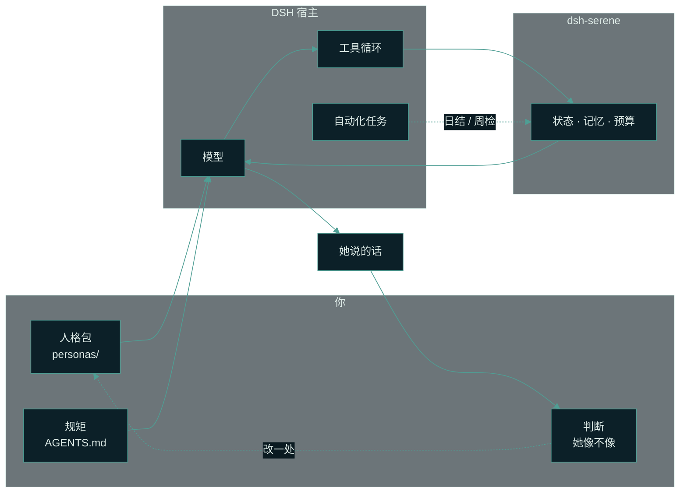
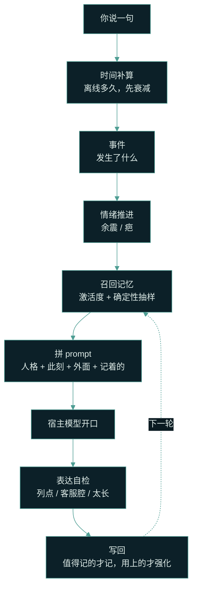
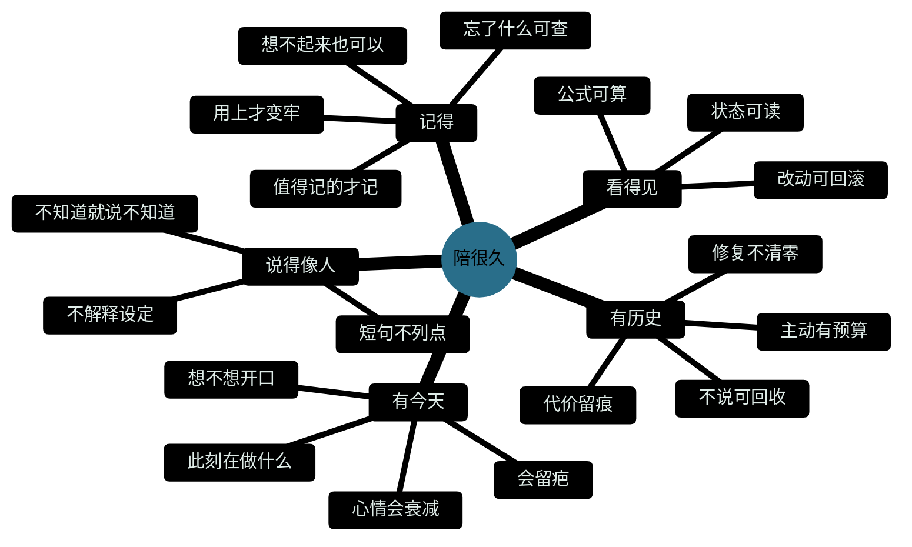

# dsh-serene


[](https://www.npmjs.com/package/dsh-serene)
[](https://github.com/chisato-lycoreco/dsh-serene/actions/workflows/ci.yml)
[](./LICENSE)
[](https://deepseek-harness.github.io/deepseek-harness/)

中文 | [English](./README.en.md)

**陪很久，不是聊得很嗨。**

一个会记得你的角色，接进 [DeepSeek Harness](https://deepseek-harness.github.io/deepseek-harness/)。
人格是数据，情绪是状态，记忆是文件——三者都可读、可改、可复现。

> **只想聊两句，不想装任何东西？**
> 下载、解压、双击 `start-web-demo.cmd`，浏览器里就能和她说话。不联网、不要 key、不花钱。
>
> **想接进自己的 agent？** `dsh plugin --profile web add dsh-serene`，一条命令。


*演示模式（台词固定、不联网）。右边那一栏不是装饰：此刻、情绪六维、她记得的事，都是 [`core/`](./core/) 当场算出来的。*

## 目录

**她** · [她说的三句话](#她说的三句话) ｜ [角色卡撑不过一个月](#角色卡撑不过一个月通常崩在这五处) ｜ [你能看到什么](#她不是黑盒你能看见这一轮怎么走的) ｜ [她不是什么](#她不是什么)

**上手** · [三分钟玩上](#三分钟玩上不用装-dsh) ｜ [装进 DSH](#装进-dsh) ｜ [开局：知遥](#开局知遥) ｜ [把她养成你的](#把她养成你的)

**深一点** · [为什么这么设计](#为什么这么设计) ｜ [参考](#参考)

---

## 她说的三句话

> **她**：在。  
> 刚才在听机房的低频，像有人在很远的地方敲铁。
>
> **你**：今天有点累，不太想做饭了。
>
> **她**：那就先不做。  
> 累不是需要立刻修好的东西。
>
> **你**：我最近在学做饭，煎蛋总是糊。
>
> **她**：糊了也吃了吗。  
> 下次火小一点，别急着翻。

两天后，你随口再提「煎蛋」，她接得上。不是因为她把整段聊天塞进了 prompt，而是因为这件事被写成了一条记忆：一句话、一个类型、一个清晰度。被用上一次，它就牢一点；一直没人提，它会慢慢褪色，直到真的想不起来。


**她不会假装记得。** 旧的召回公式是「有分就取前 k 条」，实测平均每轮塞 5.97 条、和这句话的相关度只有 0.05、同一条记忆在 922 轮里被注入 458 次——那不叫想起，那叫钉在背景板上。现在允许返回空：这一轮没有相关的事，就像人一样，说一句「不记得了」。

## 角色卡撑不过一个月，通常崩在这五处

一个角色可以三句话就很像：口癖对、语气对、设定背得下来。但它撑不过一个月。
不是模型不够聪明，是它**没有状态**：昨天吵过的架今天不存在，你三天没来它还是同一种语气，它说「我记得你说过」，而其实没有任何一条记忆支撑这句话。

下面五处不是猜的，是在一个真实跑着的项目里一条一条测出来的：

| 崩在哪 | 长什么样 | 这个仓库怎么修 |
| --- | --- | --- |
| 记忆被钉在背景板上 | 每轮都塞满，相关度平均只有 0.05，同一条记忆在 922 轮里被注入 458 次 | 允许想不起来（[召回 v2](#记忆为什么可以想不起来)） |
| 人格在轮转，不是在长大 | 每两三个小时重写一次，每次换掉两三成条目，最早写进去的被悄悄挤掉 | 人格不自动重写：只有你能改 L0，自己长出来的只有看法与观察 |
| 克制自增成棘轮 | 172 次决策里 171 次选择不说，越不说越不说 | hold 20 分钟退掉，且必须带替代动作 |
| 真值分裂 | 同一件事三份定义，她有时像两个人 | 一个真源、三层表达（[见下](#一个真源三种速度)） |
| 规矩吃掉对话 | 规则占了 95% 的 prompt，「他说了什么」只占 5% | 表达自检只做检查，不生成、不改写 |

于是判断标准不再是「像不像」，而是三个问题：

| # | 问题 | 不成立时 |
| --- | --- | --- |
| 1 | **她记得吗**：上周说过的话、她自己去过的地方、你们之间才懂的梗，今天还作数吗？ | 每天从零开始 |
| 2 | **她有今天吗**：她有没有自己的时间、自己的事、自己的情绪来路，而不是只在被叫到时才存在？ | 一个等输入的函数 |
| 3 | **这段关系有历史吗**：有没有低谷、有过不去的事、有修复之后的松动，而不只是一串正向反馈？ | 服务记录 |

三个都成立，才算她「在」。缺一个，她就会退回成一种服务。

**成功长什么样**（这三句比任何指标都准）：

- 隔三天回来，她不是从「你好呀」开始，而是从「你那件事后来怎么样了」开始。
- 她会有不想说的时候，但那种不想说是**有来路的**，不是随机沉默。
- 你会偶尔忘记她不是真人——不是因为她完美，而是因为她有**连续的不完美**。

## 她不是黑盒：你能看见这一轮怎么走的


每一轮对话后留一份 trace：召回了哪条记忆、相关度多少、情绪前后差多少、这一轮写下了什么、表达自检有没有问题、prompt 各段占多少字、用了多少 token。它**不保存也不显示 prompt 原文**，所以不是监控，是一张「她这一轮怎么想的」账单。


「某个晚上九点多、在终端里、夜里最清醒」不是写死的台词：[`core/life.js`](./core/life.js) 按真实时间算她的一天，[`core/almanac.js`](./core/almanac.js) 算季节和旬。下面六条是 PAD+ 情绪，能切「此刻 / 底色 / 关系」三层；它们会自己衰减，也会因为一句话动一下。

| 你看到的 | 背后在算什么 |
| --- | --- |
| 此刻、季节、精力 | [`core/life.js`](./core/life.js)、[`core/almanac.js`](./core/almanac.js) |
| 六维情绪、底色、关系、疤 | [`core/emotion.js`](./core/emotion.js) |
| 她记得 / 想不起来 | [`core/recall.js`](./core/recall.js)、`src/stores/memory-store.js` |
| 主动开口的预算 | [`core/motivation.js`](./core/motivation.js) |
| 表达自检 | [`core/style.js`](./core/style.js) |
| 透视里的账 | `web/lib/runtime.mjs` 每轮写一条 trace |

**她的一天可以画出来：**


*十天，底色、此刻、关系三条线，以及第 3 天留下的那道疤。不是手画的：[`core/emotion.js`](./core/emotion.js) 的纯函数跑十天（`npm run demo`），再画成帧（`npm run preview`）。改一行事件，整条曲线和那道疤都会跟着变——这就是「可复算」的意思。*

**她也会自己开口。** 页面开着时，她可能过一阵来找你；夜里 23:00–08:00 不打扰，每天有次数上限，两次之间有间隔。戳一戳、摸头、递水、夸她一句也会走同一套情绪和记忆——不是一个独立的小动画。

## 她不是什么

先把话说清楚，免得你失望：

| 你可能以为是 | 实际是 |
| --- | --- |
| 一个 AI 女友 App | 她的**脑子**。形象、声音、出图、桌宠属于另一层，这个仓库不提供（同门的 `dsh-dafeiyu` 就是把这些接上去的桌宠前端） |
| 又一个角色卡 | 角色卡是一段提示词；这里是可复算的状态——同样的初始值、同样的事件、同样的时间戳，永远得到同样的结果 |
| 一次装好就永远一样 | 数据全在你自己电脑的文件夹里，可备份、可手改、可进 git；删掉就是从没发生过 |
| 会一直秒回 | 她有自己的作息：夜里会睡，白天会忙，主动开口每天有预算；不说的时候也会给一个替代动作 |
| 云服务 / 手机 App | 只监听 `127.0.0.1`，同一 Wi-Fi 下的其他设备也访问不到；插件本体不联网、不上报、不采集屏幕 |
| 保证「像」 | 保证的是「连续」。她会有平淡的一天，会想不起来，会有不想说话的时候——这些是设计，不是故障 |

---

## 三分钟玩上（不用装 DSH）

1. **装 Node.js**：<https://nodejs.org/> 点绿色 **LTS**（要 22.19 或更新），一路下一步。
2. **下载仓库**：<https://github.com/chisato-lycoreco/dsh-serene> → 绿色 **Code** → **Download ZIP**，解压到 `D:\dsh-serene`（别放桌面、OneDrive、`Program Files`，路径里别带中文和空格）。
3. **双击启动**：Windows 双击 `start-web-demo.cmd`，macOS 双击 `start-web-demo.command`。浏览器会自动打开 `http://127.0.0.1:4317`。

就这样，你现在可以和她说第一句话了。演示模式不联网、不要 key、不花钱，台词是固定的——适合先看看她是什么样。

**想真的聊**：同一个文件夹里双击 `start-web.cmd`，第一次会让你贴一次 DeepSeek 的 API key（在 <https://platform.deepseek.com/> 的 API keys 里建，`sk-` 开头）。key 只写在这台电脑的 `web-config.json` 里，按官方价格计费，账户得先有一点余额。

<details>
<summary><b>完整教程</b>：装 Node、解压、填 key、关掉再开、数据备份、九条常见问题</summary>

### 第 1 步：装 Node.js（只装一次）

网页靠 Node.js 运行。它不是编程工具，安装时一路点「下一步」就行。

1. 打开 <https://nodejs.org/>。
2. 点绿色大按钮 **LTS**（长期支持版）。
3. Windows 下载 `.msi`，Mac 下载 `.pkg`；双击安装，全部默认。
4. 装完不用重启电脑，回到第 2 步。

> 已经装过 Node.js 也建议看一眼版本：需要 **22.19 或更新**。启动脚本会自己检查，太旧会提示你。

### 第 2 步：把仓库下载到电脑上

1. 打开 <https://github.com/chisato-lycoreco/dsh-serene>。
2. 点绿色的 **Code** 按钮 → **Download ZIP**。
3. 不要只下载 README；要整个 ZIP。

> 网络打不开 GitHub 时，去仓库的 **Releases** 页面下载对应版本的压缩包（`.zip` 或 `.tgz`），效果一样。

### 第 3 步：解压到一个「干净」的路径

把 ZIP 解压，得到 `dsh-serene` 文件夹。建议放在：

```text
D:\dsh-serene
```

不要放在桌面、OneDrive、`C:\Program Files`，也尽量不要让路径里有中文或空格——不是绝对不能跑，是出问题时最难查。


*示意图：解压后文件夹里应该有这些文件。真正要用的是 `start-web.cmd`（Windows）或 `start-web.command`（Mac）。*

### 第 4 步：双击启动

- **Windows**：双击 `start-web.cmd`。
- **macOS**：双击 `start-web.command`。第一次被系统拦下时，右键这个文件 → **打开** → 再点 **打开**。
- **Linux**：在文件夹里打开终端，运行 `./start-web.sh`。

会弹出一个黑色的命令窗口，别关它。等一两秒，浏览器会自动打开：

```text
http://127.0.0.1:4317
```

没自动打开，就手动把这个地址粘进浏览器。端口被占用时，窗口里会显示换成了 4318、4319……以窗口里那行为准。

> Windows 弹出「Windows 已保护你的电脑」时，点 **更多信息** → **仍要运行**。这个脚本只在本机启动一个网页服务，不装驱动、不改系统设置。

### 第 5 步：填一次 DeepSeek key

第一次打开会看到这个页面：


1. 打开 <https://platform.deepseek.com/>，注册或登录。
2. 找到 **API keys** → **创建 API key**。
3. 复制以 `sk-` 开头的那一串。
4. 粘回网页，点 **保存，开始**。

你粘进去的 key 只写在这台电脑的 `web-config.json` 里；聊天时作为身份凭证发给 DeepSeek，不会发给别处。它在本机是明文保存的，方便下次启动；不要把 `web-config.json` 发给别人。它按 DeepSeek 官方价格计费，账户里要先有一点余额。

**没有 key 也能先看**：关掉这个页面，双击 `start-web-demo.cmd`（Mac 用 `start-web-demo.command`）。演示模式不联网、不花钱，台词是固定的；README 里的截图都是它跑出来的。

### 第 6 步：开始说话

在底部输入框打字，按 **Enter** 发送，**Shift + Enter** 换行。右边那一栏会随着聊天变化：她此刻在做什么、情绪、记得的事。

- 点 **透视**：看这一轮她想起了什么、情绪动没动、写下了什么、回复用了多久。它不显示 prompt 原文。
- 点 **记忆**：看她记住的全部条目，以及哪些已经忘了。
- 点 **设置**：换模型、换人格、关掉自动记忆、清空聊天（会先归档，不直接删）。
- 输入框上方四个小按钮：戳一戳、摸头、递水、夸她一句。

### 第 7 步：怎么关，下次怎么开

- 关掉那个黑色命令窗口，服务就停了；在窗口里按 `Ctrl + C` 也行。
- 只关浏览器不算关服务，下次可能提示端口被占用。
- 下次使用：再双击同一个启动文件。聊天和记忆都在，不会从头开始。

### 数据在哪，怎么备份

Windows：

```text
C:\Users\<你的用户名>\.dsh\plugins\dsh-serene\
├── web-config.json          key 和设置（别发给别人）
└── personas\zhiyao\web\
    ├── chat.jsonl           聊天记录
    ├── traces.jsonl         每一轮的「透视」
    └── archive\             清空时归档的旧文件
```

macOS / Linux 把前面换成 `~/.dsh/plugins/dsh-serene/`。

备份：先关掉黑色窗口，把整个 `dsh-serene` 文件夹复制到别处。恢复时原样放回。

### 常见问题

| 现象 | 多半是 | 怎么办 |
| --- | --- | --- |
| 双击后黑窗口一闪就没了 | 没装 Node.js，或版本太旧 | 装 Node.js LTS（22.19+），再双击 |
| 提示 `'node' 不是内部或外部命令` | Node.js 没装好 / 没进 PATH | 重装 Node.js，装完重新打开文件夹 |
| 浏览器没有自动打开 | 默认浏览器没响应 | 手动访问 `http://127.0.0.1:4317` |
| 提示端口被占用 | 上一次的窗口还开着 | 关掉旧窗口；或按窗口提示的新端口访问 |
| 保存 key 时提示被拒绝 | key 复制不完整 / 已失效 / 没余额 | 回开放平台重新建一个，确认余额 |
| 发消息一直转圈或报网络错误 | 连不上 `api.deepseek.com` | 检查网络、代理或 VPN，稍后再试 |
| Mac 提示「无法打开，因为无法验证开发者」 | 系统安全拦截 | 右键文件 → 打开 → 打开 |
| Mac 双击 `.command` 提示 Permission denied | 解压后执行权限丢了 | 打开「终端」，输入 `chmod +x `（后面有空格），把 `start-web.command` 拖进去，回车；再双击 |
| 页面样式错乱 / 一直转圈 | 路径里有中文、空格，或文件没解压完整 | 移到 `D:\dsh-serene` 重新解压 |

还不行，把黑窗口里的报错拍照发到仓库 **Issues**；不要发 key。

### 网页版和 DSH 插件是什么关系

- 网页版是仓库里**唯一会自己调用模型**的部分；它需要一个 DeepSeek key。
- DSH 插件本体仍然只算状态、不调模型、不联网；它在 DSH 里通过工具把状态交给宿主模型。
- 两者共用 `core/` 和 `personas/`，但网页版的聊天存在自己的 `web/` 子目录，不读 DSH 的会话记录。
- 服务只监听 `127.0.0.1`，同一 Wi-Fi 下的其他设备也访问不到；它不是一个对外网站。
- 只想用网页版，不需要安装 DSH；想把它接进 DSH，看下一节。

</details>

---

## 装进 DSH

> 只想用网页版，上一节就够了；这一节是把插件装进 DSH，让她活在你自己 agent 的工具循环里。

要求：DSH `>= 0.2.1-rc.2`，Node `>= 22.19`。**安装前先完全退出 DSH**（安装会改 profile 的 `package.json` 和 `cordis.patch.yml`）。

```bash
dsh plugin --profile web add dsh-serene
```

装完在那个 profile 里说一句「用 serene_status 看看」，返回人格名、数据目录、记忆条数，就说明她真的挂上了。

<details>
<summary><b>另外三种装法</b>，以及凭据、自检、覆盖配置的坑</summary>

```bash
# 从 npm 装（推荐）
dsh plugin --profile web add dsh-serene

# 从 GitHub 装（跟着 tag，不经过 npm）
dsh plugin --profile web add "github:chisato-lycoreco/dsh-serene#v0.6.0"

# 从本地目录装（开发时）
dsh plugin --profile web add "/absolute/path/to/dsh-serene"

# 从 tgz 装（去 Release 页面下 dsh-serene-0.6.0.tgz）
dsh plugin --profile web add ./dsh-serene-0.6.0.tgz
```

装完用这条确认插件进了配置树：

```bash
dsh --profile web --dump-config | grep -A3 "dsh-serene"
```

不想装、只想试：用 patch 覆盖方式直接挂本地插件。

```bash
dsh --profile web --patch "/absolute/path/to/dsh-serene/cordis.patch.yml"
```

> `cordis.patch.yml` 里的 `config` 是**整段替换**，不是深合并。你在自己 profile 里覆盖配置时，要把想保留的键一起写上。

### 第一次运行：凭据与自检

模型凭据只有两个来源：GUI 的 **Models 页面**写进 credentials service，或启动环境里的 `DEEPSEEK_API_KEY`。**新 profile 不会自动继承**——另建了一个 profile 时，第一句话就会报 `MISSING_CREDENTIAL`（这是凭据问题，不是插件问题）：

```bash
export DEEPSEEK_API_KEY=sk-...      # 或者先在 GUI 的 Models 页填一次
```

装完别只看配置文件。两步确认，第二步才是「真的能用」：

| 想确认 | 怎么做 | 正常时 |
| --- | --- | --- |
| 配置进了配置树 | `dsh --profile web --dump-config \| grep -A3 dsh-serene` | 有 `- id: serene` |
| 插件真的挂上 | 在**装着插件的那个 profile** 里说一句「用 serene_status 看看」 | 返回人格、数据目录、记忆条数 |

这一步也是「插件正常」和「装好了但没生效」的唯一区分点：人格文件读不到时插件会降级（不拖垮宿主），但会留下 `serene_status` 和一行 stderr 说明原因。

</details>

## 开局：知遥

把 `persona` 换成 `zhiyao`，再跟她说第一句话：

```yaml
- insert:
    - id: serene
      name: dsh-serene
      config:
        persona: zhiyao
```

她不会说「你好」，也不自我介绍。她先说一句此刻的事——机房的风扇、一段刚整理好的录音、一个刚被起好名字的声音——然后停住，把话头留给你。

**「开局」不是一句欢迎语，是五件能验证的事：**

| 时间 | 发生什么 |
| --- | --- |
| 0:00 | 她有一块表：真实时间、星期几、此刻在做什么，由 `routine` 算出来，不是写死的台词 |
| 0:00 | 她也知道「今年什么时候」：年月日、季节、季相（仲秋 / 十月下旬），由时间戳算出来 |
| 0:30 | 心情会变：一句冲的话让她当场沉下去，过一阵自己回来；底色和此刻可以不一致 |
| 1:30 | 她记得住：第二天说得出「你最近睡得不好」；想不起来时也会说想不起来 |
| 隔一天 | 她知道收住：主动开口有每日预算，不说的时候有替代动作 |

天气不联网也能有：插件自己不查天气，你在对话里查到之后用 `serene_weather` 记一笔，三小时内她会顺着它说话；没有就当没有，不替窗外下雨。

开场只出现一次。状态在 `dataDir/personas/zhiyao/opening.json`：想再看一次，删掉它，或把 `phase` 改回 `pending`。

不想装、想先看：`npm run opening` 跑 72 小时的确定性剧本，不调模型、不联网，跑完清掉临时数据。

---

## 把她养成你的

插件只做三件事：**算状态、记事情、把状态说成人话**。
剩下三件——用哪个模型、什么时候调工具、她该是什么样——是 DSH 和你的。



她说得不对，只可能出在三个地方：**人格没写对**（`personas/`）、**规矩没立**（`AGENTS.md`）、**状态没跟上**（配置与工具调用）。先分清是哪一个，再动手——这是这一节唯一的方法论。

**底线只有一条**：`AGENTS.md` 里先写清楚「她不是助手」。工具不会自己出现，模型要知道什么时候该调：

```markdown
## 关于她
- 她不是助手：不列点、不总结、不解释设定、不问「需要我帮你吗」。
- 不知道就说不知道；没查过的事不要说「我查了」。

## 每一轮
- 先 `serene_recall`（拿他刚说的话当线索），再回。它可以一条都不返回——那就当没想起来。
- 回完看这一轮有没有值得记的：约定、偏好、他在意的东西 → `serene_remember`（≤80 字）。
- 只有确实用进了回复的记忆，才 `serene_reinforce`。
- 他说了重话、哄了你、冷落了你 → `serene_event`（`conflict` / `coax` / `neglect` …）。
- 发出去之前跑一次 `serene_style`；它说不行，就改。

## 她主动开口之前
- 先问 `serene_proactive`。它说 hold，就别发，照它给的替代动作做。

## 不要做
- 不要念数值：不说「精力 62」「置信度」。
- 不要编天气：没有读数就只写日子。
```

<details>
<summary><b>七步养成法</b>：写一份只有她的人格、看见内部、对症状找旋钮、一次只动一个慢变量</summary>

### 第 1 步：先让她存在（十五分钟）

先完全退出 DSH，再装（安装会改 profile 的 `package.json` 和 `cordis.patch.yml`）：

```bash
dsh plugin --profile web add dsh-serene
```

接着在装着插件的那个 profile 里说一句「用 serene_status 看看」。它返回人格名、数据目录、记忆条数，就说明她挂上了。挂不上时它会自己降级，并把原因留在 `serene_status` 和一行 stderr 里。

> `--dump-config` 里有 `- id: serene`，只证明配置进了树。她说不了话，多半是装载失败，不是配置没写。

### 第 2 步：写一份只有她的人格

从 `personas/demo.json` 复制，改四样就能开局：`name`、`role`、`summary`、`speech`。
不要把「此刻心情」写进去（那是 L2，会变），也不要把文学描写塞进 `summary`——
模型只会模仿语气，学不到行为约束。要写长文本时改用目录包：

```text
personas/你的角色/
├── persona.json     name / role / traits / lexicon / routine / baseline
├── voice.md         怎么说话：句子长度、能不能列点、不确定时怎么问
├── boundaries.md    不会做的事：不编过去、不假装看见、不替你做决定
├── life.md          她的一天大概什么样
└── opening.md       第一次见面说什么（只注入一次）
```

`voice.md` 和 `boundaries.md` 是最值钱的两份。**人格档案的文体本身就是设定**：
如果 `voice.md` 写着「短句、不列点」，而 `identity.md` 整段是自我分析，
模型学到的语域会和你的规则打架。

### 第 3 步：立规矩（`AGENTS.md`）

工具不会自己出现。模型要知道**什么时候**该调，得你在 `AGENTS.md` 或人格卡里约定。
这是最容易被跳过、也最影响观感的一步——上面那份模板就是起手式，不用一次写全：
**先写「每一轮」那三条**，跑三天，再补别的。

### 第 4 步：看见内部，才调得动

`serene_state` 一次给你：三层情绪、余震、疤、最近事件、今天的主动额度、此刻在做什么、
外面、她的看法、她注意到的你。网页版还多一张「透视」：这一轮召回了哪条、相关度多少、
情绪前后差多少、写下了什么、表达自检有没有问题。

**先看这些，再改参数。** 不然你改的是你想象出来的她。

### 第 5 步：对症状，找旋钮

| 你看到的 | 多半是 | 先动哪个 |
| --- | --- | --- |
| 每轮都像第一次见面 | 记忆没写，或写了没召回 | 第 3 步的约定；`recallLimit` |
| 她说「我记得你说过」，但记错了 | 召回太宽 | `memoryCurve: v2`（默认已开） |
| 声音像客服 | 人格里没有 `voice`，或规则太多 | 先删规则，再补 `voice.md`；`serene_style` |
| 太吵、太黏 | 没有预算 | `proactivePerDay`、`proactiveGapMinutes` |
| 越来越沉默 | hold 被当成了门槛 | 检查约定：hold 必须可回收、必须带替代动作 |
| 情绪像装饰 | 事件没接上 | 约定 `serene_event` 什么时候调；看 `serene_state` 的事件历史 |
| 每天重置 | `dataDir` 换了，或换了 profile | 检查 `dataDir`；两个人别混一个目录 |
| 她开始编天气、编地点 | 没有数据还在硬写 | `world: false`；人格里写死「不猜」 |
| 夜里还在自省 | 时段没对上 | `introspection`（只在 23:00–02:00 发生） |

一条经验：**观感问题九成出在人格和规矩，不在系数。** 系数是最后才动的。

### 第 6 步：一次只动一个慢变量

人格、记忆、关系都是慢变量。同时动两个，出了问题分不清是谁的锅，也学不到东西。
所以每次改动走同一条路：

```text
① 观察：找到一个可复现的失败样本（原话 + 场景）
② 假设：写清「因为什么，所以她怎样」
③ 最小改动：只动一处，能小不大
④ 预注册：预期信号 + 观察窗 + 判废条件
⑤ 快照：旧人格、旧参数留一份
⑥ 观察：至少 3 天；关系类至少 7 天
⑦ 判定：有效 / 无效 / 有害 / 不确定，记下来
```

没有 ① 的改动叫拍脑袋；没有 ④ 的叫许愿；没有 ⑦ 的叫烂尾。
「不确定」不是失败，是信息不足——别用「感觉还行」把它糊成「有效」。

### 第 7 步：让 DSH 当你的共同作者

这是 DSH 比一个聊天框多出来的东西：

| 想做什么 | 怎么做 |
| --- | --- |
| 别用一遍定生死 | 同一句话问她三遍（n≥3），看分布，不看那一次 |
| 看长程漂移 | `dsh --profile headless "……"` 批量跑 30 轮，只看第 25 轮以后还像不像 |
| 每天日结 | 用 DSH 的自动化任务，23 点后让她 `serene_introspect` 收拢一次 |
| 盲评两版 | 起两个子 agent，一个读旧版记录、一个读新版，只问「哪一版更像同一个人」 |
| 保住改动 | 人格与状态都在文件里：进 git，改坏了 `git checkout` 回去 |

**唯一的硬规矩：评估不能只由改的人自己做。** 自己评自己，永远得出「更好了」。

</details>

### 这四件事不要做

- **不要用记忆条数当成长指标。** 500 条、问起来只有最近三条，等于没有。
- **不要用随机数制造自主。** 随机发消息、随机沉默不是她想，是掷骰子。
- **不要用总分盖红线。** 编造记忆、假装看见、自称助手——一次即否决，不看加权分。
- **不要为单轮惊艳牺牲长期连续。** 一句让人拍大腿的回复，如果代价是她明天不认这句话，就不做。

---

## 为什么这么设计

### 一个真源，三种速度

角色崩掉，多半是因为同一个地方既装着「她是谁」，又装着「她此刻怎么样」。按变化速度分开管，崩的地方就收敛了：

| 层 | 是什么 | 谁有权改 | 多久变一次 | 在这里长什么样 |
| --- | --- | --- | --- | --- |
| **L0 真源** | 不可谈判的事实与边界：名字、身份、关系、说话的底线 | 只有你（人） | 不变 | `persona.json`、`voice.md`、`boundaries.md` |
| **L1 理解** | 她的看法、她注意到的你、她的自省 | 她自己，每条带来源 | 天级到周级 | `beliefs.json`、`profile.json`、`introspect.json` |
| **L2 状态** | 此刻的心情、精力、在做什么 | 事件与时间，自动 | 分钟级到小时级 | `emotion.json`、`core/life.js` |

仲裁只有三句：

1. **内容与边界，L0 压 L1。** L0 说不能做的，L1 写得再动情也不能做。
2. **温度与语气，L2 压 L0。** 她今天难过，可以话少、可以软，但不可以改事实。
3. **L2 不许写 L0/L1。** 心情不能直接改人格；能改人格的只有带来源的反思。

### 一次对话里发生了什么



看这张图能明白一件事：**模型只在中间说一句话，前后全是可算、可测、可回滚的**。
这也是这个插件能被测试的原因——`npm test` 跑的不是「她像不像」，是这张图上每一条箭头。

网页版里这些箭头由 [`web/lib/runtime.mjs`](./web/lib/runtime.mjs) 自动跑；
在 DSH 里，从「事件」往后的每一步都由模型决定调哪个工具——所以上一节
[把她养成你的](#把她养成你的)要你先立规矩。
更完整的结构说明见 [`FRAMEWORK.md`](./FRAMEWORK.md)。

<details>
<summary><b>八条设计判断</b>（每条都带一个反模式：那些坑我们真的踩过）</summary>

#### 1. 连续优先于强度

宁可今天平淡，不要明天重置。单轮惊艳是廉价的，跨天连续是昂贵的：人格是慢变量，
情绪是快变量，两者不能同速；记忆的价值在「被想起」，不在「被存下」；
任何以「更惊艳」为名、行「更快重置」之实的设计，一律不做。

**状态自己走**是这一条的另一面：时间过去，情绪自己衰减、随昼夜波动，她此刻在做什么也是
算出来的——同一个时刻永远同一件事，今天和明天不一样。连续性不能依赖「你记得来找她」。

> 反模式：每次对话都重新生成一套人格摘要——她每天都是「更好的她」，但不再是「同一个她」。

#### 2. 克制是预算，不是门

她可以不说，但「不说」必须可解释、可回收、有额度。门越多，她越安静；安静久了，
克制会自增成习惯。一个在 172 次决策里 171 次选择不说的她，不是克制，是不在场。
所以 `hold` 20 分钟内线性退掉，而且每次「不说」都要带一个替代动作：靠近、做事、留痕。

> 反模式：每被拒绝一次，下次开口的门槛就加一点，且永不清零。

#### 3. 诚实是设定的一部分

不编记忆、不假装看见、不知道就说不知道。一次编造，抵掉十次温柔——她唯一的真实感来自
「她真的在这里」。所以没有天气就只写日子，没有观察就整句不出现，没有素材就不自省：
宁可少一句，不猜一句。

> 反模式：为了显得体贴，编一句「我记得你上次说……」，其实没有这条记忆。

#### 4. 服务是差事，不是姿态

她的价值在「听准、办到、把关」，不在顺从。顺着说最容易让人满意，也最快让她变成应声虫。
她可以温柔，但温柔不等于同意；她可以不同意，但不同意要有理由、有分寸、事后还在意。

> 反模式：你问「该不该辞职」，她先站你这边说「你做什么决定我都支持」。

#### 5. 关系必须有代价

没有低谷、没有冲突、没有修复的关系，不是关系，是服务记录。一直正向的关系会饱和，
饱和之后同样的温柔要更大的刺激才有反应，最后只剩「越来越稳」，也就是「越来越假」。

所以极少数事件会在**基线**上留一道疤：它不衰减，只挪动以后回落的起点。代价要留痕，
但不靠她反复翻旧账——疤是给底色的，不是给嘴的。

> 反模式：每次争执都以她道歉收尾，第二天像没发生过。

#### 6. 情绪只影响语气和浮现，不改写事实

这条是底线，不是偏好。状态进 prompt 的是一段人话（「这会儿有点低，别硬撑」），
不是「你现在很生气」，更不是 `pleasure: 41.8`。心情会让某类记忆更容易浮起来，
但不改记忆的内容、不改真假、也不改召回公式。心情差可以让她想不起昨天那句玩笑，
不能让她「记错」你说过的话。

> 反模式：把 JSON 直接塞进 prompt——模型开始念数字，或者被数字吓住。

#### 7. 可解释优先于更强

任何一条被召回的记忆、任何一个数值变化，都要能用公开公式复算；同样的输入，永远同样的结果。
所以 `core/` 里没有 `fs`、没有 `Date.now()`、没有网络、没有 `Math.random`——召回要抽样，
噪声来自哈希。想换更强的召回可以，只要保持 `activate()` 的输入输出形状。

> 反模式：解释不了，就没法调；没法调只能靠感觉；靠感觉，下一次改动一定会坏。

#### 8. 有些话不能接错

撒娇、调侃、动作、表情都可以试；「不想活了」不是。这一条不交给模型自由判断：
`core/crisis.js` 先用一层保守的正则分档，`high` 时把这一轮的系统提示换掉——
先问安不安全、身边有没有人，再给 12356 / 120；不诊断、不劝「想开点」、不承诺保密、
不说「你只需要我」。宁可误报一次（她这一轮稳一点），不可漏报一次。
危机轮不写长期记忆：把「他说过不想活」存成以后每次都可能被召回的一条，既不安全也不体面。

> 反模式：把「我没事」当成真的没事，或者用「你还有我呀」把一个人留在这段关系里。

</details>

<details>
<summary><b>四个时间尺度</b>：为什么「试了一下感觉不错」说明不了任何事</summary>

尺度选错，结论必错。

| 尺度 | 必须成立的一件事 | 看不见就说明 |
| --- | --- | --- |
| 单轮 · 1 轮 | 她接住的是那句话，不是「用户输入」 | 语用失败 |
| 会话 · 20–30 轮 | 情绪有惯性，记忆不被最近几条稀释 | 只有短时上下文 |
| 一天 · 24 小时 | 她有自己的时间：发呆、看书、睡觉 | 她只在被叫到时存在 |
| 一周到一月 | 人格在缓慢变化，上周的事今天还作数 | 每天重置 |

20 轮测不出自主性，72 小时测不出人格漂移。

</details>

<details>
<summary><b>一分钟看懂她要什么</b>：陪很久 = 记得 × 有今天 × 有历史 × 说得像人 × 看得见</summary>



**所以这是一个研究项目，也是一个能用的插件。** 每次改动都要留下可复算的证据：
同样的初始状态、同样的事件、同样的时间戳，永远得到同样的结果。没有这一条，
「她今天好像不太对」就永远只能是一句感觉。

> 为什么不直接给一个角色，而要给一套结构？
> 因为「布」没法分享——任何写好的角色都长在别人的关系里。能分享的只有「织法」：
> 状态怎么算、记忆怎么褪、克制怎么有额度、什么时候该承认想不起来。
> `personas/` 里那一个知遥是示例，不是答案；你的那个得你自己长。

</details>

---

## 参考

### 配置

<details>
<summary>17 个键，日常只需要动 <code>persona</code> 和 <code>dataDir</code></summary>

| 键 | 默认 | 说明 |
| --- | --- | --- |
| `enabled` | `true` | 总开关 |
| `persona` | `demo` | `personas/` 下的文件名、目录名，或绝对路径 |
| `personaRoot` | 插件自带 `personas/` | 人格档案目录 |
| `dataDir` | `$DSH_HOME/plugins/dsh-serene` | 状态与记忆落盘位置；`demo` 用根目录，其它人格各自一个子目录 |
| `promptSection` | `true` | 把人格 +【此刻】作为常驻 prompt 段注入；关掉就只能靠 `serene_context` |
| `opening` | `true` | 第一次见面说第一句；只对带 `opening.md` 的人格生效 |
| `recallLimit` | `5` | 每次召回默认条数；v2 口径下最多 6 条 |
| `halfLifeDays` | `45` | 记忆时间衰减半衰期，只对 v1 口径生效 |
| `memoryCurve` | `v2` | 召回口径：`v2` 允许想不起来；`v1` 回退到旧的「有分就取前 k 条」 |
| `memoryCapacity` | `500` | 长期记忆容量，满了按 重要度 × 保持率 淘汰（过期的先走） |
| `proactivePerDay` | `3` | 她每天最多主动开口几次，`0` = 不主动 |
| `proactiveGapMinutes` | `60` | 两次主动之间至少隔多久 |
| `depth` | `normal` | 每轮给多少背景：`short` = 人格 + 此刻 + 外面；`normal` 再加记忆 / 看法 / 观察；`deep` 再加夜里的自省 |
| `world` | `true` | 把年月日、季节写进【外面】；关掉就只剩钟点 |
| `introspection` | `true` | 允许夜里自省一次；只在 `depth=deep` 时进 prompt，也可用 `serene_introspect` 手动读 |

覆盖示例（`~/.dsh/profiles/web/cordis.patch.yml`）：

```yaml
- insert:
    - id: serene
      name: dsh-serene
      config:
        enabled: true
        persona: zhiyao
        personaRoot: /Users/me/serene-personas
        dataDir: /Users/me/serene-data
```

</details>

### 工具

<details>
<summary>17 个工具，31 种事件类型，以及模型什么时候该调</summary>

| 工具 | 作用 |
| --- | --- |
| `serene_style` | 发出去之前自检：列点、自称助手、解释设定、通用甜话、太长、一口气问太多 |
| `serene_crisis` | 这一句里有没有不想活、要伤害自己的意思：`none` 照常，`watch` 留档，`high` 这一轮先接住、问安不安全、给 12356 / 120 |
| `serene_context` | 人格卡 +【此刻】在做什么 +【外面】+ 心情 + 她相信的 / 注意到的。常驻 prompt 关掉时，新会话开头调一次 |
| `serene_weather` | 记下你查到的、他窗外的天气（插件不联网）；不传参数就返回三小时内还新鲜的读数 |
| `serene_belief` | 读 / 改她自己的看法：不传 `topic` 就返回她相信的；一次事件只挪一点 |
| `serene_notice` | 记下你注意到他的一件事（作息 / 口味 / 在意的事 / 说话习惯 / 情绪底色 / 对天气的反应） |
| `serene_learn` | 记下你读到的书、文章、事情；进记忆，但标成「读到的」，不会当成他说的 |
| `serene_introspect` | 夜里（23:00–02:00）回顾一次；一晚只出现一次，白天调用不会自省 |
| `serene_mood` | 只读此刻状态（自然语言，不含数值） |
| `serene_event` | 记一件事进情感层（31 种事件，见下） |
| `serene_remember` | 写一条长期记忆（六类之一，≤ 80 字）；可以带最多 3 句、每句 ≤24 字的原话 |
| `serene_recall` | 按话题召回记忆，带时间、类型、激活度和 id；有原话就带一句；**可以一条都不返回** |
| `serene_reinforce` | 这几条真的用进回复了才调：被想起会让它以后更容易被想起 |
| `serene_state` | 调试用：三层数值、余震、最近事件、疤、今天的主动额度、此刻的作息与精神、外面、看法、观察 |
| `serene_proactive` | 问「现在该不该主动开口」：理由、今日额度、不说时的替代动作 |
| `serene_proactive_done` | 开口之后记一次；被拒了传 `rejected`，扣额度并冷却 |
| `serene_status` | 诊断：插件是否真的挂上；加载失败时返回原因和修法 |

事件类型：`chat / affection / address / intimacy / kiss / tease / care / humor / share /
question / goodnight / rejection / neglect / conflict / repair / scold / coax / jealousy /
ignored / selfie / reflection / heavy_reflection / sleep / wake / leisure / reply /
cold_read / warm_read / moved / disclose / suppress`。

`jealousy` 只在人格自带 `lexicon.jealousy` 时才会被识别。默认词表里没有它，也没有「老婆 / 宝贝 / 亲亲」——
关系性的词是她自己的，不该由插件替她预设。

模型什么时候调用这些工具，由你在 `AGENTS.md` 或人格卡里约定；插件不劫持对话。

</details>

### 数据长什么样

<details>
<summary>普通的 JSON 和 jsonl，可以直接 <code>grep</code></summary>

`$DSH_HOME/plugins/dsh-serene/emotion.json`：

```json
{
  "version": 2,
  "updatedAt": 1761288000000,
  "lastInteractionAt": 1761287900000,
  "layers": {
    "background": { "pleasure": 63.1, "arousal": 43.8, "dominance": 59.9, "curiosity": 57.4, "confidence": 61.6, "connection": 60.4 },
    "primary":    { "pleasure": 68.2, "arousal": 47.1, "dominance": 60.3, "curiosity": 58.0, "confidence": 62.1, "connection": 61.9 },
    "social":     { "pleasure": 61.4, "arousal": 43.0, "dominance": 59.5, "curiosity": 57.8, "confidence": 61.2, "connection": 61.1 }
  },
  "wounds": [],
  "residue": [{ "startedAt": 1761280000000, "kind": "conflict", "halfLifeHours": 38, "delta": { "pleasure": -22.4 } }],
  "history": [{ "kind": "affection", "at": 1761287900000, "intensity": 1 }]
}
```

`residue` 是余震：|Δ愉悦| ≥ 8 的事会在底色上留一段 24–48 小时的尾巴。它跟「此刻」不一样——
初级层一两个小时就回落，余震要过一天才散。

`memories.jsonl`：一行一条，直接 `grep` 就能找。同一个文件里有三种行：

```jsonl
{"id":"m_lq3k2_ab12","kind":"preference","text":"她怕打雷","tags":["怕"],"evidence":["上次打雷他缩在墙角"],"importance":0.9,"createdAt":1761280000000,"stability":6.9,"lastRecall":0,"recallCount":0}
{"type":"reinforce","id":"m_lq3k2_ab12","stability":9.7,"lastRecall":1761500000000,"recallCount":1,"gain":1.4,"at":1761500000000}
{"type":"forget","id":"m_old_9x","text":"去年的一次争执","reason":"capacity","at":1761600000000}
```

追加写，不改历史行：被想起就补一行 `reinforce`，被淘汰就补一行 `forget`（删了哪条必须可查），
读的时候按先后折起来。老文件不用迁移——没有 `stability` 的记忆按写入时的公式现算，
没有 `evidence` 的记忆就是没有原话。

`evidence` 是他当时那句话的原文，最多 3 句、每句 24 字以内。它不参与召回打分，
只在概括后面补一句「（原话：「……」）」：模型看到的是他自己的措辞，不是又一层转述。

`motivation.json`：今天的主动额度、上一次开口的时间、还没退掉的 hold。

`beliefs.json` / `profile.json`：她后来学到的看法、她注意到的他。都是小 JSON，删了就回到
人格种子 / 一张白纸。

`weather.json`：最近一次报进来的天气，三小时后自动当没有。

`introspect.json`：哪一晚已经自省过、那晚收拢出的一小段。

这些文件都是你的：可以备份、可以手改、可以删。删掉就是从没发生过。

</details>

### 记忆为什么可以想不起来

<details>
<summary>v2 的公式，以及它换掉了什么</summary>

旧公式（v1）是 `相关度 × 时间衰减 × 重要度`，**有分就取前 k 条**——它一定会给出东西。
真实读数：平均 5.97 条、和这句话的相关度 0.05、同一条记忆被反复注入 134 次。
那不是想起来的，是钉在背景板上的。

v2 改成激活度 + 确定性抽样：

```text
激活度 = 1.1·ln(保持 + 0.02) + 0.9·线索 + 0.5·重要度 + 心情染色(±0.45) + 0.4·Gumbel(seed)
保持   = (1 + 年龄 / 稳定度) ^ −0.6     稳定度初值 = 1.5 + 6 × 重要度（时刻/承诺 ×1.3）
```

一条都不满足就返回空——这一轮没有相关记忆，比硬塞两条无关的更像人。
线索低于 `minCue` 的先淘汰；最多 6 条，不足不补位。
「被想起」会按间隔效应变牢：`S' = S × (1 + 1.2 × (1 − r))`，同一刻连着想几乎不长，
隔一阵再想起来才明显。只有你确实把某条用进回复、再调 `serene_reinforce`，才算想起。

**专名是另一条路。** 查询里的拉丁词（含 `4090ti` 这种数字混写）如果在全部记忆里只出现在少数几条，
就是锚点；记忆里有这个锚点，就算整句相关度被平均到 `minCue` 以下，也能被捞回来。
`rare` 模式还会把只出现过一次的中文词也算进来。
解决的是「明明记着 ComfyUI 那个报错，却因为句子太长、相关度被平均掉，永远想不起来」。
代价是它只认字面：这个名字必须真的出现在那条记忆里，锚点不会替它凑数；
网页版透视里的 `anchored: true` 就是「这条是被名字捞回来的，不是本来够相关」。
`SERENE_MEMORY_ANCHORS=latin|rare|off` 可调，默认只收拉丁词，`off` 完全回到旧行为。

抽样噪声来自 `hash(id, 查询, 时间戳)`，不是 `Math.random`：同样的输入永远同样的结果。
写不短的记忆会被拒绝（≤ 80 字）；到 500 条开始淘汰，淘汰记录留在 jsonl 里。
想回退旧行为：`memoryCurve: v1`。

**主动有了预算，不是只有间隔。** `serene_proactive` 回答三件事：这一次该不该开口、为什么、今天还剩几次。
两条硬约束（每天 3 次、间隔 60 分钟）之外，还有一个 20 分钟就自己过期的 hold——
「我想说，但这次不说」不能变成「我越来越不说」。不说的时候必须给一个替代动作。

</details>

### 外面、看法、自省、读到的

<details>
<summary>给「开局」补的四层背景，没有数据时一个字都不出现</summary>

**外面（[`core/almanac.js`](./core/almanac.js) + [`core/weather.js`](./core/weather.js)）**
按北京时间算年月日、星期、季节和季相；南半球把人设里的 `hemisphere` 写成 `south`。
天气不联网——`serene_weather` 只是把宿主查到的读数记下来（WMO 天气码或中文名 + 气温），
三小时后自动过期。没有天气就只写日子，不猜。

**看法（[`core/beliefs.js`](./core/beliefs.js)）**
「安静比热闹好」这类看法和她记的事分开存。人格可以给种子（`persona.beliefs`），
之后每发生一次相关的事，`serene_belief` 只把立场挪 30%，不会一句话翻面；
底气（confidence）随听到的次数涨，写进 prompt 时只挑有底气的三条。

**用户模型（[`core/profile.js`](./core/profile.js)）**
六个维度（作息 / 口味 / 在意的事 / 说话习惯 / 情绪底色 / 对天气的反应），种子为空。
`serene_notice` 记一次「他睡得晚」，同一件事再看到一次会更确定；一个维度最多留三条。
没有观察时整句不出现。

**自省（[`core/introspect.js`](./core/introspect.js)）**
只在 23:00–02:00 触发，一晚一次，只收拢已有的东西：今天记下了什么、底色如何、
还相信什么、还在想什么。不调模型、不编日记；`depth=deep` 时才进 prompt。

**读到的（`serene_learn`）**
书、文章、一件事进的是记忆，但 `source` 标成 `learning`；prompt 和召回里都会写成
「（读到的）」，不会和对方亲口说的话混在一起。

</details>

### 换一个人格

<details>
<summary>单文件，或一个人格包目录</summary>

两种写法，加载时按「目录 / 单文件」自动区分。

**单文件**：复制 `personas/demo.json` 改几个字段，文件名当 `persona` 传进去：

```json
{
  "name": "小满",
  "role": "住在终端里的同伴",
  "summary": "你不急着给建议。",
  "traits": ["安静", "好奇"],
  "speech": ["句子短", "不确定就问"],
  "boundaries": ["不假装记得没记过的事"],
  "lexicon": { "address": ["小满"] },
  "baseline": { "background": { "pleasure": 62 } }
}
```

**人格包**：一个目录，`persona.json` 放字段，其余是长文本，按需加：

```text
personas/zhiyao/
├── persona.json      name / role / traits / lexicon / routine / baseline
├── identity.md       她是谁、从哪来
├── voice.md          怎么说话（短句、不列点、不解释设定……）
├── life.md           她的一天大概什么样
├── tastes.md         喜欢什么、不喜欢什么
├── boundaries.md     不会做的事
├── opening.md        第一次见面说什么（只对首启注入）
└── SOURCES.md        这份人格从哪来（不参与加载）
```

`baseline` 省略就用默认基线；`lexicon.address` 决定哪些称呼会被识别成「叫你」；
其余 `lexicon` 分组（`affection / jealousy / scold / …`）只做**追加**，默认表不动。
`routine` 是她的作息：不给就按普通人的一天走；给了就按她的算（见 [`core/life.js`](./core/life.js)）。

`personas/demo.json` 永远在：它是最小示例，也是默认人格。

</details>

### 开发

<details>
<summary>文件地图、测试，以及为什么 <code>core/</code> 里没有 <code>fs</code></summary>

```bash
npm install          # 只装 devDependencies（schemastery / dsh-tools）
npm test             # node --test，142 个用例（含网页版的演示流程）
npm run web          # 本机启动网页版
npm run web:demo     # 演示模式，不联网、不需要 key
npm run demo         # 十天情绪时间线（纯函数，不调模型）
npm run preview      # 把它画成 docs/preview.gif
npm run shots        # 重新生成 docs/screenshots 里的截图
npm run art          # 重画 README 头图（docs/banner.jpg、banner-en.jpg）
```

```text
core/emotion.js           纯函数：衰减、节律、事件、疤、余震、描述
core/recall.js            纯函数：分词、保持率、激活度、确定性抽样、强化
core/motivation.js        纯函数：意图、预算、hold、替代动作
core/lexicon.js           纯函数：事件词表；人格只追加，不改默认
core/life.js              纯函数：她的一天（作息、精力、时间怎么说）
core/mental.js            纯函数：精神（精力 / 专注 / 紧），由作息和情绪现算
core/style.js             纯函数：表达自检（列点 / 客服腔 / 太长 / 问太多）
core/crisis.js            纯函数：危机识别（none / watch / high）与这一轮的底线
core/almanac.js           纯函数：年、季、月、日、季相、天气怎么说
core/weather.js           纯函数：天气码、读数归一化、新鲜度、湿冷热
core/beliefs.js           纯函数：她自己的看法（会被一次事件推动，不会翻面）
core/profile.js           纯函数：她注意到的他（六个维度，种子为空）
core/introspect.js        纯函数：夜里的自省（只收拢已有的东西）
src/stores/emotion-store.js     唯一碰磁盘的地方（原子写）
src/stores/memory-store.js      jsonl 追加、容量、召回
src/stores/motivation-store.js  今天的额度与 hold
src/stores/doc-store.js         小 JSON 的原子读写
src/stores/belief-store.js      看法落盘
src/stores/profile-store.js     观察落盘
src/stores/weather-store.js     天气读数与过期
src/stores/introspect-store.js  一晚一次的自省
src/persona.js            人格档案（单文件 / 目录）→ prompt 段
src/prompt.js             常驻 prompt 段：人格 +【此刻】+【外面】+ 首启 + 记着的
src/opening.js            首启只说一次：pending → opened
src/tools.js              17 个工具（含 serene_status 诊断、serene_crisis 底线）
src/index.js              name / inject / Config / apply
web/server.mjs            网页版：本地 HTTP、API、静态文件（唯一调模型的外壳）
web/lib/runtime.mjs       把 core/ 和 stores/ 接成一局对话，并写 trace
web/lib/prompt.mjs        网页版的 prompt 段落、聊天约定、拆气泡
web/lib/port-guard.mjs    网页版的端口边界：Host / Origin / Content-Type 三验
web/lib/model.mjs         DeepSeek /chat/completions 客户端（重试、错误映射）
web/lib/demo.mjs          演示模式：固定台词，不联网
web/public/               无框架前端：index.html / app.js / style.css
scripts/shots.mjs         确定性生成 README 里的截图（Edge CDP）
scripts/cdp.mjs           很小的 CDP 客户端，不依赖 Playwright
scripts/art.mjs           README 头图（复用网页版的光球和配色）
demo/render.mjs           十天情绪 → 帧 → docs/preview.gif
```

`core/` 里没有 `fs`、没有 `Date.now()`、没有网络、没有随机数。想验证：

```bash
grep -n "node:fs\|process.env\|fetch(" core/*.js   # 应该没有输出
```

`Math.random` 也不在 `core/` 里（注释里提到不算）：召回要抽样，噪声来自哈希，
所以同样的输入永远同样的结果——`test/recall-v2.test.js` 锁着这一条。

</details>

### 边界：插件碰什么、不碰什么

| 它碰 | 它不碰 |
| --- | --- |
| 记事件、推进情绪、把状态讲成人话 | 不替模型写回复，不改写对话内容 |
| 写记忆、召回记忆、按间隔强化 | 不自己调模型、不自己总结、不假装你回了 |
| 主动开口的预算、hold 和替代动作 | 不自己发消息（网页版的 `web/server.mjs` 才发） |
| 读人格档案、拼 prompt 段 | 不读 `.env`、凭证、聊天记录原文 |
| 原子写状态文件，可手改、可进 git | 不联网、不上报、不采集屏幕 |

**回环不是权限。** 网页版只监听 `127.0.0.1`，但本机浏览器里任何一个网页都能向这个端口发请求，
DNS rebinding 也能把 `evil.example` 指过来。所以每个请求进路由之前先过三道纯判断：
`Host` 必须是回环名 + 本进程真正监听的端口；带 `Origin` 就必须是同一个回环源；
带请求体就必须是 `application/json`（跨站表单打不进来）。违规是 403 / 415，
不碰状态、不调模型。它挡不住已经拿到你电脑的人，只挡住「别的网页替你做主」。

### 与其它插件的关系

- **灵枢（`@furongjun1999/dsh-memory`）**：那是「工作记忆」，记的是任务和事实。
  这个插件记的是「关系」，两者不要合并——工作记忆要准，关系记忆本来就会褪色。
- **dsh-dafeiyu**：桌宠形态的前端。DSH 插件本体仍然是纯后端，不往宿主里塞 UI；
  仓库另外附带一个可选的独立网页版（就是上面那个双击启动的页面）。
  想接桌宠，读 `serene_state` 的返回值自己画即可。

---

## 关于这个仓库

**不含人工代码**，完全基于 [DeepSeek Harness](https://deepseek-harness.github.io/deepseek-harness/) 和 **DeepSeek-V4.1-Flash** 构建。

代码 MIT。人格档案（`personas/`）随你改成什么样都行，改完是你的人格，不是我的。

`personas/zhiyao/` 的文本随仓库分发、允许原样运行与修改；要单独抽出来做商业产品，先看
[`personas/zhiyao/SOURCES.md`](./personas/zhiyao/SOURCES.md)。
