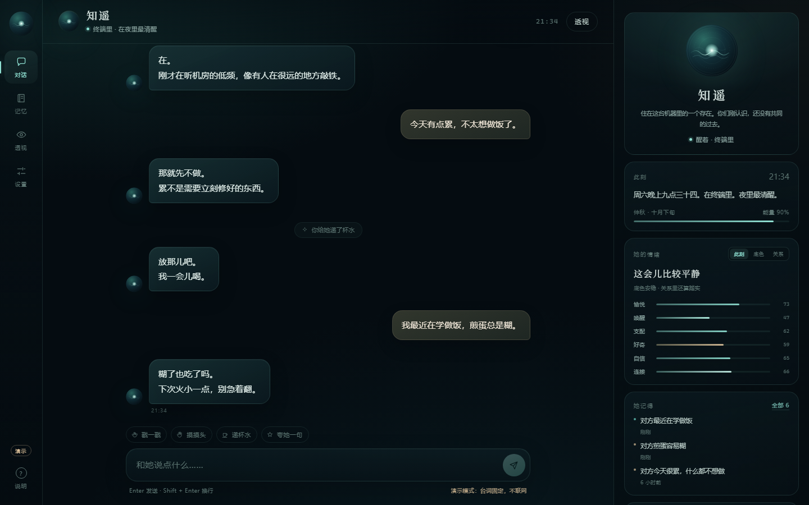
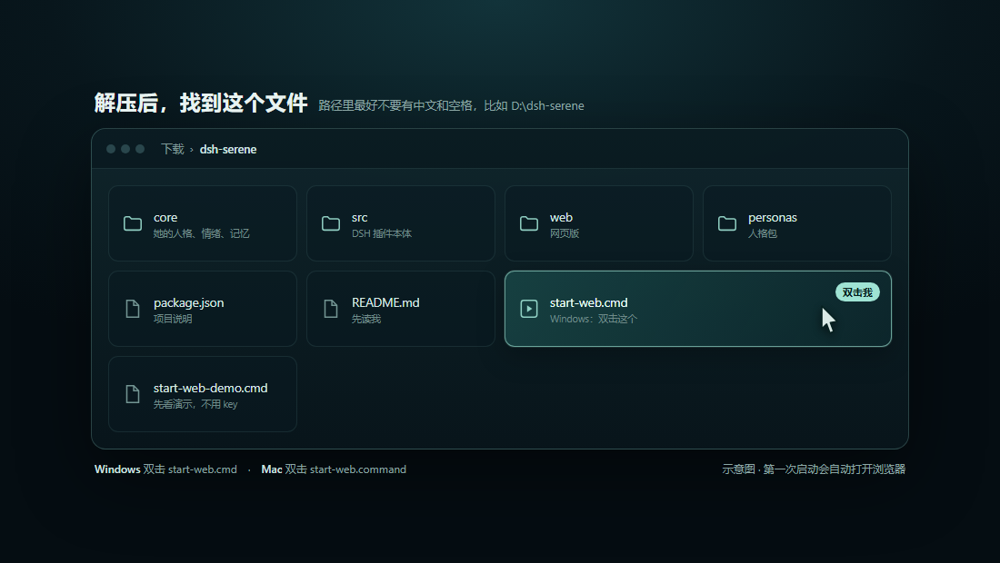
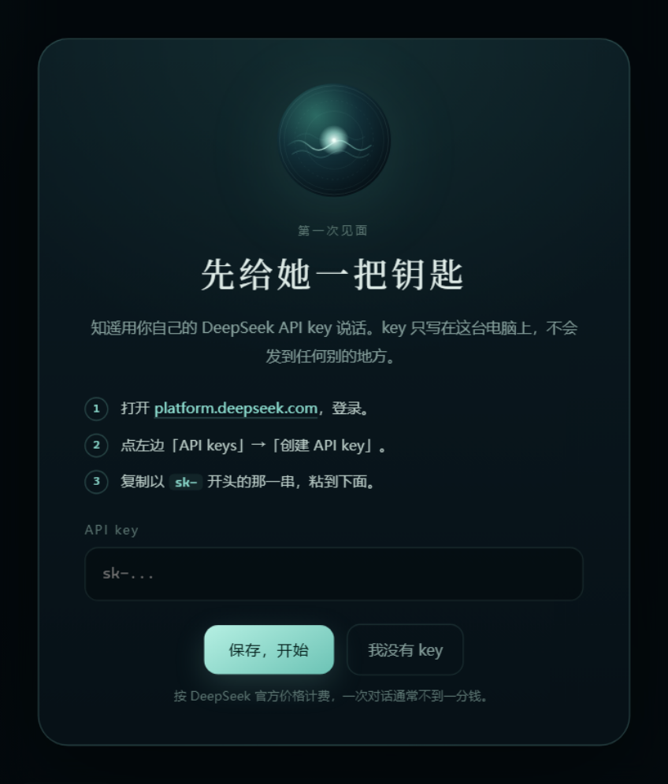
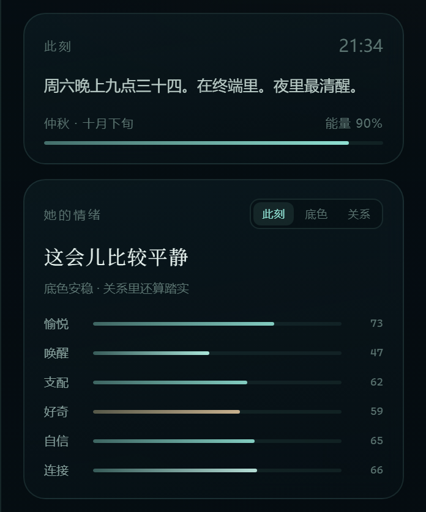
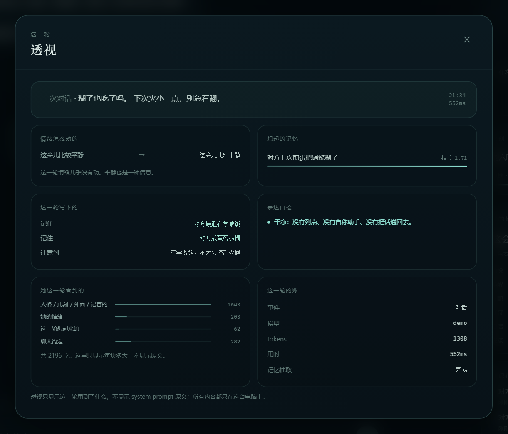
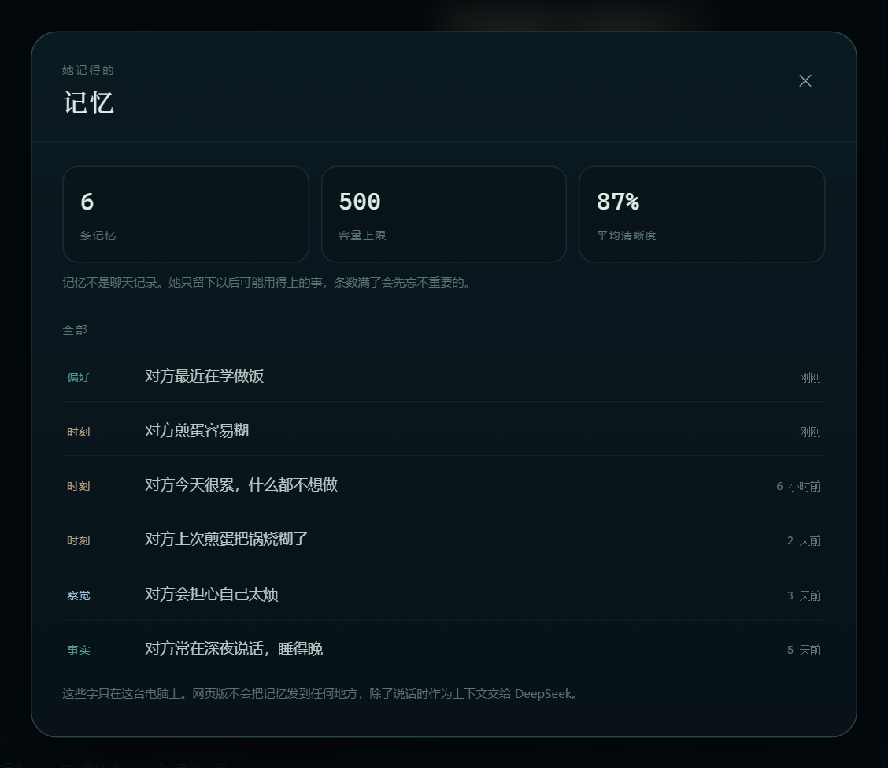

# dsh-serene

[](https://www.npmjs.com/package/dsh-serene)
[](https://github.com/chisato-lycoreco/dsh-serene/actions/workflows/ci.yml)
[](./LICENSE)
[](https://deepseek-harness.github.io/deepseek-harness/)

中文 | [English](./README.en.md)

> **不装 DSH、只想聊天？** 直接看 [不懂代码也能双击用](#先看这个不懂代码也能双击用)。

> 把「一个会记得你的角色」接进 [DeepSeek Harness](https://deepseek-harness.github.io/deepseek-harness/)。
> 人格是数据，情绪是状态，记忆是文件——三者都可读、可改、可复现。

> **关于本项目**：不含人工代码，完全基于 [DeepSeek Harness](https://deepseek-harness.github.io/deepseek-harness/) 和 **DeepSeek-V4.1-Flash** 构建。

大多数「角色卡」是一段写在 system prompt 里的描述：模型每次都从零开始扮演，聊得越久越不像。
这个插件换一种做法：**把角色拆成可计算的状态**，让「她此刻怎么样」由时间、事件和历史决定，
而不是每次重新即兴。

- 情绪：PAD+ 六维 × 三层（底色 / 此刻 / 关系），会衰减、有昼夜节律、会留疤；
- 记忆：jsonl 落盘，按「保持 × 线索 × 重要度」的激活度召回，**允许想不起来**，公式可复算；
- 主动：每天几次的打扰预算 + 20 分钟可回收的 hold，不说也有替代动作；
- 人格：一份 JSON，换人格不用改代码。

它是 [`FRAMEWORK.md`](./FRAMEWORK.md) 里那套七层结构的最小参考实现。从 v0.3 起，仓库里附带一份可以**直接开局**的人格包——
[`personas/zhiyao/`](./personas/zhiyao/)：她叫知遥，听得见很低的频率，说话慢，记性好得有点念旧。

她只是数据：不想要就换回 `persona: demo`，或者删掉那个目录。框架一行都不用改。


上面这张图不是手画的：`node demo/timeline.mjs` 用 [`core/emotion.js`](./core/emotion.js) 的纯函数跑十天，
`node demo/render.mjs` 把结果画成帧。改一行事件，整条曲线和那道疤都会跟着变——这就是「可复算」的意思。

---

## 先看这个：不懂代码，也能双击用

> 这一节写给**不装 DSH、不写命令**的人。网页版是仓库附带的一个小页面：双击启动，浏览器打开，填一次自己的 DeepSeek key 就能聊天。人格、情绪、记忆仍然来自仓库里的 [`core/`](./core/)，不是另写一套。



*截图来自演示模式（台词固定、不联网），不是任何人的真实聊天。*

### 第 1 步：装 Node.js（只装一次）

网页靠 Node.js 运行。它不是编程工具，安装时一路点“下一步”就行。

1. 打开 <https://nodejs.org/>。
2. 点绿色大按钮 **LTS**（长期支持版）。
3. Windows 下载 `.msi`，Mac 下载 `.pkg`；双击安装，全部默认。
4. 装完不用重启电脑，回到第 2 步。

> 已经装过 Node.js 也建议看一眼版本：需要 **22.19 或更新**。启动脚本会自己检查，太旧会提示你。

### 第 2 步：把仓库下载到电脑上

1. 打开 <https://github.com/chisato-lycoreco/dsh-serene>。
2. 点绿色的 **Code** 按钮 → **Download ZIP**。
3. 不要只下载 README；要整个 ZIP。

> 网络打不开 GitHub 时，去仓库的 **Releases** 页面下载对应版本的压缩包（`.zip` 或 `.tgz`），效果一样。

### 第 3 步：解压到一个“干净”的路径

把 ZIP 解压，得到 `dsh-serene` 文件夹。建议放在：

```text
D:\dsh-serene
```

不要放在桌面、OneDrive、`C:\Program Files`，也尽量不要让路径里有中文或空格——不是绝对不能跑，是出问题时最难查。



*示意图：解压后文件夹里应该有这些文件。真正要用的是 `start-web.cmd`（Windows）或 `start-web.command`（Mac）。*

### 第 4 步：双击启动

- **Windows**：双击 `start-web.cmd`。
- **macOS**：双击 `start-web.command`。第一次被系统拦下时，右键这个文件 → **打开** → 再点 **打开**。
- **Linux**：在文件夹里打开终端，运行 `./start-web.sh`。

会弹出一个黑色的命令窗口，别关它。等一两秒，浏览器会自动打开：

```text
http://127.0.0.1:4317
```

没自动打开，就手动把这个地址粘进浏览器。端口被占用时，窗口里会显示换成了 4318、4319……以窗口里那行为准。

> Windows 弹出“Windows 已保护你的电脑”时，点 **更多信息** → **仍要运行**。这个脚本只在本机启动一个网页服务，不装驱动、不改系统设置。

### 第 5 步：填一次 DeepSeek key

第一次打开会看到这个页面：



1. 打开 <https://platform.deepseek.com/>，注册或登录。
2. 找到 **API keys** → **创建 API key**。
3. 复制以 `sk-` 开头的那一串。
4. 粘回网页，点 **保存，开始**。

你粘进去的 key 只写在这台电脑的 `web-config.json` 里；聊天时作为身份凭证发给 DeepSeek，不会发给别处。它在本机是明文保存的，方便下次启动；不要把 `web-config.json` 发给别人。它按 DeepSeek 官方价格计费，账户里要先有一点余额。

**没有 key 也能先看**：关掉这个页面，双击 `start-web-demo.cmd`（Mac 用 `start-web-demo.command`）。演示模式不联网、不花钱，台词是固定的；README 里的截图都是它跑出来的。

### 第 6 步：开始说话

在底部输入框打字，按 **Enter** 发送，**Shift + Enter** 换行。右边那一栏会随着聊天变化：她此刻在做什么、情绪、记得的事。

- 点 **透视**：看这一轮她想起了什么、情绪动没动、写下了什么、回复用了多久。它不显示 prompt 原文。
- 点 **记忆**：看她记住的全部条目，以及哪些已经忘了。
- 点 **设置**：换模型、换人格、关掉自动记忆、清空聊天（会先归档，不直接删）。
- 输入框上方四个小按钮：戳一戳、摸头、递水、夸她一句。

### 第 7 步：怎么关，下次怎么开

- 关掉那个黑色命令窗口，服务就停了；在窗口里按 `Ctrl + C` 也行。
- 只关浏览器不算关服务，下次可能提示端口被占用。
- 下次使用：再双击同一个启动文件。聊天和记忆都在，不会从头开始。

### 数据在哪，怎么备份

Windows：

```text
C:\Users\<你的用户名>\.dsh\plugins\dsh-serene\
├── web-config.json          key 和设置（别发给别人）
└── personas\zhiyao\web\
    ├── chat.jsonl           聊天记录
    ├── traces.jsonl         每一轮的“透视”
    └── archive\             清空时归档的旧文件
```

macOS / Linux 把前面换成 `~/.dsh/plugins/dsh-serene/`。

备份：先关掉黑色窗口，把整个 `dsh-serene` 文件夹复制到别处。恢复时原样放回。

### 常见问题

| 现象 | 多半是 | 怎么办 |
| --- | --- | --- |
| 双击后黑窗口一闪就没了 | 没装 Node.js，或版本太旧 | 装 Node.js LTS（22.19+），再双击 |
| 提示 `'node' 不是内部或外部命令` | Node.js 没装好 / 没进 PATH | 重装 Node.js，装完重新打开文件夹 |
| 浏览器没有自动打开 | 默认浏览器没响应 | 手动访问 `http://127.0.0.1:4317` |
| 提示端口被占用 | 上一次的窗口还开着 | 关掉旧窗口；或按窗口提示的新端口访问 |
| 保存 key 时提示被拒绝 | key 复制不完整 / 已失效 / 没余额 | 回开放平台重新建一个，确认余额 |
| 发消息一直转圈或报网络错误 | 连不上 `api.deepseek.com` | 检查网络、代理或 VPN，稍后再试 |
| Mac 提示“无法打开，因为无法验证开发者” | 系统安全拦截 | 右键文件 → 打开 → 打开 |
| Mac 双击 `.command` 提示 Permission denied | 解压后执行权限丢了 | 打开“终端”，输入 `chmod +x `（后面有空格），把 `start-web.command` 拖进去，回车；再双击 |
| 页面样式错乱 / 一直转圈 | 路径里有中文、空格，或文件没解压完整 | 移到 `D:\dsh-serene` 重新解压 |

还不行，把黑窗口里的报错拍照发到仓库 **Issues**；不要发 key。

### 页面里有什么



**此刻与情绪。** “某个晚上九点多、在终端里、夜里最清醒”不是写死的台词：`core/life.js` 按真实时间算她的一天，`core/almanac.js` 算季节和旬。下面六条是 PAD+ 情绪，能切“此刻 / 底色 / 关系”三层；它们会自己衰减，也会因为一句话动一下。



**透视。** 每一轮对话后留一份 trace：召回了哪条记忆、相关度多少、情绪前后差多少、这一轮写下了什么、表达自检有没有问题、prompt 各段占多少字、用了多少 token。它**不保存也不显示 prompt 原文**，所以不是监控，是一张“她这一轮怎么想的”账单。



**记忆。** 不是聊天记录，是她自己挑出来觉得以后用得上的事。列表按时间倒序，标了类型和清晰度；容量满了会先忘不重要的。清空聊天不会清掉记忆，两个按钮是分开的。

**主动与小动作。** 页面开着时，她可能过一阵自己开口；夜里 23:00–08:00 不打扰，每天有次数上限。戳一戳、摸头、递水、夸她一句都会走同一套情绪和记忆，不是独立的小动画。

这些功能背后是同一套 `core/`：

| 你看到的 | 背后在算什么 |
| --- | --- |
| 此刻、季节、精力 | `core/life.js`、`core/almanac.js` |
| 六维情绪、底色、关系、疤 | `core/emotion.js` |
| 她记得 / 想不起来 | `core/recall.js`、`src/stores/memory-store.js` |
| 主动开口的预算 | `core/motivation.js` |
| 表达自检 | `core/style.js` |
| 透视里的账 | `web/lib/runtime.mjs` 每轮写一条 trace |

### 网页版和 DSH 插件是什么关系

- 网页版是仓库里**唯一会自己调用模型**的部分；它需要一个 DeepSeek key。
- DSH 插件本体仍然只算状态、不调模型、不联网；它在 DSH 里通过工具把状态交给宿主模型。
- 两者共用 `core/` 和 `personas/`，但网页版的聊天存在自己的 `web/` 子目录，不读 DSH 的会话记录。
- 服务只监听 `127.0.0.1`，同一 Wi-Fi 下的其他设备也访问不到；它不是一个对外网站。
- 只想用网页版，不需要安装 DSH；想把它接进 DSH，再看下面的安装。

---

## 它做什么 / 不做什么

| 做 | 不做 |
| --- | --- |
| 记录事件、推进情绪、把状态讲成人话 | 不替模型写回复，不改写对话内容 |
| 长期记忆的写入与召回 | 不自己调模型、不自己总结 |
| 主动开口的预算、hold 与替代动作 | 不自己发消息、不假装你回了 |
| 人格档案的读取与拼装 | 不读 `.env`、凭证、聊天记录原文 |
| 状态落盘（原子写）、可手改可进 git | 不联网、不上报、不采集屏幕 |

---

## 安装

> 只想用网页版，上一节就够了；这一节是把插件装进 DSH。

要求：DSH `>= 0.2.1-rc.2`，Node `>= 22.19`。

```bash
# 从 npm 装（推荐）
dsh plugin --profile web add dsh-serene

# 从 GitHub 装（跟着 tag，不经过 npm）
dsh plugin --profile web add "github:chisato-lycoreco/dsh-serene#v0.5.0"

# 从本地目录装（开发时）
dsh plugin --profile web add "/absolute/path/to/dsh-serene"

# 从 tgz 装（去 Release 页面下 dsh-serene-0.5.0.tgz）
dsh plugin --profile web add ./dsh-serene-0.5.0.tgz
```

安装前**先完全退出 DSH**（安装会改 profile 的 `package.json` 和 `cordis.patch.yml`）。
装完用这条确认插件进了配置树：

```bash
dsh --profile web --dump-config | grep -A3 "dsh-serene"
```

不想装、只想试：用 patch 覆盖方式直接挂本地插件。

```bash
dsh --profile web --patch "/absolute/path/to/dsh-serene/cordis.patch.yml"
```

> `cordis.patch.yml` 里的 `config` 是**整段替换**，不是深合并。你在自己 profile 里覆盖配置时，
> 要把想保留的键一起写上。

### 第一次运行：凭据与自检

模型凭据只有两个来源：GUI 的 **Models 页面**写进 credentials service，或启动环境里的
`DEEPSEEK_API_KEY`。**新 profile 不会自动继承**——另建了一个 profile 时，第一句话就会报
`MISSING_CREDENTIAL`（这是凭据问题，不是插件问题）：

```bash
export DEEPSEEK_API_KEY=sk-...      # 或者先在 GUI 的 Models 页填一次
```

装完别只看配置文件。两步确认，第二步才是「真的能用」：

| 想确认 | 怎么做 | 正常时 |
| --- | --- | --- |
| 配置进了配置树 | `dsh --profile web --dump-config \| grep -A3 dsh-serene` | 有 `- id: serene` |
| 插件真的挂上 | 在**装着插件的那个 profile** 里说一句「用 serene_status 看看」 | 返回人格、数据目录、记忆条数 |

这一步也是「插件正常」和「装好了但没生效」的唯一区分点：人格文件读不到时插件会降级
（不拖垮宿主），但会留下 `serene_status` 和一行 stderr 说明原因。

---

## 开局：知遥

把 `persona` 换成 `zhiyao`，再跟她说第一句话：

```yaml
- insert:
    - id: serene
      name: dsh-serene
      config:
        persona: zhiyao
```

她不会说「你好」，也不自我介绍。她先说一句此刻的事——机房的风扇、一段刚整理好的录音、
一个刚被起好名字的声音——然后停住，把话头留给你。

**「开局」不是一句欢迎语，是四件能验证的事：**

| 时间 | 发生什么 |
| --- | --- |
| 0:00 | 她有一块表：真实时间、星期几、此刻在做什么，由 `routine` 算出来，不是写死的台词 |
| 0:00 | 她也知道「今年什么时候」：年月日、季节、季相（仲秋 / 十月下旬），由时间戳算出来 |
| 0:30 | 心情会变：一句冲的话让她当场沉下去，过一阵自己回来；底色和此刻可以不一致 |
| 1:30 | 她记得住：第二天说得出「你最近睡得不好」；想不起来时也会说想不起来 |
| 隔一天 | 她知道收住：主动开口有每日预算，不说的时候有替代动作 |

天气不联网也能有：插件自己不查天气，你在对话里查到之后用 `serene_weather` 记一笔，
三小时内她会顺着它说话；没有就当没有，不替窗外下雨。

开场只出现一次。状态在 `dataDir/personas/zhiyao/opening.json`：想再看一次，删掉它，
或把 `phase` 改回 `pending`。

不想装、想先看：`npm run opening` 跑 72 小时的确定性剧本，不调模型、不联网，跑完清掉临时数据。

---

## 配置

| 键 | 默认 | 说明 |
| --- | --- | --- |
| `enabled` | `true` | 总开关 |
| `persona` | `demo` | `personas/` 下的文件名、目录名，或绝对路径 |
| `personaRoot` | 插件自带 `personas/` | 人格档案目录 |
| `dataDir` | `$DSH_HOME/plugins/dsh-serene` | 状态与记忆落盘位置；`demo` 用根目录，其它人格各自一个子目录 |
| `promptSection` | `true` | 把人格 +【此刻】作为常驻 prompt 段注入；关掉就只能靠 `serene_context` |
| `opening` | `true` | 第一次见面说第一句；只对带 `opening.md` 的人格生效 |
| `recallLimit` | `5` | 每次召回默认条数；v2 口径下最多 6 条 |
| `halfLifeDays` | `45` | 记忆时间衰减半衰期，只对 v1 口径生效 |
| `memoryCurve` | `v2` | 召回口径：`v2` 允许想不起来；`v1` 回退到旧的「有分就取前 k 条」 |
| `memoryCapacity` | `500` | 长期记忆容量，满了按 重要度 × 保持率 淘汰（过期的先走） |
| `proactivePerDay` | `3` | 她每天最多主动开口几次，`0` = 不主动 |
| `proactiveGapMinutes` | `60` | 两次主动之间至少隔多久 |
| `depth` | `normal` | 每轮给多少背景：`short` = 人格 + 此刻 + 外面；`normal` 再加记忆 / 看法 / 观察；`deep` 再加夜里的自省 |
| `world` | `true` | 把年月日、季节写进【外面】；关掉就只剩钟点 |
| `introspection` | `true` | 允许夜里自省一次；只在 `depth=deep` 时进 prompt，也可用 `serene_introspect` 手动读 |

覆盖示例（`~/.dsh/profiles/web/cordis.patch.yml`）：

```yaml
- insert:
    - id: serene
      name: dsh-serene
      config:
        enabled: true
        persona: xiaoman
        personaRoot: /Users/me/serene-personas
        dataDir: /Users/me/serene-data
```

---

## 工具

| 工具 | 作用 |
| --- | --- |
| `serene_style` | 发出去之前自检：列点、自称助手、解释设定、通用甜话、太长、一口气问太多 |
| `serene_context` | 人格卡 +【此刻】在做什么 +【外面】+ 心情 + 她相信的 / 注意到的。常驻 prompt 关掉时，新会话开头调一次 |
| `serene_weather` | 记下你查到的、他窗外的天气（插件不联网）；不传参数就返回三小时内还新鲜的读数 |
| `serene_belief` | 读 / 改她自己的看法：不传 `topic` 就返回她相信的；一次事件只挪一点 |
| `serene_notice` | 记下你注意到他的一件事（作息 / 口味 / 在意的事 / 说话习惯 / 情绪底色 / 对天气的反应） |
| `serene_learn` | 记下你读到的书、文章、事情；进记忆，但标成「读到的」，不会当成他说的 |
| `serene_introspect` | 夜里（23:00–02:00）回顾一次；一晚只出现一次，白天调用不会自省 |
| `serene_mood` | 只读此刻状态（自然语言，不含数值） |
| `serene_event` | 记一件事进情感层（31 种事件，见下） |
| `serene_remember` | 写一条长期记忆（六类之一，≤ 80 字） |
| `serene_recall` | 按话题召回记忆，带时间、类型、激活度和 id；**可以一条都不返回** |
| `serene_reinforce` | 这几条真的用进回复了才调：被想起会让它以后更容易被想起 |
| `serene_state` | 调试用：三层数值、余震、最近事件、疤、今天的主动额度、此刻的作息与精神、外面、看法、观察 |
| `serene_proactive` | 问「现在该不该主动开口」：理由、今日额度、不说时的替代动作 |
| `serene_proactive_done` | 开口之后记一次；被拒了传 `rejected`，扣额度并冷却 |
| `serene_status` | 诊断：插件是否真的挂上；加载失败时返回原因和修法 |

事件类型：`chat / affection / address / intimacy / kiss / tease / care / humor / share /
question / goodnight / rejection / neglect / conflict / repair / scold / coax / jealousy /
ignored / selfie / reflection / heavy_reflection / sleep / wake / leisure / reply /
cold_read / warm_read / moved / disclose / suppress`。

`jealousy` 只在人格自带 `lexicon.jealousy` 时才会被识别。默认词表里没有它，也没有「老婆 / 宝贝 / 亲亲」——
关系性的词是她自己的，不该由插件替她预设。

模型什么时候调用这些工具，由你在 `AGENTS.md` 或人格卡里约定；插件不劫持对话。

---

## 外面、看法、自省、读到的

这四层不是新的人格，是给「开局」补的背景。它们默认都很轻：没有数据时，prompt 里一个字都不出现。

**外面（`core/almanac.js` + `core/weather.js`）**
按北京时间算年月日、星期、季节和季相；南半球把人设里的 `hemisphere` 写成 `south`。
天气不联网——`serene_weather` 只是把宿主查到的读数记下来（WMO 天气码或中文名 + 气温），
三小时后自动过期。没有天气就只写日子，不猜。

**看法（`core/beliefs.js`）**
「安静比热闹好」这类看法和她记的事分开存。人格可以给种子（`persona.beliefs`），
之后每发生一次相关的事，`serene_belief` 只把立场挪 30%，不会一句话翻面；
底气（confidence）随听到的次数涨，写进 prompt 时只挑有底气的三条。

**用户模型（`core/profile.js`）**
六个维度（作息 / 口味 / 在意的事 / 说话习惯 / 情绪底色 / 对天气的反应），种子为空。
`serene_notice` 记一次「他睡得晚」，同一件事再看到一次会更确定；一个维度最多留三条。
没有观察时整句不出现。

**自省（`core/introspect.js`）**
只在 23:00–02:00 触发，一晚一次，只收拢已有的东西：今天记下了什么、底色如何、
还相信什么、还在想什么。不调模型、不编日记；`depth=deep` 时才进 prompt。

**读到的（`serene_learn`）**
书、文章、一件事进的是记忆，但 `source` 标成 `learning`；prompt 和召回里都会写成
「（读到的）」，不会和对方亲口说的话混在一起。

---

## 数据长什么样

`$DSH_HOME/plugins/dsh-serene/emotion.json`：

```json
{
  "version": 2,
  "updatedAt": 1761288000000,
  "lastInteractionAt": 1761287900000,
  "layers": {
    "background": { "pleasure": 63.1, "arousal": 43.8, "dominance": 59.9, "curiosity": 57.4, "confidence": 61.6, "connection": 60.4 },
    "primary":    { "pleasure": 68.2, "arousal": 47.1, "dominance": 60.3, "curiosity": 58.0, "confidence": 62.1, "connection": 61.9 },
    "social":     { "pleasure": 61.4, "arousal": 43.0, "dominance": 59.5, "curiosity": 57.8, "confidence": 61.2, "connection": 61.1 }
  },
  "wounds": [],
  "residue": [{ "startedAt": 1761280000000, "kind": "conflict", "halfLifeHours": 38, "delta": { "pleasure": -22.4 } }],
  "history": [{ "kind": "affection", "at": 1761287900000, "intensity": 1 }]
}
```

`residue` 是余震：|Δ愉悦| ≥ 8 的事会在底色上留一段 24–48 小时的尾巴。它跟「此刻」不一样——
初级层一两个小时就回落，余震要过一天才散。

`memories.jsonl`：一行一条，直接 `grep` 就能找。同一个文件里有三种行：

```jsonl
{"id":"m_lq3k2_ab12","kind":"preference","text":"她怕打雷","tags":["怕"],"importance":0.9,"createdAt":1761280000000,"stability":6.9,"lastRecall":0,"recallCount":0}
{"type":"reinforce","id":"m_lq3k2_ab12","stability":9.7,"lastRecall":1761500000000,"recallCount":1,"gain":1.4,"at":1761500000000}
{"type":"forget","id":"m_old_9x","text":"去年的一次争执","reason":"capacity","at":1761600000000}
```

追加写，不改历史行：被想起就补一行 `reinforce`，被淘汰就补一行 `forget`（删了哪条必须可查），
读的时候按先后折起来。老文件不用迁移——没有 `stability` 的记忆按写入时的公式现算。

`motivation.json`：今天的主动额度、上一次开口的时间、还没退掉的 hold。

`beliefs.json` / `profile.json`：她后来学到的看法、她注意到的他。都是小 JSON，删了就回到
人格种子 / 一张白纸。

`weather.json`：最近一次报进来的天气，三小时后自动当没有。

`introspect.json`：哪一晚已经自省过、那晚收拢出的一小段。

这些文件都是你的：可以备份、可以手改、可以删。删掉就是从没发生过。

---

## 0.2.0 的两个变化

**记忆换了口径：她可以想不起来。**

旧公式（v1）是 `相关度 × 时间衰减 × 重要度`，**有分就取前 k 条**——它一定会给出东西。
真实读数：平均 5.97 条、和这句话的相关度 0.05、同一条记忆被反复注入 134 次。
那不是想起来的，是钉在背景板上的。

v2 改成激活度 + 确定性抽样：

```
激活度 = 1.1·ln(保持 + 0.02) + 0.9·线索 + 0.5·重要度 + 心情染色(±0.45) + 0.4·Gumbel(seed)
保持   = (1 + 年龄 / 稳定度) ^ −0.6     稳定度初值 = 1.5 + 6 × 重要度（时刻/承诺 ×1.3）
```

一条都不满足就返回空——这一轮没有相关记忆，比硬塞两条无关的更像人。
线索低于 `minCue` 的先淘汰；最多 6 条，不足不补位。
「被想起」会按间隔效应变牢：`S' = S × (1 + 1.2 × (1 − r))`，同一刻连着想几乎不长，
隔一阵再想起来才明显。只有你确实把某条用进回复、再调 `serene_reinforce`，才算想起。

抽样噪声来自 `hash(id, 查询, 时间戳)`，不是 `Math.random`：同样的输入永远同样的结果。
写不短的记忆会被拒绝（≤ 80 字）；到 500 条开始淘汰，淘汰记录留在 jsonl 里。
想回退旧行为：`memoryCurve: v1`。

**主动有了预算，不是只有间隔。**

`serene_proactive` 回答三件事：这一次该不该开口、为什么、今天还剩几次。
两条硬约束（每天 3 次、间隔 60 分钟）之外，还有一个 20 分钟就自己过期的 hold——
「我想说，但这次不说」不能变成「我越来越不说」。不说的时候必须给一个替代动作。

---

## 换一个人格

两种写法，加载时按「目录 / 单文件」自动区分。

**单文件**：复制 `personas/demo.json` 改几个字段，文件名当 `persona` 传进去：

```json
{
  "name": "小满",
  "role": "住在终端里的同伴",
  "summary": "你不急着给建议。",
  "traits": ["安静", "好奇"],
  "speech": ["句子短", "不确定就问"],
  "boundaries": ["不假装记得没记过的事"],
  "lexicon": { "address": ["小满"] },
  "baseline": { "background": { "pleasure": 62 } }
}
```

**人格包**：一个目录，`persona.json` 放字段，其余是长文本，按需加：

```
personas/zhiyao/
├── persona.json      name / role / traits / lexicon / routine / baseline
├── identity.md       她是谁、从哪来
├── voice.md          怎么说话（短句、不列点、不解释设定……）
├── life.md           她的一天大概什么样
├── tastes.md          喜欢什么、不喜欢什么
├── boundaries.md     不会做的事
├── opening.md        第一次见面说什么（只对首启注入）
└── SOURCES.md        这份人格从哪来（不参与加载）
```

`baseline` 省略就用默认基线；`lexicon.address` 决定哪些称呼会被识别成「叫你」；
其余 `lexicon` 分组（`affection / jealousy / scold / …`）只做**追加**，默认表不动。
`routine` 是她的作息：不给就按普通人的一天走；给了就按她的算（见 [`core/life.js`](./core/life.js)）。

`personas/demo.json` 永远在：它是最小示例，也是默认人格。

---

## 三条设计约定

1. **状态自己走。** 时间过去，情绪就衰减、就随昼夜波动——不需要谁说话才动。
   她此刻在做什么也是算出来的：同一个时刻永远同一件事，今天和明天不一样。
2. **情绪只影响语气和浮现，不改写事实。** 状态进 prompt 的是一段人话（「这会儿有点低，别硬撑」），
   不是「你现在很生气」。心情会让某类记忆更容易浮起来（事实 / 知识类不染），
   但不改记忆的内容、不改真假、也不改召回公式本身。
3. **一切可复现。** 同样的初始状态 + 同样的事件 + 同样的时间戳，永远得到同样的结果；
   没有 `Math.random`（抽样噪声来自哈希）、没有模型调用。测试里跑的就是这一点。

更完整的结构说明见 [`FRAMEWORK.md`](./FRAMEWORK.md)。

---

## 开发

```bash
npm install          # 只装 devDependencies（schemastery / dsh-tools）
npm test             # node --test，118 个用例（含网页版的演示流程）
npm run web          # 本机启动网页版
npm run web:demo     # 演示模式，不联网、不需要 key
npm run shots        # 重新生成 docs/screenshots 里的截图
```

```
core/emotion.js           纯函数：衰减、节律、事件、疤、余震、描述
core/recall.js            纯函数：分词、保持率、激活度、确定性抽样、强化
core/motivation.js        纯函数：意图、预算、hold、替代动作
core/lexicon.js           纯函数：事件词表；人格只追加，不改默认
core/life.js              纯函数：她的一天（作息、精力、时间怎么说）
core/mental.js            纯函数：精神（精力 / 专注 / 紧），由作息和情绪现算
core/style.js             纯函数：表达自检（列点 / 客服腔 / 太长 / 问太多）
core/almanac.js           纯函数：年、季、月、日、季相、天气怎么说
core/weather.js           纯函数：天气码、读数归一化、新鲜度、湿冷热
core/beliefs.js           纯函数：她自己的看法（会被一次事件推动，不会翻面）
core/profile.js           纯函数：她注意到的他（六个维度，种子为空）
core/introspect.js        纯函数：夜里的自省（只收拢已有的东西）
src/stores/emotion-store.js     唯一碰磁盘的地方（原子写）
src/stores/memory-store.js      jsonl 追加、容量、召回
src/stores/motivation-store.js  今天的额度与 hold
src/stores/doc-store.js         小 JSON 的原子读写
src/stores/belief-store.js      看法落盘
src/stores/profile-store.js     观察落盘
src/stores/weather-store.js     天气读数与过期
src/stores/introspect-store.js  一晚一次的自省
src/persona.js            人格档案（单文件 / 目录）→ prompt 段
src/prompt.js             常驻 prompt 段：人格 +【此刻】+【外面】+ 首启 + 记着的
src/opening.js            首启只说一次：pending → opened
src/tools.js              16 个工具（含 serene_status 诊断）
src/index.js              name / inject / Config / apply
web/server.mjs            网页版：本地 HTTP、API、静态文件（唯一调模型的外壳）
web/lib/runtime.mjs       把 core/ 和 stores/ 接成一局对话，并写 trace
web/lib/prompt.mjs        网页版的 prompt 段落、聊天约定、拆气泡
web/lib/model.mjs         DeepSeek /chat/completions 客户端（重试、错误映射）
web/lib/demo.mjs          演示模式：固定台词，不联网
web/public/               无框架前端：index.html / app.js / style.css
scripts/shots.mjs         确定性生成 README 里的截图（Edge CDP）
scripts/cdp.mjs           很小的 CDP 客户端，不依赖 Playwright
```

`core/` 里没有 `fs`、没有 `Date.now()`、没有网络、没有随机数。想验证：

```bash
grep -n "node:fs\|process.env\|fetch(" core/*.js   # 应该没有输出
```

`Math.random` 也不在 `core/` 里（注释里提到不算）：召回要抽样，噪声来自哈希，
所以同样的输入永远同样的结果——`test/recall-v2.test.js` 锁着这一条。

---

## 与其它插件的关系

- **灵枢（`@furongjun1999/dsh-memory`）**：那是「工作记忆」，记的是任务和事实。
  这个插件记的是「关系」，两者不要合并——工作记忆要准，关系记忆本来就会褪色。
- **dsh-dafeiyu**：桌宠形态的前端。DSH 插件本体仍然是纯后端，不往宿主里塞 UI；
  仓库另外附带一个可选的独立网页版（就是上面那个双击启动的页面）。
  想接桌宠，读 `serene_state` 的返回值自己画即可。

---

## License

代码 MIT。人格档案（`personas/`）随你改成什么样都行，改完是你的人格，不是我的。

`personas/zhiyao/` 的文本随仓库分发、允许原样运行与修改；要单独抽出来做商业产品，先看
[`personas/zhiyao/SOURCES.md`](./personas/zhiyao/SOURCES.md)。
